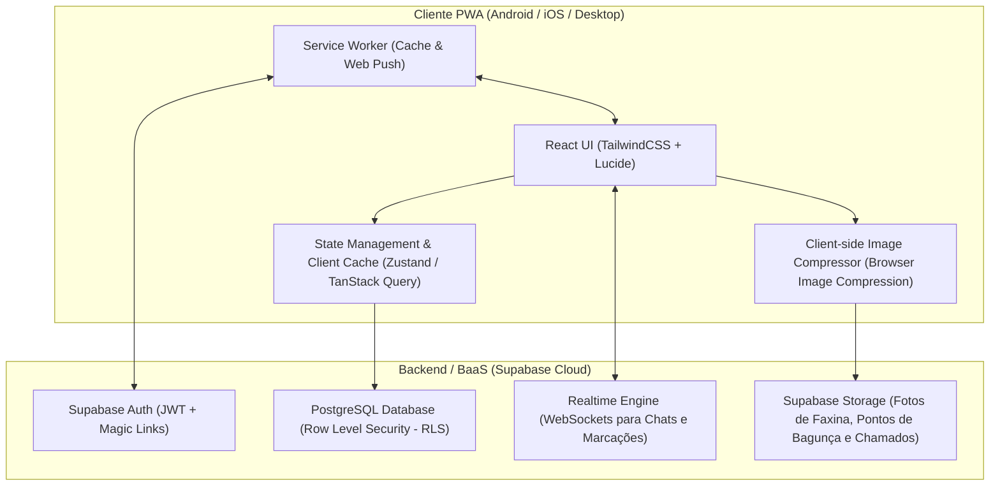
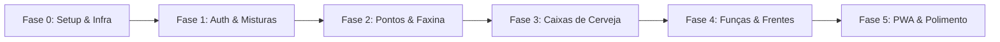

# Guia de Arquitetura e Engenharia (AGY.md) - Canta Grillo PWA

> **República Canta Grillo**  
> **Versão do Documento:** 0.1.0  
> **Status:** Referência Técnica Oficial  
> **Alinhamento:** [REQUIREMENTS.md](./REQUIREMENTS.md)

---

## 1. Visão Geral da Arquitetura

O **Canta Grillo PWA** adota uma arquitetura *Client-Side Rendered (CSR)* com padrão **JAMstack** e **Backend as a Service (BaaS)**, priorizando execução *mobile-first*, consumo mínimo de rede, suporte offline parcial e sincronização em tempo real.



### 1.1 Princípios Arquiteturais e Decisões de Engenharia
1. **Autenticação Direta via Supabase Auth + RLS (Sem Middleware Próprio):**
   - A autenticação é gerida diretamente pelo SDK do Supabase no cliente, persistindo sessões JWT com renovação automática no PWA.
   - A segurança e autorização de acesso a dados é delegada integralmente às políticas de **Row Level Security (RLS)** do PostgreSQL, eliminando a necessidade de manter uma API intermediária rodando 24/7.
   - Regras de negócio automáticas (ex.: 7 pontos gerando 1 caixa de cerveja) são executadas via **Database Triggers** e **Stored Procedures (RPC)** no Postgres.
   - Tarefas que exigem segredos de servidor (como disparo de Web Push Notifications com chaves VAPID) utilizam **Supabase Edge Functions** serverless sob demanda.
2. **Mobile-First Radical & Navegação 3-Abas:** O layout e a ergonomia são pensados primeiramente para telas de smartphone (5" a 6.7"), com toque rápido, navegação por bottom bar em 3 abas essenciais (`Rotina`, `Início` no centro, `Casa`) e navegação interna por pilha com botão de retorno (`‹ Voltar`).
3. **Design System Editorial / Warm Paper:** Estética minimalista, opaca e limpa, eliminando visual "neon/LED" artificial de IA. Paleta inspirada em papel e tinta: fundo `#f6f5ef` (`bg-paper`), superfícies `#fffefa` (`bg-surface`), texto `#16241b` (`text-ink`), bordas `#e4e2d6` (`border-line`), destaque em verde floresta `#0a6b24` (`text-forest`) e alertas em terracota `#b4532f` (`text-clay`). Tipografia moderna e legível com `DM Sans Variable`.
4. **Route Guard & Gate de Aprovação de Moradores (Zero Data Leakage):**
   - Novos cadastros são criados com status `ativo: false` até aprovação expressa por um Administrador na tela de aprovações.
   - O `AuthGuard` intercepta a renderização antes da Home: exibe `LoadingScreen` durante a inicialização, bloqueia moradores pendentes em `PendingApprovalScreen` com botão de re-checagem instantânea, e só libera a Home e dados da casa para perfis confirmados (`ativo: true`).
   - Possui timeout de segurança (2.5s) e fallback automático para evitar travamentos de tela em conexões lentas ou tabelas com RLS.
5. **Proteção de Links e Segredos via Supabase (`house_settings`):**
   - Links privados da casa (como a pasta do Google Drive e URLs de Atas) **não** são embutidos como constantes estáticas no bundle JS (`VITE_DRIVE_URL`), eliminando risco de vazamento por inspeção de código no cliente.
   - São consultados dinamicamente no Supabase via hook `useHouseLinks` nas tabelas `public.house_settings` e `public.atas_reuniao`, protegidas por RLS.
6. **PWA Standalone:** Execução fora do navegador convencional no iOS e Android, sem barra de navegação do browser, com splash screen própria e ícone na tela de início.
7. **Upload Otimizado:** Compressão no cliente (*client-side*) antes do upload para o Supabase Storage, limitando fotos a ~800KB e formato WebP.
8. **Comunicação em Tempo Real Nativa:** Uso do Supabase Realtime (WebSockets Postgres Changes e Broadcast) para os chats de frentes, discussões de pontos e marcação instantânea da folha de misturas.

---

## 2. Stack Tecnológica

| Camada | Tecnologia | Justificativa |
| :--- | :--- | :--- |
| **Linguagem** | **TypeScript 5.x** | Tipagem estrita de ponta a ponta, evitando erros de runtime no dia a dia da casa. |
| **Bundler & Tooling** | **Vite** | Build instantâneo, HMR ultrarrápido e ecossistema moderno para SPAs. |
| **Framework UI** | **React 18 / 19** | Padrão da indústria com ecossistema vasto de hooks e componentes. |
| **Estilização** | **TailwindCSS** | Design system consistente, utilitário, com fácil adaptação para temas e modo escuro. |
| **PWA Tooling** | **vite-plugin-pwa** | Geração automática de `manifest.json`, Service Workers (Workbox) e estratégias de cache offline. |
| **Ícones** | **Lucide React** | Pacote de ícones moderno, leve e consistente. |
| **Gerenciamento de Estado & Cache** | **TanStack Query (React Query) + Zustand** | Cache de dados do servidor assíncrono com revalidação automática e estado local simples. |
| **Validação de Schemas** | **Zod** | Validação de formulários e contratos de API/Supabase. |
| **Backend & Banco de Dados** | **Supabase (PostgreSQL 15+)** | Auth, Postgres relacional robusto, Realtime WebSockets e Storage em um único BaaS. |
| **Notificações** | **Web Push API** | Notificações push nativas suportadas no Android e iOS (Safari 16.4+). |

---

## 3. Modelo Conceitual e Lógico Estendido (MER-X)

O modelo de dados do **Canta Grillo PWA** é formalizado segundo a notação do **Modelo Entidade-Relacionamento Estendido (MER-X)**, contemplando especializações/generalizações, entidades associativas, entidades fracas por identificação, cardinalidades completas `(min, max)` e atributos próprios de relacionamento.

---

### 3.1 Diagrama MER-X (Conceitual Estendido)

```mermaid
classDiagram
    direction TB

    %% Especialização / Generalização (Herança t, d)
    class USUARIO {
        <<Superclasse>>
        +UUID id (PK)
        +String nome
        +String apelido
        +String email (UK)
        +String avatar_url
        +Enum role [admin, morador, externo]
        +Boolean ativo
        +DateTime created_at
    }

    class ADMINISTRADOR {
        <<Subclasse (t, d)>>
        %% Conta institucional / superadmin (herda atributos de USUARIO)
    }

    class MORADOR {
        <<Subclasse (t, d)>>
        +String geracao [ex: '024', '025']
        +UUID quarto_id (FK)
        +Int pontos_mes_atual (Derivado)
        +Int caixas_pendentes_count (Derivado)
    }

    class MEMBRO_EXTERNO {
        <<Subclasse (t, d)>>
        +String telefone_contato
        +Int misturas_mes_atual (Derivado)
    }

    USUARIO <|-- MORADOR : Especialização Total Disjunta (t, d)
    USUARIO <|-- MEMBRO_EXTERNO : Especialização Total Disjunta (t, d)
    USUARIO <|-- ADMINISTRADOR : Especialização Total Disjunta (t, d)

    %% Entidades Fortes
    class QUARTO {
        <<Entidade Forte>>
        +UUID id (PK)
        +String nome (UK)
        +Int capacidade
    }

    class FRENTE {
        <<Entidade Forte>>
        +UUID id (PK)
        +String nome (UK)
        +String slug (UK / Chave Natural de Rota)
    }

    class AREA_COMUM {
        <<Entidade Forte>>
        +UUID id (PK)
        +String nome (UK)
        +String descricao
    }

    class ITEM_CATALOGO_MERCADO {
        <<Entidade Forte>>
        +UUID id (PK)
        +String nome (UK)
        +String categoria
        +String unidade_medida
        +Boolean is_ativo
    }

    %% Entidades Associativas e Fracas
    class ESCALA_SEMANAL_FAXINA {
        <<Entidade Associativa com Chave Composta Natural>>
        +UUID quarto_id (PK, FK)
        +UUID area_comum_id (PK, FK)
        +Int semana_ano (PK)
        +Int ano (PK)
        +Int faltas_semana (Derivado)
        +String penalidade_atribuida
    }

    class REGRA_PONTO {
        <<Entidade de Parametrização>>
        +Int pontos (PK / 2 a 7)
        +String descricao
        +UUID atualizado_por (FK Usuario)
        +DateTime atualizado_em
    }

    class REGISTRO_DIARIO_FAXINA {
        <<Entidade Fraca>>
        +UUID id (PK)
        +UUID quarto_id (FK)
        +UUID area_comum_id (FK)
        +Int semana_ano (FK)
        +Int ano (FK)
        +Date data (UK com Escala)
        +Enum status [cumprido, faltou]
        +String[] fotos_comprovacao (Multivalorado)
        +DateTime enviado_em
        +UUID registrado_por (FK Morador)
    }

    class PONTO_BAGUNCA {
        <<Entidade Forte>>
        +UUID id (PK)
        +UUID relator_id (FK Morador)
        +UUID culpado_id (FK Morador, Nulo se aberta)
        +String foto_url
        +String local_descricao
        +Enum status [aberta, assumida]
        +DateTime created_at
        +DateTime assumida_em
    }

    class MENSAGEM_DISCUSSAO_PONTO_BAGUNCA {
        <<Entidade Fraca>>
        +UUID id (PK)
        +UUID ponto_bagunca_id (FK)
        +UUID autor_id (FK Usuario)
        +String conteudo
        +DateTime enviada_em
    }

    class CAIXA_CERVEJA {
        <<Entidade Forte>>
        +UUID id (PK)
        +UUID morador_id (FK Morador)
        +String motivo_descricao
        +Enum origem [pontos, manual]
        +Date data_atribuicao
        +Enum status [pendente, baixa_solicitada, paga]
        +DateTime solicitada_em
        +DateTime baixada_em
        +UUID baixada_por (FK Usuario Admin)
    }

    class REGISTRO_MISTURA_DIARIA {
        <<Entidade Forte>>
        +UUID id (PK)
        +UUID usuario_id (FK Usuario)
        +Date data
        +Float misturas_consumidas [0.0, 0.5, 1.0]
        +DateTime atualizado_em
    }

    class FUNCA {
        <<Entidade Forte>>
        +UUID id (PK)
        +UUID frente_id (FK Frente, Nulo se Geral)
        +UUID relator_id (FK Morador)
        +String titulo
        +String descricao
        +String foto_url (Opcional)
        +Enum status [aberta, em_andamento, concluida]
        +Date prazo
        +DateTime criado_em
    }

    class MENSAGEM_CHAT_FRENTE {
        <<Entidade Fraca>>
        +UUID id (PK)
        +UUID frente_id (FK Frente)
        +UUID autor_id (FK Morador)
        +String conteudo
        +DateTime enviada_em
    }

    class DOGS_REFEICAO_DIARIA {
        <<Entidade Forte>>
        +UUID id (PK)
        +Date data
        +Enum turno [manha, noite]
        +UUID alimentado_por (FK Morador)
        +DateTime horario_alimentacao
        +String observacoes
    }

    class ATA_REUNIAO {
        <<Entidade Forte>>
        +UUID id (PK)
        +Date data_reuniao
        +String url
        +String titulo (Opcional)
        +UUID publicada_por (FK Usuario Morador)
        +DateTime criada_em
    }

    class HOUSE_SETTINGS {
        <<Entidade Forte>>
        +String chave (PK)
        +String valor
        +String descricao (Opcional)
        +DateTime atualizado_em
    }
```



---

### 3.2 Dicionário Formal de Entidades, Especializações e Atributos

#### A. Hierarquia de Especialização/Generalização (Herança de Usuários)
- **Superclasse `USUARIO`:**
  - `id` (PK, UUID): Identificador único global gerado pelo Supabase Auth.
  - `nome` (Simples, Obrigatório): Nome completo do usuário.
  - `apelido` (Simples, Opcional): Nome de tratamento na casa.
  - `email` (Simples, Único, Obrigatório): Chave de autenticação.
  - `avatar_url` (Simples, Opcional): Foto de perfil do usuário.
  - `role` (Simples): Perfil de acesso (`'admin'`, `'morador'`, `'externo'`).
  - `ativo` (Booleano): Status de acesso aos sistemas da república.
- **Subclasse `ADMINISTRADOR` (Especialização Total e Disjunta - `t, d`):**
  - Herda todos os atributos de `USUARIO` (`role = 'admin'`).
  - Representa a conta institucional / superadmin da república para gestão de frentes, aprovação de cadastros e moderação, sem atributos residenciais adicionais.
- **Subclasse `MORADOR` (Especialização Total e Disjunta - `t, d`):**
  - Herda todos os atributos de `USUARIO`.
  - `geracao` (Simples, Obrigatório): Código da geração de ingresso (ex: `'024'`, `'025'`).
  - `quarto_id` (FK): Quarto onde dorme na casa.
  - `pontos_mes_atual` (*Atributo Derivado*): Soma dos pontos de bagunça assumidos no mês corrente.
  - `caixas_pendentes_count` (*Atributo Derivado*): Contagem de caixas de cerveja não liquidadas (`status = 'pendente'`).
- **Subclasse `MEMBRO_EXTERNO` (Especialização Total e Disjunta - `t, d`):**
  - Herda todos os atributos de `USUARIO`.
  - `telefone_contato` (Simples, Opcional): Contato para cobrança.
  - `misturas_mes_atual` (*Atributo Derivado*): Total de refeições consumidas no ciclo mensal vigente para acerto de contas com a Caixinha.

#### B. Entidades Fortes
- **`QUARTO`:** `id` (PK), `nome` (UK / Nome Único, ex: "Quarto do Meio", "Quarto dos Bixos", "Suíte", "Quarto do Fundo"), `capacidade`.
- **`FRENTE`:** `id` (PK), `nome` (UK, ex: "Financeiro", "Mercado", "Piscina", "Dogs"), `slug` (UK / Chave Natural de rota e código, ex: `'financeiro'`, `'mercado'`, `'dogs'`). *(A liderança é atribuída na associação de membros, permitindo múltiplos líderes).*
- **`AREA_COMUM`:** `id` (PK), `nome` (UK, ex: "Cozinha", "Sala de Estar", "Banheiro Social 1", "Piscina/Área Externa"), `descricao`.
- **`ITEM_CATALOGO_MERCADO`:** `id` (PK), `nome` (ex: "Detergente Neutro", "Arroz Tipo 1"), `categoria` (Limpeza, Alimentos, Descartáveis), `unidade_medida`, `is_ativo`.
- **`CAIXA_CERVEJA` (Registro Estritamente Unitário):**
  - `id` (PK): Identificador da caixa individual devida.
  - `morador_id` (FK para `MORADOR`): Devedor da prenda.
  - `motivo_descricao` (Texto): Causa formal (ex.: "7 pontos em Outubro", "Estágio na Embraer", "Início de namoro").
  - `origem` (Enum): `'pontos'` (automática via 7 pontos) ou `'manual'` (lançada por admin com motivo livre: estágio, namoro, etc.).
  - `data_atribuicao` (Data): Data oficial de lançamento.
  - `status` (Enum): `'pendente'` $\rightarrow$ `'baixa_solicitada'` $\rightarrow$ `'paga'`.
  - `baixada_em` (DateTime, Nulo se não paga): Data de confirmação da baixa.
  - `baixada_por` (FK para `USUARIO`, Nulo): Admin que auditou a baixa.
- **`PONTO_BAGUNCA`:**
  - `id` (PK), `relator_id` (FK para `MORADOR`), `culpado_id` (FK para `MORADOR`, `NULL` até que alguém assuma).
  - `foto_url` (Obrigatório): Registro visual da bagunça/copo jogado.
  - `local_descricao`: Onde foi encontrada.
  - `status`: `'aberta'` (em debate) ou `'assumida'` (ponto creditado).
- **`REGISTRO_MISTURA_DIARIA`:**
  - `id` (PK), `usuario_id` (FK para `USUARIO`), `data` (Date), `misturas_consumidas` (0.0 = Vazio, 0.5 = 1/2 mistura, 1.0 = X/cota completa).
- **`FUNCA` (Sistema Geral de Tarefas / Antigo Chamado):**
  - `id` (PK): Identificador único da funça.
  - `frente_id` (FK para `FRENTE`, Opcional/Nulo): Se associado a uma frente específica; `NULL` para Funça Geral.
  - `relator_id` (FK para `MORADOR`): Qualquer morador que abriu a funça.
  - `titulo` (Texto): Título da demanda.
  - `descricao` (Texto): Detalhes da tarefa.
  - `foto_url` (Texto, Opcional): Foto com ou sem registro visual.
  - `status` (Enum): `'aberta'`, `'em_andamento'`, `'concluida'`.
  - `prazo` (Date, Opcional): Prazo deliberado para entrega.
  - `criado_em` (DateTime).
- **`DOGS_REFEICAO_DIARIA`:**
  - `id` (PK), `data` (Date), `turno` (`'manha'`, `'noite'`), `alimentado_por` (FK `MORADOR`), `horario_alimentacao`.
- **`ATA_REUNIAO`:**
  - `id` (PK), `data_reuniao` (Date), `url` (Texto, `http`/`https`), `titulo` (Texto, Opcional), `publicada_por` (FK `MORADOR`), `criada_em` (DateTime).
  - A "última ata" é derivada dinamicamente: `ORDER BY data_reuniao DESC LIMIT 1` (índice descendente em `data_reuniao`). Qualquer morador ativo pode publicar uma nova ata.
- **`HOUSE_SETTINGS` (Configurações e Links Protegidos da Casa):**
  - `chave` (PK, Texto, ex.: `'drive_url'`), `valor` (Texto), `descricao` (Texto, Opcional), `atualizado_em` (DateTime).
  - Tabela protegida por RLS para evitar o vazamento de links privados da república (pasta do Google Drive) no código compilado client-side, sendo consultada em tempo de execução via hook `useHouseLinks`.

#### C. Entidades Associativas e Fracas
- **`ESCALA_SEMANAL_FAXINA` (Entidade Associativa com Chave Composta Natural):**
  - **Chave Primária Composta Natural:** `PRIMARY KEY (quarto_id, area_comum_id, semana_ano, ano)`.
  - Dispensa ID artificial; a própria quádrupla natural garante que um quarto não seja escalado em duplicidade para a mesma área na mesma semana.
  - Atributos adicionais: `penalidade_atribuida`, `faltas_semana` (derivado).
- **`REGISTRO_DIARIO_FAXINA` (Entidade Fraca dependente de `ESCALA_SEMANAL_FAXINA`):**
  - Identificada conjuntamente pela escala semanal + data do dia.
  - Atributos: `id` (PK), `(quarto_id, area_comum_id, semana_ano, ano)` (FK composta), `data`, `status` (`'cumprido'`, `'faltou'`), `fotos_comprovacao` (Array de URLs), `registrado_por` (FK `MORADOR`).
- **`MENSAGEM_DISCUSSAO_PONTO_BAGUNCA` (Entidade Fraca de `PONTO_BAGUNCA`):**
  - Depende do ponto de bagunça aberto.
  - Atributos: `id` (PK), `ponto_bagunca_id` (FK), `autor_id` (FK `USUARIO`), `conteudo`, `enviada_em`.
- **`PONTOS_BAGUNCA_VISUALIZACOES` (Entidade Associativa com Chave Composta Natural):**
  - **Chave Composta:** `PRIMARY KEY (ponto_id, morador_id)`.
  - Atributos adicionais: `visualizado_em` (DateTime).
  - Rastreia a remoção individual do filtro de desfoque (`blur`) e o cumprimento da verificação obrigatória em 24 horas por cada morador.
- **`MENSAGEM_CHAT_FRENTE` (Entidade Fraca de `FRENTE`):**
  - Depende da existência da Frente.
  - Atributos: `id` (PK), `frente_id` (FK), `autor_id` (FK `MORADOR`), `conteudo`, `enviada_em`.
- **`SOLICITACAO_MERCADO` (Entidade Associativa com Chave Composta Natural):**
  - **Chave Composta:** `PRIMARY KEY (item_id, mes_ano_ciclo, solicitado_por)`.
  - Atributos adicionais: `status` (`'solicitado'`, `'comprado'`), `data_solicitacao`.
- **`FUNCA_ATRIBUICAO` (Entidade Associativa entre `FUNCA` e `MORADOR`):**
  - **Chave Composta:** `PRIMARY KEY (funca_id, morador_id)`.
  - Atributos: `atribuido_por` (FK `MORADOR`), `tipo_atribuicao` (Enum: `'autoatribuicao'`, `'lider_frente'`, `'veterano_bixo'`, `'admin_geral'`, `'reuniao'`), `atribuido_em`.

---

### 3.3 Especificação Formal de Relacionamentos e Cardinalidades (min, max)

| Relacionamento | Entidade Origem & `(min, max)` | Conector | Entidade Destino & `(min, max)` | Atributos Próprios | Descrição Semântica |
| :--- | :--- | :--- | :--- | :--- | :--- |
| **Dorme_Em** | `MORADOR (1, 1)` | $\longleftrightarrow$ | `QUARTO (0, n)` | - | Todo morador reside em exatamente 1 quarto; o quarto abriga até $n$ moradores. |
| **Atua_Na_Frente** | `MORADOR (0, n)` | $\longleftrightarrow$ | `FRENTE (1, n)` | `data_inicio`, `is_lider` | Morador pode integrar múltiplas frentes; permite múltiplos líderes (co-liderança) via flag `is_lider`. |
| **Consome_Mistura** | `USUARIO (0, n)` | $\longleftrightarrow$ | `REGISTRO_MISTURA_DIARIA (1, 1)` | - | Usuário (morador ou externo) possui histórico de refeições diárias registradas. |
| **Escala_Faxina** | `QUARTO (1, n)` | $\longleftrightarrow$ | `AREA_COMUM (0, n)` | `semana_ano`, `ano` | Gera a entidade associativa com chave natural composta `ESCALA_SEMANAL_FAXINA`. |
| **Cumpre_Faxina** | `ESCALA_SEMANAL (1, n)`| $\longleftrightarrow$| `REGISTRO_DIARIO_FAXINA (1, 1)` | - | Cada dia da semana exige um registro de cumprimento com foto obrigatória. |
| **Relata_Infracao** | `MORADOR (0, n)` | $\longleftrightarrow$ | `PONTO_BAGUNCA (1, 1)` | - | Qualquer morador pode relatar um ponto de bagunça anexando foto. |
| **Assume_Infracao** | `MORADOR (0, n)` | $\longleftrightarrow$ | `PONTO_BAGUNCA (0, 1)` | `assumido_em` | Culpado assume o ponto voluntariamente; até a confissão, a ponta destino é nula (0). |
| **Debate_Infracao** | `PONTO_BAGUNCA (1, n)` | $\longleftrightarrow$ | `MENSAGEM_DISCUSSAO (1, 1)` | - | Ponto de Bagunça possui uma thread de mensagens em tempo real para apuração. |
| **Deve_Cerveja** | `MORADOR (0, n)` | $\longleftrightarrow$ | `CAIXA_CERVEJA (1, 1)` | - | Lançamento estritamente unitário associado a um morador específico. |
| **Liquida_Cerveja** | `USUARIO (Admin) (0, n)`| $\longleftrightarrow$| `CAIXA_CERVEJA (0, 1)` | `data_liquidacao` | Apenas um Administrador pode efetivar a baixa final da caixa física entregue. |
| **Solicita_Item** | `MORADOR (0, n)` | $\longleftrightarrow$ | `ITEM_CATALOGO (0, n)` | `mes_ciclo`, `status` | Morador solicita item pré-cadastrado no catálogo mestre gerido pelo Mercado. |
| **Abre_Funca** | `MORADOR (0, n)` | $\longleftrightarrow$ | `FUNCA (1, 1)` | - | Qualquer morador cadastra uma Funça (geral ou direcionada a uma frente). |
| **Atribuida_Para** | `FUNCA (0, n)` | $\longleftrightarrow$ | `MORADOR (0, n)` | `atribuido_por`, `tipo_atribuicao`, `atribuido_em` | Alocação com regras: Líder na frente / Autoatribuição / Veterano para Bixo / Admin para qualquer um. |
| **Conversa_Frente**| `FRENTE (1, n)` | $\longleftrightarrow$ | `MENSAGEM_CHAT_FRENTE (1, 1)` | - | Cada frente possui um chat interno privativo para seus membros. |
| **Alimenta_Dogs** | `MORADOR (0, n)` | $\longleftrightarrow$ | `DOGS_REFEICAO_DIARIA (1, 1)`| - | Morador que ofereceu a refeição assina o registro com horário do dia. |
| **Publica_Ata** | `MORADOR (0, n)` | $\longleftrightarrow$ | `ATA_REUNIAO (1, 1)` | - | Qualquer morador ativo registra o link de uma ata; a mais recente (por `data_reuniao`) é exibida na tela inicial. |

---

### 3.4 Regras de Integridade e Derivações do MER-X

1. **Restrição de Especialização (`t, d` - Total e Disjunta):**
   * **Totalidade (`t`):** Todo e qualquer registro na superclasse `USUARIO` pertence obrigatoriamente a uma das três subclasses: `MORADOR`, `MEMBRO_EXTERNO` ou `ADMINISTRADOR`.
   * **Disjunção (`d`):** As três categorias são mutuamente exclusivas (um usuário não pode pertencer a mais de uma subclasse simultaneamente).
2. **Cálculo Derivado de Gatilho de Cerveja:**
   * $\text{pontos\_mes} = \sum_{\text{mes}} \text{PONTO\_BAGUNCA}(\text{culpado\_id} = \text{id})$.
   * Se $\text{pontos\_mes} \ge 7$, um gatilho de integridade (Database Trigger) insere imediatamente 1 registro unitário em `CAIXA_CERVEJA` com `origem = 'pontos'`.
3. **Restrição de Integridade Referencial no Catálogo de Mercado:**
   * Moradores comuns não possuem permissão de inserção em `ITEM_CATALOGO_MERCADO`. Toda solicitação vincula-se obrigatoriamente a uma tupla pré-existente no catálogo (`item_id`).
4. **Unicidade Diária de Misturas:**
   * Chave única composta: `UNIQUE(usuario_id, data)` em `REGISTRO_MISTURA_DIARIA`, garantindo apenas um valor diário (`0.0`, `0.5`, `1.0`).
5. **Regras de Permissão para Atribuição e Governança de Funças (`public.funcas` & `public.funca_atribuicoes`):**
   * **Multi-responsáveis:** A chave composta `(funca_id, morador_id)` permite 1 ou mais moradores atribuídos simultaneamente na mesma funça.
   * **Ciclo Manual em 3 Etapas:** `aberta` -> `em_andamento` -> `concluida`. A atribuição não altera o status automaticamente; a mudança é acionada manualmente por responsáveis, líderes da frente, relator ou Admin.
   * **Se `funca.frente_id IS NOT NULL` (Funça de Frente):** A atribuição a um morador só é autorizada se `atribuido_por` for Líder daquela frente (`is_lider = true`) atribuindo para integrante da frente, autoatribuição (`morador_id = atribuido_por`) por membro da frente, alocação na Reunião Semanal (`tipo_atribuicao = 'reuniao'`), ou por Administrador (`role = 'admin'`).
   * **Se `funca.frente_id IS NULL` (Funça Geral):** A atribuição é autorizada se `atribuido_por` for Administrador, se for autoatribuição, se o autor for veterano do alvo (`geracao_num(autor) < geracao_num(alvo)`), ou na Reunião Semanal.
   * **Remoção de Responsável:** Restrita exclusivamente ao Administrador, Líder da frente correspondente, ou Veterano do morador atribuído (inclusive em Funça de Frente).
   * **Solicitação de Troca:** O morador atribuído pode solicitar troca para qualquer morador ativo da casa (`troca_solicitada_para`), que deve aceitar via RPC `aceitar_troca_funca` para efetivar a transferência da responsabilidade.
   * **Políticas RLS e Realtime:** Tabelas `public.funcas` e `public.funca_atribuicoes` blindadas com RLS garantindo autorização no PostgreSQL e sincronização instantânea via publicação `supabase_realtime`.
6. **Segurança de Perfis e Permissões por Cargo (Supabase RLS):**
   * **`PROFILES`:** A tabela permanece fechada contra `INSERT` via API client-side. A inserção ocorre unicamente via trigger `handle_new_user()` (`SECURITY DEFINER`) cravando `ativo = FALSE` e `role = 'morador'`.
   * **Políticas RLS em `PROFILES`:**
     - `SELECT`: Permitido a todos os usuários autenticados (`authenticated`).
     - `UPDATE`: Administrador pode atualizar qualquer perfil (`public.is_admin()`); morador comum atualiza apenas seus próprios dados cadastrais permitidos (apelido, nome, quarto, avatar_url). Gatilho de segurança `trg_protect_profile_roles` (`public.protect_profile_roles()`) impede estritamente que não-administradores alterem as colunas `ativo`, `role` e `geracao` (blindando a hierarquia Veterano -> Bixo nas Funças).
     - `DELETE`: Exclusivo do Administrador (`public.is_admin()`).
   * **`ROOMS`:** Leitura pública (`anon` e `authenticated`) para permitir a listagem de quartos no fluxo de cadastro de novo morador e seleção de quarto no perfil.
   * **Foto de Perfil & Supabase Storage (`avatars`):**
     - Bucket público `avatars` no Supabase Storage.
     - Políticas RLS em `storage.objects`: `SELECT` público; `INSERT`, `UPDATE` e `DELETE` restritos ao titular autenticado (`name LIKE 'avatar_' || auth.uid() || '_%'`) ou Administradores (`public.is_admin()`).
     - Compressão inteligente no cliente (center crop 512x512 JPEG 85%) para economia de dados e carregamento instantâneo no mobile, com fallback resiliente para Data URL base64.
   * **Tela "Meu Perfil & Quarto" (`MeuPerfilScreen.tsx`):** Acessível pela aba `Casa` e clicando no cabeçalho `02X · Quarto Y` da `Home`. Permite ao morador ativo configurar/remover sua Foto de Perfil, editar seu Apelido na Rep, Nome Completo e Quarto Atual (`quarto_id`), mantendo a Geração travada para morador comum (editável apenas por Administradores).
   * **Central de Gestão de Membros da Casa (`AprovacoesScreen.tsx`):** Exclusiva para Administradores, com 3 abas operacionais com fotos dos membros:
     - **Pendentes (`ativo = false`):** Aprovação (`ativo = true`) e recusa (`DELETE`) de novos moradores.
     - **Moradores Ativos (`role IN ('morador', 'admin') AND ativo = true`):** Lista todos os membros, permitindo editar apelido, nome, geração, quarto, remover foto inadequada, promover/rebaixar (`morador` <-> `admin`), desativar acesso (`ativo = false`) ou remover conta. Blindado com regras de auto-preservação para impedir auto-rebaixamento, auto-desativação ou auto-exclusão do Admin logado.
     - **Convidados Externos (`role = 'externo'`):** Gestão de agregados da folha de misturas, telefone/WhatsApp direto, ativação/desativação e edição cadastral.
7. **Governança de Frentes (`FRONT_MEMBERS`):**
   * **`SELECT`:** Aberto para todos os moradores autenticados consultarem as comissões.
   * **`INSERT`, `UPDATE` e `DELETE`:** Operações exclusivas de Administradores (`public.is_admin()`), protegendo a alocação de moradores e alternância de co-liderança (`is_lider`). A política de `INSERT` valida adicionalmente que o morador vinculado é um morador ativo da república (`role IN ('morador', 'admin') AND ativo = true`), bloqueando a vinculação de convidados externos (`role = 'externo'`).
8. **Folha de Misturas Digital (`DAILY_MEALS` - Supabase RLS):**
   * **`SELECT`:** Liberado a todos os moradores ativos e administradores (`authenticated`) para visualização de qualquer data e consolidação da contagem para a cozinheira. Convidado externo ativo pode consultar suas próprias refeições.
   * **`INSERT` e `UPDATE`:** Permitido exclusivamente no dia de hoje (`data = CURRENT_DATE`). Morador comum ativo (`ativo = true`) e Convidado externo ativo (`role = 'externo' AND ativo = true`) podem marcar/alterar exclusivamente a sua própria refeição (`usuario_id = auth.uid()`). Moradores inativos (`ativo = false`) têm escrita bloqueada. Administradores (`public.is_admin()`) têm permissão para marcar ou corrigir a cota de qualquer morador ou convidado no dia vigente.
   * **`DELETE`:** Permitido ao proprietário ativo ou administrador no dia corrente.
   * **Travas Cronológicas:** O cliente e as políticas RLS bloqueiam estritamente navegação e marcações para datas posteriores à data atual (`data > CURRENT_DATE`), e tornam datas anteriores (`data < CURRENT_DATE`) estritamente somente leitura (auditáveis, mas imutáveis).
   * **Realtime:** Transmitida via publicação `supabase_realtime` para atualização instantânea em todos os dispositivos da casa.
9. **Gestão de Convidados Externos (`MEMBROS_EXTERNOS` / `ConvidadoScreen`):**
   * **Fluxo de Convite:** Gerado na folha de misturas via link de compartilhamento rápido (`?convite=externo`) e envio para WhatsApp.
   * **Ativação Imediata:** O trigger `handle_new_user()` cria o perfil com `role = 'externo'` e `ativo = TRUE` (sem aguardar aprovação de admin), permitindo registro instantâneo da refeição.
   * **Isolamento de Segurança:** O `AuthGuard` direciona usuários `role === 'externo'` exclusivamente para a `ConvidadoScreen`, ocultando dados internos (frentes, faxinas, pontos de bagunça, cervejas, atas).
   * **Presença Binária:** Convidados registram presença de forma binária (`1.0` = comeu na casa, `0.0` = desmarcado), com histórico mensal acessível para prestação de contas com o Financeiro da casa.
   * **Vínculo com a Frente Financeiro ("Caixinha"):** Ao implementar a Frente Financeiro, os registros diários de convidados (`daily_meals` com `role = 'externo'`) deverão alimentar diretamente um **Dashboard Mensal de Cobrança**. Esse painel consolidará o total de almoços/jantas de cada convidado por ciclo/mês, multiplicando pelo valor unitário da refeição e disponibilizando botão de acerto/cobrança via WhatsApp com chave PIX da república.
10. **Pontos de Bagunça, Mecânica de Blur e Regra de 24h (`PONTOS_BAGUNCA_VISUALIZACOES` - Supabase RLS):**
   * **Visualização Individual:** Cards de pontos abertos no carrossel da Home iniciam com filtro `blur-md` e badge com contagem regressiva de 24h a partir de `created_at`. O autor do ponto (relator) nunca visualiza com blur.
   * **Desbloqueio e Auditoria:** Ao tocar no card, a foto é desfeita de blur e registrada na tabela associativa `pontos_bagunca_visualizacoes(ponto_id, morador_id)`.
   * **Políticas RLS em `PONTOS_BAGUNCA_VISUALIZACOES`:**
     - `SELECT`: Permitido para qualquer usuário autenticado (`authenticated`).
     - `INSERT`: Permitido para morador ativo (`public.is_active_morador()`) registrando estritamente a sua própria visualização (`morador_id = auth.uid()`).
   * **Penalidade Automática das 24 Horas:** A função do banco `public.verificar_penalidades_pontos_24h()` aplica 1 ponto de bagunça para qualquer morador ativo que não abrir a imagem após 24h da abertura. Se o culpado assumir a infração antes das 24h (`status = 'assumida'`), a penalidade de não-leitura é desativada para todos.
   * **Realtime:** Integrada à publicação `supabase_realtime` para sincronização instantânea de novas denúncias, visualizações e mensagens de apuração.
11. **Quadro de Pontos, Rodízio Linear e Fiscalização do Halls (`ESCALA_SEMANAL_FAXINA` & `REGISTRO_DIARIO_FAXINA`):**
   * **6 Funções e 6 Quartos:** As 6 funções fixas (Sala de TV, Sala de Estudos, Externo, Dispensa, Cozinha, Halls) rotacionam linearmente a cada Domingo às 01:00 BRT entre os 6 quartos da república ($Q_i \rightarrow F_{(i+1) \pmod 6}$).
   * **Backend Dedicado e Agendamentos:** Servidor Node.js integrado (`server/src/server.ts`) executando rotinas cron:
     - `01:00 BRT`: Corte diário. Quarto sem foto comprovada toma +1 falta na escala da semana (`status = 'faltou'`). Aos domingos, dispara a virada de semana.
     - `11:00 BRT`: Auditoria do fiscal. Se o quarto do Halls deixar tarefas de ontem sem parecer, marca `fiscal_status = 'omitido'` e o Halls toma no máximo 1 falta por omissão no dia (desde que não tenha tomado falta às 01:00 por falta de foto do hall).
   * **Políticas RLS em `areas_comuns`, `ESCALA_SEMANAL_FAXINA` e `REGISTRO_DIARIO_FAXINA`:**
     - **`areas_comuns`**: `SELECT` público para autenticados; `ALL` permitido para administradores e moradores ativos para garantir semeadura das 6 funções.
     - **`escala_semanal_faxina`**: `SELECT` público para autenticados; `ALL` permitido para administradores e moradores ativos para inicialização manual e rodízio resiliente.
     - **`registro_diario_faxina`**: `SELECT` público para autenticados; `ALL` para envio de comprovação e fiscalização do Halls.
   * **Realtime:** Transmitida via publicação `supabase_realtime` para atualização instantânea em todos os dispositivos da casa.

---

12. **Gestão de Caixas de Cerveja (`CAIXAS_CERVEJA` - Supabase RLS):**
    * **Registro Estritamente Unitário:** Cada tupla na tabela `caixas_cerveja` representa exatamente 1 caixa física devida.
    * **Políticas RLS em `public.caixas_cerveja`:**
      - `SELECT`: Permitido a todos os moradores ativos e administradores (`public.is_admin() OR public.is_active_morador()`). Convidados externos e anônimos têm acesso negado.
      - `INSERT`: Exclusivo do Administrador (`public.is_admin()`) para lançamentos de tradições (`origem = 'manual'`). Lançamentos de 7 pontos de desorganização (`origem = 'pontos'`) ocorrem via trigger `trg_gerar_cerveja_por_pontos` (`SECURITY DEFINER`).
      - `UPDATE`: Administrador pode aprovar baixa (`status = 'paga'`), dar baixa direta ou recusar/devolver solicitação (`status = 'pendente'`). Morador devedor ativo pode atualizar exclusivamente sua própria caixa (`morador_id = auth.uid()`) para solicitar baixa (`status = 'baixa_solicitada'`). Gatilho `trg_protect_caixas_cerveja_update` impede adulteração de colunas críticas pelo morador.
      - `DELETE`: Exclusivo do Administrador (`public.is_admin()`).
    * **Realtime:** Transmitida via publicação `supabase_realtime` para sincronização instantânea em todos os dispositivos da casa.

13. **Governança e Políticas RLS das Frentes, Chats, Funças, Dogs e Mercado (Fase 4):**
    * **`FRONTS`:** Leitura liberada para moradores ativos e administradores (`public.is_admin() OR public.is_active_morador()`). Modificações e criação exclusivas de administradores.
    * **`MENSAGENS_FRENTE` (Chat Interno das Frentes - RN11):** Isolamento database-first rigoroso: leitura e inserção restritas aos integrantes da respectiva frente (`public.is_front_member(frente_id)`) ou administradores (`public.is_admin()`). Mensagens enviadas devem ter `autor_id = auth.uid()`. Exclusão permitida para o próprio autor ou administrador.
    * **`FUNCAS` & `FUNCA_ATRIBUICOES` (Sistema de Tarefas das Frentes - RN09):**
      - `funcas`: Leitura para moradores ativos e admin. Inserção permitida para qualquer morador ativo (`relator_id = auth.uid()`). Atualização permitida para integrantes da frente, relator ou moradores atribuídos. Exclusão para líder da frente, relator ou administrador.
      - `funca_atribuicoes`: Autoatribuição liberada para membros da frente ou admin. Atribuição de tarefas a outros moradores permitida ao Líder da frente (`is_front_lider`) para membros da mesma frente ou a administradores (`public.is_admin()`).
    * **`DOGS_REFEICOES_DIARIAS` (Controle Alimentar dos Cães - RN10):** Leitura aberta a todos os moradores ativos e admin. Inserção e atualização permitidas no dia vigente (`data = CURRENT_DATE`) para qualquer morador ativo registrando a si mesmo como cuidador (`alimentado_por = auth.uid()`). Exclusão no dia vigente permitida ao autor, membros da Frente Dogs ou administrador.
    * **`MARKET_CATALOG` & `SOLICITACOES_MERCADO` (Suprimentos e Compras Coletivas - RN08):**
      - `market_catalog`: Leitura liberada para todos os moradores ativos (para viabilizar pedidos de reposição). Inserção, edição e exclusão de itens do catálogo oficial exclusivas de integrantes da Frente Mercado (`public.is_front_member_by_slug('mercado')`) ou administradores.
      - `solicitacoes_mercado`: Qualquer morador ativo pode solicitar produtos do catálogo mestre (`status = 'solicitado'`). Atualização do status de compra (`status = 'comprado'`) exclusiva de integrantes da Frente Mercado ou administradores.
    * **Realtime:** Publicação `supabase_realtime` habilitada para `mensagens_frente`, `funcas`, `funca_atribuicoes`, `dogs_refeicoes_diarias`, `market_catalog` e `solicitacoes_mercado`.

---

### 3.5 Diretriz de Engenharia: Chaves Naturais vs. Chaves Artificiais (Surrogates)

Para otimizar integridade e facilidade de manutenção no PostgreSQL do Supabase, adotamos uma estratégia híbrida criteriosa:

1. **Onde Adotamos Chaves Naturais Compostas (Sem IDs Artificiais):**
   * **Tabelas Associativas:** Tabelas que apenas relacionam duas ou mais entidades com contexto temporal (ex.: `ESCALA_SEMANAL_FAXINA`, `CHAMADO_ATRIBUICAO`, `SOLICITACAO_MERCADO`) utilizam **chaves primárias compostas naturais**. Criar um `id UUID` adicional nelas seria redundante e consumiria índices desnecessários.
2. **Onde Adotamos Identificadores Naturais de Rota:**
   * **`FRENTE` (`slug`):** Termos curtos e padronizados como `'mercado'`, `'piscina'`, `'dogs'`, `'manutencao'` servem de chave natural legível para rotas no frontend (`/frentes/piscina`) e filtros de código, além do ID interno.
3. **Onde Mantemos Chaves Artificiais (Surrogate UUIDs):**
   * **`USUARIO`:** O `id (UUID)` é natural do mecanismo criptográfico do Supabase Auth.
   * **`QUARTO` e `AREA_COMUM`:** Mantemos um UUID interno imutável como PK física e o `nome` como `UK`. Isso protege o banco de dados contra **mutações de nomenclatura**: se a república decidir renomear o *"Quarto dos Bixos"* para *"Quarto 026"*, alteramos apenas 1 linha na tabela de quartos, sem precisar disparar atualizações em cascata (`ON UPDATE CASCADE`) em centenas de registros de histórico de faxina dos anos anteriores.
   * **Entidades Transacionais (`CHAMADO_RAPIDO`, `PONTO_BAGUNCA`, `CAIXA_CERVEJA`):** Instâncias independentes que possuem ciclo de vida próprio e recebem fotos/comentários.

---

## 4. Padrões de Código e Convenções

### 4.1 Estrutura de Diretórios
```
canta-grillo-app/
├── public/                 # Manifest, favicon, ícones PWA, splash screens
├── src/
│   ├── assets/             # SVGs, imagens estáticas
│   ├── components/         # Componentes compartilhados
│   │   ├── ui/             # Botões, inputs, cards, modais, badges
│   │   ├── layout/         # Header, BottomNavigation, Drawer lateral
│   │   └── feedback/       # Toasts, loaders, confirmações
│   ├── features/           # Módulos verticais de negócio
│   │   ├── auth/           # Login, recuperação, perfil, convites
│   │   ├── refeicoes/      # Folha de misturas (1/2, X), convidados externos
│   │   ├── faxina/         # Quadro de quartos, envio de fotos, penalidades
│   │   ├── pontos/         # Pontos de bagunça com foto, chat da infração, assumir ponto
│   │   ├── cervejas/       # Mural de caixas unitárias, solicitações de baixa
│   │   ├── frentes/        # Chats de frentes, chamados rápidos, reunião semanal
│   │   ├── mercado/        # Catálogo mestre, sugestão restrita, lista de compras
│   │   └── dogs/           # Controle diário de refeições (manhã/noite) e remédios
│   ├── hooks/              # Hooks customizados reutilizáveis (useAuth, usePWA, useRealtime)
│   ├── lib/                # Configurações de terceiros (supabaseClient.ts, imageCompression.ts)
│   ├── services/           # Chamadas diretas de banco e storage
│   ├── types/              # Definições globais de tipos e interfaces do Supabase
│   ├── utils/              # Funções utilitárias puras (datas, formatação de moeda)
│   ├── App.tsx             # Roteador e Providers principais
│   └── main.tsx            # Ponto de entrada
├── REQUIREMENTS.md         # Documento oficial de Requisitos
├── AGY.md                  # Este documento
├── tailwind.config.js      # Configurações do Tailwind
├── vite.config.ts          # Configuração Vite + VitePWA
└── tsconfig.json           # Configuração TypeScript
```

### 4.2 Convenções de Nomenclatura
- **Arquivos de Componentes:** PascalCase (ex.: `MisturaCard.tsx`, `InfractionChatModal.tsx`).
- **Hooks:** camelCase com prefixo `use` (ex.: `useMealSheet.ts`, `useFrontChat.ts`).
- **Arquivos Utilitários / Serviços:** camelCase (ex.: `compressImage.ts`, `supabaseClient.ts`).
- **Tipos / Interfaces:** PascalCase com prefixo `T` ou nomes semânticos (ex.: `Profile`, `Infraction`, `BeerCrateStatus`).
- **Tabelas do Banco:** `snake_case` no plural (ex.: `daily_meals`, `room_cleaning_logs`).
- **Colunas do Banco:** `snake_case` (ex.: `culprit_id`, `assigned_date`).

### 4.3 Padrão de Componentes React
- Componentes funcionais estritamente tipados com TypeScript.
- Evitar prop-drilling: utilizar TanStack Query para dados do servidor e Zustand para estados efêmeros de UI.
- Todo formulário com mutação deve possuir feedback visual imediato (optimistic updates ou loading states com toast de feedback).

---

## 5. Roadmap de Implementação em Fases Atômicas

O desenvolvimento será conduzido em etapas incrementais e independentemente testáveis:



### Fase 0: Fundação, Setup & Infraestrutura Básica
- [x] Inicialização do projeto Vite + React + TypeScript + TailwindCSS.
- [x] Configuração do `vite-plugin-pwa` com suporte a ícones, manifest e service workers.
- [x] Criação e validação do script SQL oficial (`supabase/schema.sql`) com todas as tabelas MER-X, gatilhos e tabelas auxiliares (`house_settings`).
- [x] Configuração do cliente Supabase (`src/lib/supabaseClient.ts`) e `.env`.
- [x] **Refatoração Editorial / Warm Paper:** Paleta em papel `#f6f5ef`, superfícies `#fffefa`, texto `#16241b`, verde floresta `#0a6b24`, terracota `#b4532f` e tipografia `DM Sans Variable`.
- [x] **Layout Mobile-First 3-Abas:** Navegação por bottom bar (`Rotina`, `Início` central, `Casa`), header institucional com sino de notificações e pilha interna com botão de retorno (`‹ Voltar`).
- [x] **Carrossel de Pontos de Bagunça na Home:** Visualização em snap horizontal com 4 fotos por vez, modal centralizado ao toque com foco na foto, botão "Assumir ponto" e thread de discussão de mensagens.

### Fase 1: Autenticação, Perfis e Controle de Misturas (Almoço/Janta)
- [x] **Fluxo de Autenticação e Cadastro Completo:** Tela `AuthScreen.tsx` com alternância entre login e cadastro de novo morador (Nome, Apelido, Geração, Quarto dinâmico do banco, E-mail, Senha).
- [x] **Gate de Aprovação de Novos Moradores:** Novos cadastros são gerados com `ativo: false`; tela administrativa `AprovacoesScreen.tsx` para aprovação ou exclusão pelo Admin.
- [x] **Route Guard & Loading Screen:** Componente `AuthGuard.tsx` com splash screen minimalista (`LoadingScreen.tsx`), timeout de segurança de 2.5s contra travamentos, e tela de espera (`PendingApprovalScreen.tsx`) com botão de re-checagem instantânea.
- [x] **Links Protegidos da Casa:** Hook `useHouseLinks.ts` buscando `drive_url` em `public.house_settings` e a ata mais recente em `public.atas_reuniao`, blindados por RLS para não vazar no bundle client-side.
- [x] **Gestão e Alocação de Moradores nas Frentes:** Interface `FrentesScreen.tsx` com acesso geral e privilégios de Admin para vincular moradores às 10 frentes, nomear co-líderes (`is_lider`), alternar liderança e remover integrantes no Supabase (`public.front_members`).
- [x] **Folha de Misturas Digital Conectada ao Supabase:**
  - Busca lista real de moradores da tabela `public.profiles` (`ativo = true`).
  - Conexão de marcações (`—`, `1/2`, `X`) à tabela `public.daily_meals` no Supabase com data do dia (`CURRENT_DATE`).
  - Travas cronológicas (dias anteriores somente leitura; dias futuros bloqueados).
  - Sincronização em tempo real (Supabase Realtime) para refletir marcações instantaneamente entre todos os moradores.
- [x] **Gestão de Convidados Externos:**
  - Cadastro simplificado via link de convite (`?convite=externo`) e compartilhamento via WhatsApp.
  - Tela dedicada `ConvidadoScreen` com marcação binária de refeição do dia (`1.0` = comeu).
  - Listagem de convidados do dia na folha de misturas e agregação no resumo da cozinha.
  *(A apuração financeira e cobrança foi alocada para a Fase 4, na página dedicada da Frente Financeiro).*

### Fase 2: Gestão de Limpeza, Pontos Individuais & Quartos
- [x] **Módulo de Pontos Individuais (Pontos de Bagunça):**
  - Abertura de ponto de bagunça com foto obrigatória (compressão client-side).
  - Thread de bate-papo em tempo real integrada ao ponto de bagunça.
  - Ação do culpado "Assumir Ponto" com atribuição do ponto no perfil.
  - Acúmulo mensal e alerta automático de 7 pontos = 1 caixa de cerveja.
- [x] **Módulo de Faxina dos Quartos & Quadro de Pontos:**
  - Quadro semanal de quartos $\times$ áreas comuns da casa com rodízio linear circular.
  - Formulário diário de envio de fotos da arrumação da área do quarto (com compressão client-side).
  - Corte agendado diário às 01:00 BRT e auditoria do fiscal às 11:00 BRT.
  - Painel de fiscalização do Halls com aprovação, reprovação e controle de omissão.
  - Tabela de penalidades progressivas configuráveis de 2 a 7 pontos no Supabase (`public.regras_quadro_pontos`) e governança do Admin.

### Fase 3: Gestão de Caixas de Cerveja
- [x] **Gestão de Caixas de Cerveja:**
  - Registro estritamente unitário (1 caixa por registro).
  - Lançamento automático (vindos dos 7 pontos) e manual (tradições: estágio, namoro, etc.).
  - Fluxo de baixa: solicitação pelo morador com aprovação do Admin ou baixa direta pelo Admin.
  - Mural de histórico transparente das caixas.

### Fase 4: Sistema Geral de "Funças", Páginas das Frentes Organizacionais & Chats
- [x] **Sistema Geral de Funças & Painel da Reunião Semanal:**
  - Abertura de Funça geral ou vinculada a uma das 10 frentes (com título, descrição, prazo e foto opcional comprimida no cliente).
  - Suporte a múltiplos moradores responsáveis por funça via chave composta `(funca_id, morador_id)`.
  - Ciclo de vida manual em 3 etapas (`aberta` -> `em_andamento` -> `concluida`).
  - Governança estrita por cargo no banco (Database-First RLS):
    - Funça de Frente: Líder atribui a membros da frente, membros se autoatribuem ou Admin atribui globalmente.
    - Funça Geral: Veterano atribui a seu bixo (`geracao_num(autor) < geracao_num(alvo)`), autoatribuição por qualquer morador ativo ou Admin.
  - Mecanismo de Solicitação e Aceite de Troca de Funça entre moradores via RPC transacional `public.aceitar_troca_funca`.
  - Remoção de responsável restrita a Admin, Líder da frente ou Veterano do morador atribuído (inclusive em Funça de Frente).
  - Painel Centralizado da Reunião Semanal com criação rápida de funças em lote (planilha/linhas dinâmicas) e triagem coletiva das tarefas pendentes/sem dono.
  - Exibição estrita por apelido dos moradores e sincronização em tempo real via Supabase Realtime.
- [x] **Páginas e Módulos Específicos das Frentes Organizacionais:**
  - **Frente Mercado:**
    - Painel de gerenciamento do Catálogo Mestre (exclusivo para membros da frente e Admin).
    - Interface dos moradores para solicitação de itens faltantes a partir do catálogo mestre (com modal de atalho rápido na tela principal).
    - Lista de compras ativa com checklist agrupado por item para o dia de ida ao supermercado.
  - **Frente Financeiro ("Caixinha"):**
    - **Dashboard Mensal de Cobrança de Convidados:** Puxa os registros de `daily_meals` de todos os convidados (`role = 'externo'`) no mês, calcula o montante consumido e disponibiliza envio de prestação de contas pelo WhatsApp.
  - **Frente Dogs:**
    - Checklist diário das 2 refeições dos cães (Manhã e Noite) com morador, horário e observações (com modal de atalho rápido na tela principal).
  - **Demais Frentes (Piscina, Jardim, Manutenção, PP, Valéria, Hanna, Varanda):** Páginas dedicadas completas com Painel de Funças, Chat em tempo real e listagem de Membros.
- [x] **Canais de Comunicação (Chats):**
  - Criação de canais de bate-papo em tempo real dedicados para cada uma das 10 frentes, protegidos por RLS database-first restrito aos membros de cada comissão e Administradores.

### Fase 5: Notificações Web Push, Otimizações PWA & Deploy
- [ ] Configuração do Service Worker para envio e recepção de Web Push Notifications.
- [ ] Notificações para:
  - Lembrete de envio de foto de faxina diária.
  - Notificação de funça atribuída.
  - Alerta de ponto individual recebido.
- [ ] Otimização de caching offline para listas de misturas e tarefas.
- [ ] Testes de usabilidade no iOS (Safari Add to Home Screen) e Android (Chrome PWA).
- [ ] Deploy contínuo (Vercel ou Netlify) integrado ao Supabase.
