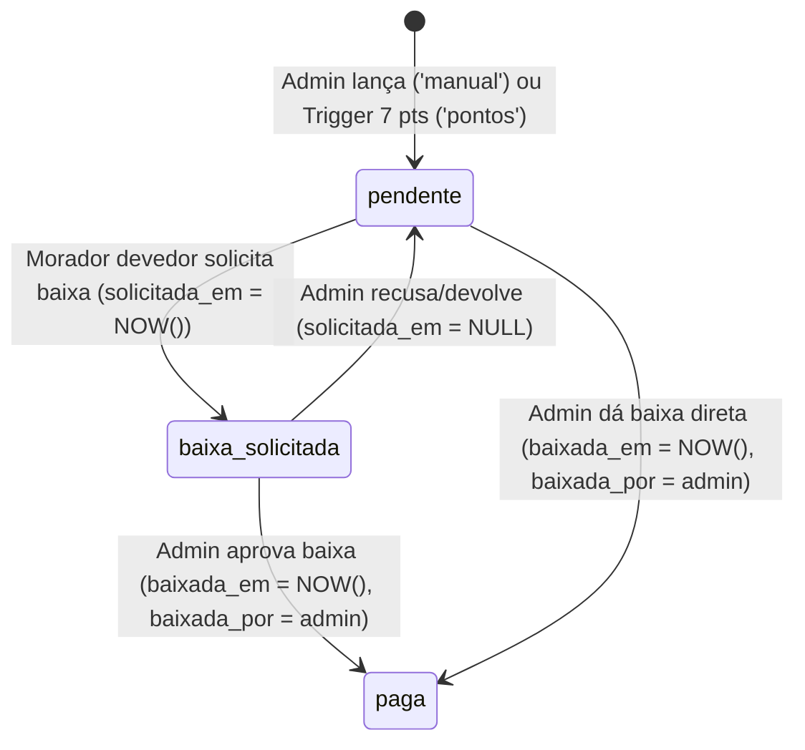

# Plano de Implementação — Feature: Caixas de Cerveja (`feature/caixas-cerveja`)

> **Diretório de Trabalho Obrigatório:** `.worktrees/caixas-cerveja/`  
> **Branch:** `feature/caixas-cerveja`  
> **Referências Normativas:** `AGY.md` (Fase 3 / Seção 3.2.B), `REQUIREMENTS.md` (Seção 3.6 e RN07) e `GEMINI.md` (Database-First & RLS)

---

## 1. Resumo Executivo e Decisões de Produto

Este documento especifica o plano técnico completo para implementação do módulo **Gestão de Caixas de Cerveja** no **Canta Grillo PWA**, com interface centrada na **lista de moradores da república** e suas respectivas caixas pendentes.

### 1.1 Regras de Negócio Essenciais (RN07)
1. **Lançamento Estritamente Unitário:**
   - Cada registro na tabela `public.caixas_cerveja` representa **exatamente 1 caixa de cerveja individual**.
   - Não existem campos de quantidade fracionada ou múltipla no banco nem na interface. Caso um morador deva mais de uma caixa, são criados múltiplos registros unitários independentes.
2. **Origens Permitidas (`origem`):**
   - `'manual'`: Lançada exclusivamente por um Administrador (`role = 'admin'`) por tradições da república (ex.: aprovação em estágio, início de namoro, conquistas, prendas da reunião).
   - `'pontos'`: Gerada automaticamente via Database Trigger (`trg_gerar_cerveja_por_pontos`) sempre que um morador atinge múltiplos de **7 pontos de bagunça assumidos** dentro do mesmo mês civil.
3. **Ciclo de Vida e Status (`status`):**
   - `'pendente'`: Caixa devida e ainda não entregue.
   - `'baixa_solicitada'`: O morador devedor entregou a caixa física na casa e solicitou a baixa pelo app (`solicitada_em` preenchido), aguardando conferência do Administrador.
   - `'paga'`: Liquidação confirmada por um Administrador (`baixada_em` e `baixada_por` preenchidos), seja aprovando uma solicitação de baixa ou realizando **baixa direta** a partir do status `'pendente'`.
   - **Recusa / Devolução de Solicitação:** Quando uma caixa está em `'baixa_solicitada'`, o Administrador pode **Aprovar** (vai para `'paga'`) ou **Recusar/Devolver** (retorna para `'pendente'` e limpa `solicitada_em = NULL`).
4. **Identificação Estrita por Apelido:**
   - Todas as referências a moradores e administradores na interface (lista de moradores, detalhes das caixas, seletor de morador no modal, autor da baixa no histórico) devem exibir estritamente o **apelido** cadastrado (`apelido || nome || 'Morador'`), nunca expondo o nome civil quando houver apelido.
5. **Arquitetura de Navegação e Interface Centrada em Moradores (`CervejasScreen.tsx`):**
   - **Acesso:** Mantido exclusivamente via aba `Casa › Cervejas` (o layout da tela `Início` / `Home` **não** deve ser alterado).
   - **Organização em 2 Abas (`'moradores' | 'historico'`):**
     1. **Aba Principal — `Moradores (Pendentes)`:**
        - Exibe a **lista de todos os moradores ativos da república**, mostrando quantas e quais caixas cada um deve.
        - **Ordenação:** Devedores no topo ordenados por quantidade total de caixas não pagas (`pendente` + `baixa_solicitada` decrescente, priorizando quem possui `'baixa_solicitada'` em caso de empate), seguidos pelos moradores com `0 caixas` em ordem alfabética de apelido.
        - **Linha/Card Expansível (Accordion) por Morador:**
          - **Cabeçalho da linha (sempre visível):** Apelido do morador (`+ badge "Você"` se for o usuário logado), geração/quarto, **resumo rápido dos motivos das caixas pendentes** (ex.: *"Passou no estágio · 7 pontos em 10/2026"*) e tag com a contagem de caixas pendentes (`2 caixas`, badge de `Baixa solicitada` quando aplicável, ou `0 caixas` para quem está em dia).
          - **Corpo expandido (ao tocar no morador):**
            - Lista detalhada de cada **caixa unitária pendente/solicitada** daquele morador, com motivo completo, badge de origem (`Tradição` ou `7 Pontos`), data de atribuição e botões de ação:
              - **Morador logado dono da caixa:** Botão `"Solicitar Baixa (Já entreguei)"` (quando `'pendente'`) ou status `"Aguardando confirmação do Admin"` (quando `'baixa_solicitada'`).
              - **Administrador:** Botões `"Confirmar Baixa"` e `"Recusar"` (quando `'baixa_solicitada'`), botão `"Dar Baixa Direta"` (quando `'pendente'`) e botão de exclusão (`Trash2`) para estorno.
            - Seção compacta com o **histórico de caixas já pagas por aquele morador** (se houver).
            - Para o **Administrador**, botão direto `"+ Lançar 1 caixa para {apelido}"` que abre o modal de lançamento manual já com o morador pré-selecionado.
     2. **Aba Secundária — `Histórico de Pagas`:**
        - Mural transparente em ordem cronológica inversa (`baixada_em DESC`) com todas as caixas já liquidadas (`status === 'paga'`) da casa, exibindo apelido do morador, motivo, origem, data de atribuição, data da baixa e apelido do Admin que confirmou.

---

## 2. Arquitetura de Banco de Dados e Segurança (Supabase RLS)

Seguindo a diretriz **Database-First** do `GEMINI.md`, toda autorização de leitura, lançamento, solicitação de baixa, liquidação e exclusão deve residir no PostgreSQL via **Row Level Security (RLS)** e **Triggers de integridade**.

### 2.1 Diagrama de Máquina de Estados (`public.caixas_cerveja`)



### 2.2 Script SQL Completo (RLS + Triggers + Realtime)

O bloco SQL abaixo deve ser adicionado ao final do arquivo `supabase/schema.sql` (e executado no SQL Editor do Supabase):

```sql
-- ==============================================================================
-- 7. POLÍTICAS RLS E TRIGGERS: GESTÃO DE CAIXAS DE CERVEJA (RN07)
-- ==============================================================================

-- 7.1 Ajuste no Trigger de 7 Pontos para cobrir INSERT direto (ex.: penalidade 24h) e UPDATE
CREATE OR REPLACE FUNCTION public.check_pontos_gerar_cerveja()
RETURNS TRIGGER AS $$
DECLARE
    v_total_pontos INT;
    v_data_ref TIMESTAMPTZ := COALESCE(NEW.assumida_em, NOW());
    v_mes_inicio DATE := DATE_TRUNC('month', v_data_ref)::DATE;
    v_mes_fim DATE := (DATE_TRUNC('month', v_data_ref) + INTERVAL '1 month - 1 day')::DATE;
BEGIN
    -- Atua apenas quando o registro entra no status 'assumida' com um culpado definido
    IF (
        NEW.status = 'assumida'
        AND NEW.culpado_id IS NOT NULL
        AND (TG_OP = 'INSERT' OR OLD.status IS DISTINCT FROM 'assumida')
    ) THEN
        SELECT COUNT(*)
        INTO v_total_pontos
        FROM public.pontos_bagunca
        WHERE culpado_id = NEW.culpado_id
          AND status = 'assumida'
          AND COALESCE(assumida_em, created_at)::DATE BETWEEN v_mes_inicio AND v_mes_fim;

        -- A cada múltiplo exato de 7 pontos no mês civil, gera 1 caixa unitária
        IF (v_total_pontos > 0 AND v_total_pontos % 7 = 0) THEN
            INSERT INTO public.caixas_cerveja (
                morador_id,
                motivo_descricao,
                origem,
                data_atribuicao,
                status
            ) VALUES (
                NEW.culpado_id,
                'Acúmulo de ' || v_total_pontos || ' pontos de bagunça em ' || TO_CHAR(v_data_ref, 'MM/YYYY'),
                'pontos',
                CURRENT_DATE,
                'pendente'
            );
        END IF;
    END IF;
    RETURN NEW;
END;
$$ LANGUAGE plpgsql SECURITY DEFINER;

DROP TRIGGER IF EXISTS trg_gerar_cerveja_por_pontos ON public.pontos_bagunca;
CREATE TRIGGER trg_gerar_cerveja_por_pontos
AFTER INSERT OR UPDATE OF status ON public.pontos_bagunca
FOR EACH ROW
EXECUTE FUNCTION public.check_pontos_gerar_cerveja();

-- 7.2 Habilitar Row Level Security em public.caixas_cerveja
ALTER TABLE public.caixas_cerveja ENABLE ROW LEVEL SECURITY;

-- SELECT: Moradores ativos e Administradores podem consultar todo o mural e histórico de caixas.
-- Convidados externos (role = 'externo') e anônimos não possuem acesso.
DROP POLICY IF EXISTS "Moradores ativos e admin leem caixas de cerveja" ON public.caixas_cerveja;
CREATE POLICY "Moradores ativos e admin leem caixas de cerveja"
ON public.caixas_cerveja FOR SELECT
TO authenticated
USING (
  public.is_admin() OR public.is_active_morador()
);

-- INSERT: Apenas Administradores podem inserir lançamentos manuais via cliente.
-- (Lançamentos automáticos de 7 pontos ocorrem via trigger SECURITY DEFINER).
DROP POLICY IF EXISTS "Apenas admin lanca caixa de cerveja manual" ON public.caixas_cerveja;
CREATE POLICY "Apenas admin lanca caixa de cerveja manual"
ON public.caixas_cerveja FOR INSERT
TO authenticated
WITH CHECK (
  public.is_admin() AND origem = 'manual'
);

-- UPDATE: Administrador pode aprovar, dar baixa direta ou recusar solicitação;
-- Morador ativo devedor pode atualizar apenas sua própria caixa para solicitar baixa.
DROP POLICY IF EXISTS "Admin liquida ou morador solicita baixa de cerveja" ON public.caixas_cerveja;
CREATE POLICY "Admin liquida ou morador solicita baixa de cerveja"
ON public.caixas_cerveja FOR UPDATE
TO authenticated
USING (
  public.is_admin() OR (public.is_active_morador() AND morador_id = auth.uid())
)
WITH CHECK (
  public.is_admin() OR (
    public.is_active_morador()
    AND morador_id = auth.uid()
    AND status = 'baixa_solicitada'
  )
);

-- DELETE: Exclusivo para Administradores (estorno de lançamento equivocado).
DROP POLICY IF EXISTS "Apenas admin remove caixa de cerveja" ON public.caixas_cerveja;
CREATE POLICY "Apenas admin remove caixa de cerveja"
ON public.caixas_cerveja FOR DELETE
TO authenticated
USING (
  public.is_admin()
);

-- 7.3 Trigger de Proteção de Colunas e Transição de Status em public.caixas_cerveja
CREATE OR REPLACE FUNCTION public.protect_caixas_cerveja_update()
RETURNS TRIGGER AS $$
BEGIN
  IF NOT public.is_admin() THEN
    -- Morador comum só pode alterar uma caixa que esteja 'pendente' para 'baixa_solicitada'
    IF OLD.status <> 'pendente' OR NEW.status <> 'baixa_solicitada' THEN
      RAISE EXCEPTION 'Moradores só podem solicitar baixa de caixas com status pendente.';
    END IF;

    -- Impede adulteração de colunas críticas pelo morador devedor
    IF NEW.morador_id IS DISTINCT FROM OLD.morador_id
       OR NEW.motivo_descricao IS DISTINCT FROM OLD.motivo_descricao
       OR NEW.origem IS DISTINCT FROM OLD.origem
       OR NEW.data_atribuicao IS DISTINCT FROM OLD.data_atribuicao
       OR NEW.baixada_em IS DISTINCT FROM OLD.baixada_em
       OR NEW.baixada_por IS DISTINCT FROM OLD.baixada_por
    THEN
      RAISE EXCEPTION 'Não é permitido alterar dados cadastrais ou de auditoria da caixa de cerveja.';
    END IF;

    -- Garante preenchimento do timestamp de solicitação
    NEW.solicitada_em := COALESCE(NEW.solicitada_em, NOW());
  END IF;

  RETURN NEW;
END;
$$ LANGUAGE plpgsql SECURITY DEFINER;

DROP TRIGGER IF EXISTS trg_protect_caixas_cerveja_update ON public.caixas_cerveja;
CREATE TRIGGER trg_protect_caixas_cerveja_update
BEFORE UPDATE ON public.caixas_cerveja
FOR EACH ROW
EXECUTE FUNCTION public.protect_caixas_cerveja_update();

-- 7.4 Habilita Realtime na tabela public.caixas_cerveja
DO $$
BEGIN
  IF NOT EXISTS (
    SELECT 1 FROM pg_publication_tables 
    WHERE pubname = 'supabase_realtime' AND tablename = 'caixas_cerveja'
  ) THEN
    ALTER PUBLICATION supabase_realtime ADD TABLE public.caixas_cerveja;
  END IF;
END $$;
```

---

## 3. Passo a Passo de Implementação no Código

Todos os arquivos abaixo devem ser criados ou editados estritamente dentro de `.worktrees/caixas-cerveja/`.

---

### Passo 1: Criar Tipos e Funções Puras de Domínio (`src/types/cervejas.ts`)

Criar o arquivo `.worktrees/caixas-cerveja/src/types/cervejas.ts` contendo a tipagem estrita da entidade `CaixaCerveja`, o agrupamento por morador (`MoradorComCaixas`) e funções utilitárias puras (que serão exercitadas nos testes unitários):

```typescript
export type CaixaCervejaOrigem = 'pontos' | 'manual';

export type CaixaCervejaStatus = 'pendente' | 'baixa_solicitada' | 'paga';

export type CervejasTab = 'moradores' | 'historico';

export interface MoradorResumoCerveja {
  id: string;
  nome: string;
  apelido: string | null;
  geracao?: string | null;
  quarto?: { nome: string } | null;
}

export interface CaixaCerveja {
  id: string;
  morador_id: string;
  motivo_descricao: string;
  origem: CaixaCervejaOrigem;
  data_atribuicao: string; // YYYY-MM-DD
  status: CaixaCervejaStatus;
  solicitada_em: string | null;
  baixada_em: string | null;
  baixada_por: string | null;
  created_at: string;
  morador?: MoradorResumoCerveja | null;
  admin_baixa?: MoradorResumoCerveja | null;
}

export interface MoradorComCaixas {
  morador: MoradorResumoCerveja;
  apelidoExibicao: string;
  caixasEmAberto: CaixaCerveja[]; // 'baixa_solicitada' (no topo) + 'pendente'
  caixasPagas: CaixaCerveja[];    // 'paga' ordenadas por baixada_em DESC
  pendentesCount: number;         // total de caixas não pagas ('pendente' + 'baixa_solicitada')
  baixaSolicitadaCount: number;   // quantas estão aguardando confirmação do Admin
  pagasCount: number;             // quantas já foram quitadas
  resumoMotivosPendentes: string; // Ex: "Passou no estágio · 7 pontos em 10/2026"
}

export interface ResumoCaixasCerveja {
  totalPendentesCasa: number;       // status === 'pendente' + 'baixa_solicitada'
  aguardandoConfirmacao: number;    // status === 'baixa_solicitada'
  moradoresDevedoresCount: number;  // quantos moradores têm pelo menos 1 caixa não paga
  minhasPendentes: number;          // do usuário logado com status !== 'paga'
  totalPagasHistorico: number;      // status === 'paga'
}

/** Sugestões rápidas de tradições da república para lançamento manual pelo Admin */
export const MOTIVOS_TRADICAO_SUGESTOES = [
  'Passou no estágio',
  'Começou a namorar',
  'Efetivado no trabalho',
  'Aniversário na república',
  'Prenda deliberada em reunião',
] as const;

/**
 * Retorna estritamente o apelido do morador (com fallback para nome apenas se apelido for nulo/vazio).
 */
export function obterApelidoMorador(
  morador?: { nome?: string | null; apelido?: string | null } | null
): string {
  if (!morador) return 'Morador';
  const apelidoLimpo = morador.apelido?.trim();
  if (apelidoLimpo) return apelidoLimpo;
  const nomeLimpo = morador.nome?.trim();
  if (nomeLimpo) return nomeLimpo;
  return 'Morador';
}

/**
 * Calcula os contadores globais de resumo do mural de cervejas.
 */
export function calcularResumoCaixas(
  caixas: CaixaCerveja[],
  currentUserId?: string | null
): ResumoCaixasCerveja {
  let totalPendentesCasa = 0;
  let aguardandoConfirmacao = 0;
  let minhasPendentes = 0;
  let totalPagasHistorico = 0;
  const devedoresSet = new Set<string>();

  for (const c of caixas) {
    if (c.status === 'paga') {
      totalPagasHistorico += 1;
    } else {
      totalPendentesCasa += 1;
      devedoresSet.add(c.morador_id);
      if (c.status === 'baixa_solicitada') {
        aguardandoConfirmacao += 1;
      }
      if (currentUserId && c.morador_id === currentUserId) {
        minhasPendentes += 1;
      }
    }
  }

  return {
    totalPendentesCasa,
    aguardandoConfirmacao,
    moradoresDevedoresCount: devedoresSet.size,
    minhasPendentes,
    totalPagasHistorico,
  };
}

/**
 * Agrupa todas as caixas por morador ativo e ordena a lista:
 * 1. Devedores primeiro, ordenados por maior número de caixas em aberto (pendentesCount DESC).
 * 2. Em caso de empate no número de caixas em aberto, prioriza quem possui solicitações de baixa (baixaSolicitadaCount DESC).
 * 3. Desempate final (inclusive para quem deve 0 caixas) por ordem alfabética do apelido.
 */
export function agruparCaixasPorMorador(
  moradores: MoradorResumoCerveja[],
  caixas: CaixaCerveja[]
): MoradorComCaixas[] {
  const mapaMoradores = new Map<string, MoradorResumoCerveja>();
  for (const m of moradores) {
    mapaMoradores.set(m.id, m);
  }

  // Garante que mesmo se houver caixa de um morador não listado no array inicial, ele seja incluído
  for (const c of caixas) {
    if (!mapaMoradores.has(c.morador_id) && c.morador) {
      mapaMoradores.set(c.morador_id, c.morador);
    }
  }

  const resultado: MoradorComCaixas[] = [];

  for (const morador of mapaMoradores.values()) {
    const caixasDoMorador = caixas.filter((c) => c.morador_id === morador.id);

    const caixasEmAberto = caixasDoMorador
      .filter((c) => c.status === 'pendente' || c.status === 'baixa_solicitada')
      .sort((a, b) => {
        if (a.status !== b.status) {
          return a.status === 'baixa_solicitada' ? -1 : 1;
        }
        return new Date(b.created_at).getTime() - new Date(a.created_at).getTime();
      });

    const caixasPagas = caixasDoMorador
      .filter((c) => c.status === 'paga')
      .sort((a, b) => {
        const dataA = a.baixada_em ? new Date(a.baixada_em).getTime() : new Date(a.created_at).getTime();
        const dataB = b.baixada_em ? new Date(b.baixada_em).getTime() : new Date(b.created_at).getTime();
        return dataB - dataA;
      });

    const pendentesCount = caixasEmAberto.length;
    const baixaSolicitadaCount = caixasEmAberto.filter((c) => c.status === 'baixa_solicitada').length;
    const pagasCount = caixasPagas.length;

    const resumoMotivosPendentes =
      caixasEmAberto.length > 0
        ? caixasEmAberto.map((c) => c.motivo_descricao).join(' · ')
        : '';

    resultado.push({
      morador,
      apelidoExibicao: obterApelidoMorador(morador),
      caixasEmAberto,
      caixasPagas,
      pendentesCount,
      baixaSolicitadaCount,
      pagasCount,
      resumoMotivosPendentes,
    });
  }

  return resultado.sort((a, b) => {
    if (b.pendentesCount !== a.pendentesCount) {
      return b.pendentesCount - a.pendentesCount;
    }
    if (b.baixaSolicitadaCount !== a.baixaSolicitadaCount) {
      return b.baixaSolicitadaCount - a.baixaSolicitadaCount;
    }
    return a.apelidoExibicao.localeCompare(b.apelidoExibicao, 'pt-BR');
  });
}

/**
 * Filtra e ordena o histórico global de caixas já pagas (aba 'historico').
 */
export function obterHistoricoCaixasPagas(caixas: CaixaCerveja[]): CaixaCerveja[] {
  return caixas
    .filter((c) => c.status === 'paga')
    .sort((a, b) => {
      const dataA = a.baixada_em ? new Date(a.baixada_em).getTime() : new Date(a.created_at).getTime();
      const dataB = b.baixada_em ? new Date(b.baixada_em).getTime() : new Date(b.created_at).getTime();
      return dataB - dataA;
    });
}

/**
 * Valida se uma transição de status é permitida para o papel do usuário.
 */
export function podeExecutarTransicaoCaixa(params: {
  caixa: Pick<CaixaCerveja, 'morador_id' | 'status'>;
  novoStatus: CaixaCervejaStatus;
  userId: string;
  isAdmin: boolean;
}): boolean {
  const { caixa, novoStatus, userId, isAdmin } = params;

  if (isAdmin) {
    // Admin pode liquidar caixa pendente ou solicitada -> paga
    if ((caixa.status === 'pendente' || caixa.status === 'baixa_solicitada') && novoStatus === 'paga') {
      return true;
    }
    // Admin pode recusar/devolver baixa solicitada -> pendente
    if (caixa.status === 'baixa_solicitada' && novoStatus === 'pendente') {
      return true;
    }
    return false;
  }

  // Morador comum só pode solicitar baixa da própria caixa que está pendente
  if (
    caixa.morador_id === userId &&
    caixa.status === 'pendente' &&
    novoStatus === 'baixa_solicitada'
  ) {
    return true;
  }

  return false;
}

/**
 * Valida os dados de entrada de um lançamento manual unitário.
 */
export function validarLancamentoManual(input: {
  morador_id: string;
  motivo_descricao: string;
  isAdmin: boolean;
}): { valido: boolean; erro?: string } {
  if (!input.isAdmin) {
    return { valido: false, erro: 'Apenas administradores podem lançar caixas manualmente.' };
  }
  if (!input.morador_id.trim()) {
    return { valido: false, erro: 'Selecione o morador responsável pela caixa.' };
  }
  if (!input.motivo_descricao.trim() || input.motivo_descricao.trim().length < 3) {
    return { valido: false, erro: 'Informe o motivo ou tradição do lançamento (mín. 3 caracteres).' };
  }
  return { valido: true };
}
```

---

### Passo 2: Implementar a Tela `src/features/cervejas/CervejasScreen.tsx`

Criar o arquivo `.worktrees/caixas-cerveja/src/features/cervejas/CervejasScreen.tsx` seguindo rigorosamente o Design System Editorial / Warm Paper (`bg-paper`, `bg-surface`, `text-ink`, `text-muted`, `border-line`, `text-forest`, `bg-mint`, `text-clay`, `bg-clay-tint`) e os componentes de `src/components/ui.tsx`.

#### Especificação Detalhada da Interface (`CervejasScreen.tsx`):

1. **Cabeçalho (`PageTitle`):**
   - `title="Caixas de Cerveja"`
   - `hint="Moradores e caixas unitárias pendentes na casa"`
   - `back={{ label: 'Casa', onClick: onBack }}`
   - `action`: Se `isAdmin`, renderiza botão `<Button onClick={() => abrirModalLancamento()}>+ Lançar</Button>`.
2. **Cards de Resumo no Topo (Grid 3 colunas):**
   - **Caixas Pendentes:** `resumo.totalPendentesCasa` (destaque em `text-clay` quando $> 0$, com subtítulo `${resumo.moradoresDevedoresCount} moradores`).
   - **Suas Pendentes:** `resumo.minhasPendentes` (destaque se o usuário logado dever alguma).
   - **Já Entregues:** `resumo.totalPagasHistorico` (destaque em `text-forest`).
   - Se `isAdmin && resumo.aguardandoConfirmacao > 0`, exibir um banner de alerta rápido informando quantas caixas estão com **baixa solicitada** aguardando conferência do Admin.
3. **Seletor de 2 Abas (`'moradores' | 'historico'`):**
   - Segmented control com 2 botões:
     - `Moradores (${moradoresAgrupados.length})`
     - `Histórico de Pagas (${resumo.totalPagasHistorico})`
4. **Aba 1: Lista de Moradores com Accordion de Caixas (`activeTab === 'moradores'`):**
   - Renderiza a lista de `MoradorComCaixas` gerada por `agruparCaixasPorMorador(moradoresAtivos, caixas)`.
   - **Estado Inicial de Expansão:** O card do próprio usuário logado (se tiver caixas pendentes) ou moradores com `baixa_solicitada` (quando visualizado pelo Admin) podem iniciar expandidos ou serem expandidos/recolhidos ao toque (`expandedMoradorIds: Set<string>`).
   - **Cabeçalho da Linha do Morador (Sempre Visível):**
     - **Esquerda:**
       - Nome de exibição estrito pelo apelido: `{item.apelidoExibicao}` + badge `(Você)` caso `item.morador.id === user?.id`.
       - Subtítulo contextual:
         - Se `item.pendentesCount > 0`: exibe `item.resumoMotivosPendentes` (ex.: `"Passou no estágio · Acúmulo de 7 pontos..."`) truncado em até 2 linhas para leitura imediata de **quais** caixas estão pendentes sem nem precisar abrir.
         - Se `item.pendentesCount === 0`: exibe `"Geração ${item.morador.geracao || '025'} · ${item.morador.quarto?.nome || 'Quarto'} · Em dia"`.
     - **Direita:**
       - Se `item.baixaSolicitadaCount > 0`: badge `<Tag tone="neutral">{item.baixaSolicitadaCount} em análise</Tag>`.
       - Contador de caixas pendentes:
         - Se `item.pendentesCount > 0`: `<Tag tone="alert">{item.pendentesCount} {item.pendentesCount === 1 ? 'caixa' : 'caixas'}</Tag>`
         - Se `item.pendentesCount === 0`: `<Tag tone="green">0 caixas</Tag>`
       - Ícone `ChevronDown` / `ChevronUp`.
   - **Corpo Expandido do Morador (Ao clicar na linha):**
     - **Lista de Caixas Pendentes (`item.caixasEmAberto`):**
       - Se `item.caixasEmAberto.length === 0`: mensagem discreta `"Nenhuma caixa pendente para {item.apelidoExibicao}."`
       - Para cada `caixa` em `item.caixasEmAberto`:
         - Card interno unitário mostrando:
           - `caixa.motivo_descricao` em destaque.
           - Badge de origem: `Tradição` (`origem === 'manual'`) ou `7 Pontos` (`origem === 'pontos'`).
           - Data de atribuição (`dd/mm/aaaa`) e badge de status (`Pendente` ou `Baixa solicitada`).
           - **Botões de Ação na Caixa Unitária:**
             - **Se usuário logado é o devedor (`caixa.morador_id === user?.id`):**
               - `status === 'pendente'`: Botão `"Solicitar Baixa (Já entreguei)"` $\rightarrow$ atualiza para `status: 'baixa_solicitada', solicitada_em: new Date().toISOString()`.
               - `status === 'baixa_solicitada'`: Texto informativo `"Solicitação enviada · Aguardando confirmação do Admin"`.
             - **Se usuário logado é Admin (`isAdmin`):**
               - `status === 'baixa_solicitada'`: Botão primário `"Confirmar Baixa"` ($\rightarrow$ `'paga'`) e botão contornado `"Recusar"` ($\rightarrow$ `'pendente'`, `solicitada_em: null`).
               - `status === 'pendente'`: Botão `"Dar Baixa Direta"` ($\rightarrow$ `'paga'`).
               - Botão de exclusão (`Trash2`) para remover lançamento equivocado.
     - **Resumo de Caixas Pagas do Morador (`item.caixasPagas`):**
       - Se `item.pagasCount > 0`, exibe uma subseção discreta `"Já pagas por {item.apelidoExibicao} ({item.pagasCount})"` listando motivo e data de baixa de cada caixa quitada.
     - **Ação Rápida do Admin no Rodapé do Morador:**
       - Se `isAdmin`, botão `"+ Lançar 1 caixa para {item.apelidoExibicao}"` que abre o modal de lançamento manual já com `moradorSelecionadoId = item.morador.id`.
5. **Aba 2: Histórico Geral de Caixas Pagas (`activeTab === 'historico'`):**
   - Lista todas as caixas retornadas por `obterHistoricoCaixasPagas(caixas)`.
   - Cada item exibe o apelido do morador (`obterApelidoMorador(caixa.morador)`), o motivo (`caixa.motivo_descricao`), a origem (`Tradição` ou `7 Pontos`), a data de atribuição e a auditoria de liquidação (`"Baixada em dd/mm/aaaa por {obterApelidoMorador(caixa.admin_baixa)}"`).
6. **Modal de Lançamento Manual Unitário (Exclusivo Admin):**
   - Select de moradores ativos exibindo `{obterApelidoMorador(m)} — Geração {m.geracao || '025'}`.
   - Chips de preenchimento rápido com `MOTIVOS_TRADICAO_SUGESTOES`.
   - Campo obrigatório `motivo_descricao` e campo `data_atribuicao` (default: hoje).
   - Aviso claro de que cada envio lança **1 caixa individual** (`origem: 'manual'`, `status: 'pendente'`).
7. **Sincronização Realtime:**
   - Assinatura no canal `caixas-cerveja-realtime` (`table: 'caixas_cerveja'`) atualizando a tela instantaneamente quando qualquer caixa for lançada, solicitada ou baixada.

---

### Passo 3: Conectar `CervejasScreen` em `src/App.tsx`

Editar `.worktrees/caixas-cerveja/src/App.tsx`:
1. Importar `CervejasScreen`:
   ```tsx
   import { CervejasScreen } from './features/cervejas/CervejasScreen';
   ```
2. Remover o array estático `dividas` (linhas 44-48 de `src/App.tsx`).
3. No `switch (screen)` dentro de `MainApp`, substituir o `case 'cervejas':` (linhas 439-454) por:
   ```tsx
   case 'cervejas':
     return <CervejasScreen onBack={goBack} />;
   ```
4. **Não alterar** o layout da tela `home` (`case 'home':`), mantendo o acesso exclusivamente via `Casa › Cervejas`.

---

### Passo 4: Atualizar `supabase/schema.sql` e Documentação (`AGY.md` e `REQUIREMENTS.md`)

1. **`supabase/schema.sql`**:
   - Atualizar a função `public.check_pontos_gerar_cerveja()` e o trigger `trg_gerar_cerveja_por_pontos` para disparar em `AFTER INSERT OR UPDATE OF status ON public.pontos_bagunca`.
   - Adicionar a seção `7. POLÍTICAS RLS E TRIGGERS: GESTÃO DE CAIXAS DE CERVEJA (RN07)` ao final de `supabase/schema.sql`.
2. **`AGY.md`**:
   - Na Seção `3.4 Regras de Integridade e Derivações do MER-X`, adicionar o item **12. Gestão de Caixas de Cerveja (`CAIXAS_CERVEJA` - Supabase RLS)**.
   - Na Seção `5. Roadmap de Implementação em Fases Atômicas` (`Fase 3`), marcar `[x] Gestão de Caixas de Cerveja` como concluída.
3. **`REQUIREMENTS.md`**:
   - Na Seção `3.6` e `RN07`, documentar a visualização centrada na lista de moradores com contagem/detalhamento de caixas pendentes, o fluxo de aprovação/recusa pelo Admin, a identificação estrita por apelido e as políticas RLS.

---

### Passo 5: Criar Testes Unitários (`tests/unit/caixas-cerveja.test.mjs`)

Criar o arquivo `.worktrees/caixas-cerveja/tests/unit/caixas-cerveja.test.mjs` utilizando `node:test` e `node:assert/strict`, cobrindo:
1. **Identificação Estrita por Apelido (`obterApelidoMorador`):**
   - Prioriza `apelido` sobre `nome`.
   - Faz fallback para `nome` quando `apelido` é `null` ou vazio.
2. **Agrupamento e Ordenação por Morador (`agruparCaixasPorMorador`):**
   - Lista todos os moradores ativos (inclusive quem tem `0 caixas` pendentes).
   - Ordena moradores com mais caixas pendentes no topo (`pendentesCount DESC`).
   - Desempata priorizando moradores com `'baixa_solicitada'` (`baixaSolicitadaCount DESC`) e depois por ordem alfabética de apelido.
   - Monta `resumoMotivosPendentes` concatenando os motivos das caixas não pagas daquele morador.
   - Separa corretamente `caixasEmAberto` e `caixasPagas` de cada morador.
3. **Cálculo de Resumo Global (`calcularResumoCaixas`):**
   - Contabiliza `totalPendentesCasa`, `aguardandoConfirmacao`, `moradoresDevedoresCount`, `minhasPendentes` e `totalPagasHistorico`.
4. **Regras de Transição de Status e Permissões (`podeExecutarTransicaoCaixa`):**
   - Morador comum pode solicitar baixa (`pendente` $\rightarrow$ `baixa_solicitada`) apenas da própria caixa.
   - Morador comum **não** pode solicitar baixa da caixa de outro morador nem liquidar (`paga`).
   - Admin pode aprovar solicitação (`baixa_solicitada` $\rightarrow$ `paga`), dar baixa direta (`pendente` $\rightarrow$ `paga`) e recusar/devolver solicitação (`baixa_solicitada` $\rightarrow$ `pendente`).
5. **Validação de Lançamento Manual Unitário (`validarLancamentoManual`):**
   - Rejeita lançamento manual por não-admin e valida `morador_id` e `motivo_descricao`.

---

## 4. Checklist de Verificação Pós-Implementação

Executar todos os comandos abaixo dentro de `.worktrees/caixas-cerveja/`:

```bash
# 1. Executar testes unitários (incluindo a nova suíte caixas-cerveja.test.mjs)
npm test

# 2. Validar tipagem TypeScript e build de produção do Vite
npm run build

# 3. Executar linter (oxlint)
npm run lint
```
