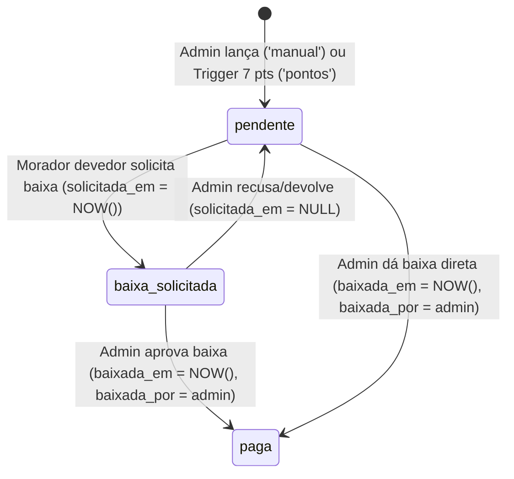

# Planos de Implementação — Módulos Canta Grillo PWA

1. [Sistema Geral de Funças & Reunião Semanal (`feature/funcas`)](#1-sistema-geral-de-funças--reunião-semanal)
2. [Páginas das Frentes Organizacionais & Chats Internos (`feature/frentes`)](#2-páginas-das-frentes-organizacionais--chats-internos)
3. [Gestão de Caixas de Cerveja (`feature/caixas-cerveja`)](#3-gestão-de-caixas-de-cerveja)

---

## 1. Sistema Geral de Funças & Reunião Semanal

# Plano de Execução e Implementação Detalhado — Sistema Geral de Funças & Reunião Semanal (`feature/funcas`)

> **Documento Guia de Implementação para Agentes / Modelos de IA**  
> **Branch:** `feature/funcas`  
> **Diretório de Trabalho Obrigatório:** `/home/ciosaki/hd/canta-grillo-app/.worktrees/funcas/`  
> **Referências:** [AGY.md](./AGY.md) (Fase 4), [REQUIREMENTS.md](./REQUIREMENTS.md) (RN09), [GEMINI.md](./GEMINI.md) (Database-First RLS)

---

## 0. Restrições Globais Obrigatórias (LEIA ANTES DE INICIAR)

1. **Isolamento de Worktree:**
   - **TODA** leitura, criação e edição de arquivos, bem como **TODA** execução de comandos (`run_command`, `npm test`, `npm run build`, etc.) **DEVE** ocorrer estritamente dentro de:
     ```bash
     /home/ciosaki/hd/canta-grillo-app/.worktrees/funcas/
     ```
   - Nunca edite arquivos na raiz `/home/ciosaki/hd/canta-grillo-app/` fora de `.worktrees/funcas/`.

2. **Diretriz Database-First (`GEMINI.md`):**
   - A segurança real deve residir no PostgreSQL/Supabase via **Row Level Security (RLS)** e funções `SECURITY DEFINER`.
   - Ao concluir a implementação, apresente também na resposta final o bloco SQL completo pronto para execução no SQL Editor do Supabase.
   - Atualize [AGY.md](./AGY.md) e [REQUIREMENTS.md](./REQUIREMENTS.md) refletindo as políticas RLS e regras implementadas.

3. **Identificação Estrita por Apelido:**
   - Em **todas** as telas, cards, seletores (`<select>`), badges de responsáveis, relatores, autores de atribuição e pedidos de troca, exiba **estritamente o `apelido`** do morador (`profile.apelido || profile.nome?.split(' ')[0] || 'Morador'`). Nunca exiba o nome civil completo se houver apelido.

4. **Design System Editorial / Warm Paper:**
   - Mantenha rigorosamente a estética do app (`bg-paper`, `bg-surface`, `text-ink`, `text-muted`, `border-line`, `bg-forest`, `text-forest`, `bg-mint`, `bg-clay-tint`, `text-clay`).
   - Reutilize os componentes de [`src/components/ui.tsx`](./src/components/ui.tsx) (`PageTitle`, `Section`, `Row`, `Tag`, `Button`) e ícones do pacote `lucide-react`.

---

## 1. Especificação Funcional e Regras de Negócio Consolidadas

### 1.1 Conceito e Escopo da Funça (`public.funcas`)
- Toda tarefa, reparo ou missão da casa é uma **Funça**.
- **Campos:**
  - `id` (UUID, PK)
  - `frente_id` (UUID, FK opcional para `public.fronts(id)`):
    - `NULL` $\rightarrow$ **Funça Geral** da casa.
    - `NOT NULL` $\rightarrow$ **Funça de Frente** (vinculada a uma das 10 frentes).
  - `relator_id` (UUID, FK para `public.profiles(id)`): Morador ativo ou Admin que abriu a funça.
  - `titulo` (TEXT, obrigatório)
  - `descricao` (TEXT, obrigatório — no lançamento rápido em lote da reunião semanal, se deixado em branco, usar fallback `''` ou repetir o título).
  - `foto_url` (TEXT, opcional): Imagem comprimida no cliente (máx 1024px, JPEG qualidade 0.75) enviada ao bucket `'funcas'` do Supabase Storage, com fallback automático para `data:image/jpeg;base64,...` caso o bucket não exista.
  - `status` (TEXT): `'aberta'`, `'em_andamento'`, `'concluida'`.
  - `prazo` (DATE, opcional).
  - `created_at` (TIMESTAMPTZ).

### 1.2 Múltiplos Responsáveis (`public.funca_atribuicoes`)
- Uma Funça pode ter **0, 1 ou múltiplos moradores atribuídos simultaneamente** (ex.: dupla de bixos ou múltiplos membros de uma frente).
- Chave primária composta natural: `PRIMARY KEY (funca_id, morador_id)`.
- **Tipos de atribuição (`tipo_atribuicao`):**
  - `'autoatribuicao'`: O próprio morador puxou a funça para si.
  - `'lider_frente'`: Líder da frente atribuiu a um integrante da mesma frente.
  - `'veterano_bixo'`: Veterano atribuiu uma Funça Geral a um bixo seu.
  - `'admin_geral'`: Administrador atribuiu a funça.
  - `'reuniao'`: Alocação feita no Painel Centralizado da Reunião Semanal.
  - `'troca'`: Responsabilidade transferida após aceite de uma solicitação de troca entre moradores.

### 1.3 Ciclo de Vida Manual em 3 Etapas (`status`)
- **Regra:** Atribuir 1 ou mais responsáveis a uma funça **NÃO** altera seu status automaticamente para `'em_andamento'`.
- O ciclo de vida é **manual em 3 etapas**:
  1. **`'aberta'`**: Estado inicial da funça (esteja ela sem dono ou já atribuída a 1+ moradores aguardando início).
  2. **`'em_andamento'`**: O responsável (ou autorizado) clica no botão **"Iniciar (Em andamento)"** quando começa a executar a tarefa.
  3. **`'concluida'`**: Ao finalizar, clica no botão **"Concluir"** (1 toque simples, sem exigir foto de comprovação).
- **Quem pode alterar o status para `'em_andamento'` ou `'concluida'`:**
  - Qualquer um dos **responsáveis atribuídos** à funça (`morador_id = user.id`);
  - O **Líder da Frente** correspondente (quando `frente_id IS NOT NULL`);
  - O **Veterano** que atribuiu a tarefa (`atribuido_por = user.id`) ou que seja veterano de algum responsável;
  - O **Relator** que abriu a funça (`relator_id = user.id`);
  - O **Administrador** (`role === 'admin'`).

### 1.4 Matriz de Permissões de Atribuição
1. **Funça de Frente (`frente_id IS NOT NULL`):**
   - **Líder da Frente** (`is_lider = true` naquela frente): pode atribuir a qualquer integrante daquela frente (`tipo_atribuicao = 'lider_frente'`).
   - **Integrante da Frente**: pode se **autoatribuir** (`morador_id = user.id`, `tipo_atribuicao = 'autoatribuicao'`). Moradores que não pertencem à frente não podem usar autoatribuição normal nela.
   - **Administrador** (`role === 'admin'`): pode atribuir a qualquer morador ativo da casa (`tipo_atribuicao = 'admin_geral'`).
2. **Funça Geral (`frente_id IS NULL`):**
   - **Qualquer Veterano ativo**: pode atribuir **qualquer Funça Geral pendente** (mesmo que aberta por outro morador) para qualquer **bixo seu** (`geracao_num(veterano) < geracao_num(bixo)`, ex.: `'024'` atribui para `'025'` ou `'026'`), com `tipo_atribuicao = 'veterano_bixo'`.
   - **Administrador** (`role === 'admin'`): pode atribuir a qualquer morador ativo (`tipo_atribuicao = 'admin_geral'`).
   - **Qualquer morador ativo**: pode se **autoatribuir** (`morador_id = user.id`, `tipo_atribuicao = 'autoatribuicao'`).
3. **Painel da Reunião Semanal (`tipo_atribuicao = 'reuniao'`):**
   - **Qualquer morador ativo** (ou Admin) operando a aba `Reunião Semanal` pode alocar **qualquer funça** (Geral ou de Frente) para **qualquer morador ativo da casa**, definir/alterar `prazo` e criar múltiplas funças em lote com `tipo_atribuicao = 'reuniao'`.

### 1.5 Remoção de Responsável vs. Solicitação de Troca
1. **Remoção Direta (`DELETE` em `public.funca_atribuicoes`):**
   - Um morador atribuído **NÃO** pode simplesmente remover a si mesmo de uma funça.
   - Apenas podem remover um responsável de uma funça:
     - **Administrador** (`role === 'admin'`);
     - **Líder da Frente** da funça (se `frente_id IS NOT NULL`);
     - **Veterano do morador atribuído** (`geracao_num(usuario) < geracao_num(responsavel_atribuido)`) — **IMPORTANTE:** o veterano do morador atribuído pode removê-lo **tanto em Funça Geral quanto em Funça de Frente**.
2. **Solicitação de Troca com Outro Morador:**
   - O responsável atual (`morador_id = user.id`) pode clicar em **"Pedir Troca"** e selecionar **qualquer morador ativo da casa** (independente de a funça ser Geral ou de Frente, desde que o alvo ainda não seja responsável na mesma funça).
   - Isso grava `troca_solicitada_para = <alvo_id>` e `troca_solicitada_em = NOW()` na linha de `public.funca_atribuicoes`.
   - Enquanto a troca estiver pendente:
     - O solicitante vê o status `"Troca enviada p/ [Apelido]"` e pode cancelar o pedido (`troca_solicitada_para = null`).
     - O morador destinatário vê um alerta em destaque na aba `Minhas` (e na Home) com dois botões:
       - **Aceitar Troca**: executa a função RPC `public.aceitar_troca_funca(p_funca_id, p_morador_origem_id)` (ou substitui a atribuição no banco), fazendo com que o morador origem saia da funça e o destinatário assuma com `tipo_atribuicao = 'troca'`.
       - **Recusar Troca**: limpa `troca_solicitada_para = null` e `troca_solicitada_em = null`, mantendo a funça com o responsável original.

---

## 2. Passo a Passo de Execução

### PASSO 1: Atualizar `supabase/schema.sql` (Tabelas, Funções, RPC e RLS)

Edite o arquivo [`supabase/schema.sql`](./supabase/schema.sql) dentro de `.worktrees/funcas/`:

1. **Na definição da tabela `public.funca_atribuicoes` (por volta da linha 188):**
   Atualize a tabela para incluir `'troca'` no `CHECK` de `tipo_atribuicao` e as colunas de solicitação de troca (incluindo `ALTER TABLE ... ADD COLUMN IF NOT EXISTS` para compatibilidade com bancos já criados):

```sql
-- 13. ATRIBUIÇÃO DE FUNÇAS (Suporta múltiplos responsáveis e Solicitação de Troca)
CREATE TABLE IF NOT EXISTS public.funca_atribuicoes (
    funca_id UUID NOT NULL REFERENCES public.funcas(id) ON DELETE CASCADE,
    morador_id UUID NOT NULL REFERENCES public.profiles(id) ON DELETE CASCADE,
    atribuido_por UUID REFERENCES public.profiles(id) ON DELETE SET NULL,
    tipo_atribuicao TEXT NOT NULL CHECK (tipo_atribuicao IN ('autoatribuicao', 'lider_frente', 'veterano_bixo', 'admin_geral', 'reuniao', 'troca')),
    atribuido_em TIMESTAMPTZ DEFAULT NOW(),
    troca_solicitada_para UUID REFERENCES public.profiles(id) ON DELETE SET NULL,
    troca_solicitada_em TIMESTAMPTZ,
    PRIMARY KEY (funca_id, morador_id)
);

-- Garantir colunas e constraint atualizada caso a tabela já exista no banco
ALTER TABLE public.funca_atribuicoes ADD COLUMN IF NOT EXISTS troca_solicitada_para UUID REFERENCES public.profiles(id) ON DELETE SET NULL;
ALTER TABLE public.funca_atribuicoes ADD COLUMN IF NOT EXISTS troca_solicitada_em TIMESTAMPTZ;
ALTER TABLE public.funca_atribuicoes DROP CONSTRAINT IF EXISTS funca_atribuicoes_tipo_atribuicao_check;
ALTER TABLE public.funca_atribuicoes ADD CONSTRAINT funca_atribuicoes_tipo_atribuicao_check
    CHECK (tipo_atribuicao IN ('autoatribuicao', 'lider_frente', 'veterano_bixo', 'admin_geral', 'reuniao', 'troca'));
```

2. **Ao final do arquivo [`supabase/schema.sql`](./supabase/schema.sql), adicione a seção 7 com as funções auxiliares, RPC de troca, políticas RLS e Realtime:**

```sql
-- ==============================================================================
-- 7. SISTEMA GERAL DE FUNÇAS E REUNIÃO SEMANAL: HELPERS, RPC DE TROCA E RLS
-- ==============================================================================

-- Extrai o número inteiro de uma geração (ex: '024' -> 24, '025' -> 25)
CREATE OR REPLACE FUNCTION public.geracao_num(p_geracao TEXT)
RETURNS INT AS $$
DECLARE
  v_clean TEXT;
BEGIN
  IF p_geracao IS NULL THEN
    RETURN NULL;
  END IF;
  v_clean := NULLIF(REGEXP_REPLACE(p_geracao, '\D', '', 'g'), '');
  IF v_clean IS NULL THEN
    RETURN NULL;
  END IF;
  RETURN v_clean::INT;
END;
$$ LANGUAGE plpgsql IMMUTABLE;

-- Verifica se p_veterano_id é veterano de p_bixo_id (geracao menor = mais antigo na casa)
CREATE OR REPLACE FUNCTION public.is_veterano_de(p_veterano_id UUID, p_bixo_id UUID)
RETURNS BOOLEAN AS $$
  SELECT EXISTS (
    SELECT 1
    FROM public.profiles vet
    JOIN public.profiles bixo ON bixo.id = p_bixo_id
    WHERE vet.id = p_veterano_id
      AND vet.ativo = true
      AND vet.role IN ('morador', 'admin')
      AND bixo.ativo = true
      AND public.geracao_num(vet.geracao) IS NOT NULL
      AND public.geracao_num(bixo.geracao) IS NOT NULL
      AND public.geracao_num(vet.geracao) < public.geracao_num(bixo.geracao)
  );
$$ LANGUAGE sql SECURITY DEFINER;

-- Verifica se o usuário é líder de uma frente específica
CREATE OR REPLACE FUNCTION public.is_lider_frente(p_frente_id UUID, p_user_id UUID)
RETURNS BOOLEAN AS $$
  SELECT EXISTS (
    SELECT 1
    FROM public.front_members fm
    JOIN public.profiles p ON p.id = fm.profile_id
    WHERE fm.front_id = p_frente_id
      AND fm.profile_id = p_user_id
      AND fm.is_lider = true
      AND p.ativo = true
  );
$$ LANGUAGE sql SECURITY DEFINER;

-- Verifica se o usuário é integrante (membro ou líder) de uma frente específica
CREATE OR REPLACE FUNCTION public.is_membro_frente(p_frente_id UUID, p_user_id UUID)
RETURNS BOOLEAN AS $$
  SELECT EXISTS (
    SELECT 1
    FROM public.front_members fm
    JOIN public.profiles p ON p.id = fm.profile_id
    WHERE fm.front_id = p_frente_id
      AND fm.profile_id = p_user_id
      AND p.ativo = true
  );
$$ LANGUAGE sql SECURITY DEFINER;

-- RPC Transacional para Aceitar Solicitação de Troca de Funça
CREATE OR REPLACE FUNCTION public.aceitar_troca_funca(p_funca_id UUID, p_morador_origem_id UUID)
RETURNS VOID AS $$
DECLARE
  v_alvo_id UUID;
BEGIN
  SELECT troca_solicitada_para INTO v_alvo_id
  FROM public.funca_atribuicoes
  WHERE funca_id = p_funca_id AND morador_id = p_morador_origem_id;

  IF v_alvo_id IS NULL OR v_alvo_id <> auth.uid() THEN
    RAISE EXCEPTION 'Nenhuma solicitação de troca pendente para o seu usuário nesta funça.';
  END IF;

  -- Remove a atribuição do solicitante original
  DELETE FROM public.funca_atribuicoes
  WHERE funca_id = p_funca_id AND morador_id = p_morador_origem_id;

  -- Insere o morador que aceitou a troca (se ainda não estiver atribuído na mesma funça)
  INSERT INTO public.funca_atribuicoes (
    funca_id,
    morador_id,
    atribuido_por,
    tipo_atribuicao,
    atribuido_em,
    troca_solicitada_para,
    troca_solicitada_em
  ) VALUES (
    p_funca_id,
    auth.uid(),
    p_morador_origem_id,
    'troca',
    NOW(),
    NULL,
    NULL
  )
  ON CONFLICT (funca_id, morador_id) DO UPDATE SET
    troca_solicitada_para = NULL,
    troca_solicitada_em = NULL;
END;
$$ LANGUAGE plpgsql SECURITY DEFINER;

-- Habilitar RLS nas tabelas funcas e funca_atribuicoes
ALTER TABLE public.funcas ENABLE ROW LEVEL SECURITY;
ALTER TABLE public.funca_atribuicoes ENABLE ROW LEVEL SECURITY;

-- POLÍTICAS EM public.funcas
DROP POLICY IF EXISTS "Leitura de funcas para moradores ativos" ON public.funcas;
CREATE POLICY "Leitura de funcas para moradores ativos"
ON public.funcas FOR SELECT
TO authenticated
USING (public.is_admin() OR public.is_active_morador());

DROP POLICY IF EXISTS "Abertura de funcas por moradores ativos" ON public.funcas;
CREATE POLICY "Abertura de funcas por moradores ativos"
ON public.funcas FOR INSERT
TO authenticated
WITH CHECK (
  public.is_admin() OR (
    public.is_active_morador() AND relator_id = auth.uid()
  )
);

DROP POLICY IF EXISTS "Atualizacao de funcas por moradores ativos" ON public.funcas;
CREATE POLICY "Atualizacao de funcas por moradores ativos"
ON public.funcas FOR UPDATE
TO authenticated
USING (public.is_admin() OR public.is_active_morador())
WITH CHECK (public.is_admin() OR public.is_active_morador());

DROP POLICY IF EXISTS "Exclusao de funcas por admin, lider, veterano ou relator" ON public.funcas;
CREATE POLICY "Exclusao de funcas por admin, lider, veterano ou relator"
ON public.funcas FOR DELETE
TO authenticated
USING (
  public.is_admin() OR (
    public.is_active_morador() AND (
      relator_id = auth.uid() OR
      (frente_id IS NOT NULL AND public.is_lider_frente(frente_id, auth.uid()))
    )
  )
);

-- POLÍTICAS EM public.funca_atribuicoes
DROP POLICY IF EXISTS "Leitura de atribuicoes de funcas" ON public.funca_atribuicoes;
CREATE POLICY "Leitura de atribuicoes de funcas"
ON public.funca_atribuicoes FOR SELECT
TO authenticated
USING (public.is_admin() OR public.is_active_morador());

DROP POLICY IF EXISTS "Insercao de atribuicoes de funcas com regras RN09" ON public.funca_atribuicoes;
CREATE POLICY "Insercao de atribuicoes de funcas com regras RN09"
ON public.funca_atribuicoes FOR INSERT
TO authenticated
WITH CHECK (
  public.is_admin() OR (
    public.is_active_morador() AND
    atribuido_por = auth.uid() AND (
      -- 1. Modo Reunião Semanal: qualquer morador ativo secretariando pode alocar
      tipo_atribuicao = 'reuniao'
      OR
      -- 2. Regras para Funça de Frente vs Funça Geral
      EXISTS (
        SELECT 1 FROM public.funcas f
        WHERE f.id = funca_id AND (
          -- Funça de Frente (frente_id IS NOT NULL)
          (
            f.frente_id IS NOT NULL AND (
              (tipo_atribuicao = 'lider_frente' AND public.is_lider_frente(f.frente_id, auth.uid()) AND public.is_membro_frente(f.frente_id, morador_id))
              OR
              (tipo_atribuicao = 'autoatribuicao' AND morador_id = auth.uid() AND public.is_membro_frente(f.frente_id, auth.uid()))
            )
          )
          OR
          -- Funça Geral (frente_id IS NULL)
          (
            f.frente_id IS NULL AND (
              (tipo_atribuicao = 'veterano_bixo' AND public.is_veterano_de(auth.uid(), morador_id))
              OR
              (tipo_atribuicao = 'autoatribuicao' AND morador_id = auth.uid())
            )
          )
        )
      )
    )
  )
);

DROP POLICY IF EXISTS "Atualizacao de atribuicao para solicitacao de troca" ON public.funca_atribuicoes;
CREATE POLICY "Atualizacao de atribuicao para solicitacao de troca"
ON public.funca_atribuicoes FOR UPDATE
TO authenticated
USING (
  public.is_admin() OR (
    public.is_active_morador() AND (
      morador_id = auth.uid() OR
      troca_solicitada_para = auth.uid() OR
      public.is_veterano_de(auth.uid(), morador_id)
    )
  )
)
WITH CHECK (
  public.is_admin() OR (
    public.is_active_morador() AND (
      morador_id = auth.uid() OR
      troca_solicitada_para = auth.uid() OR
      troca_solicitada_para IS NULL OR
      public.is_veterano_de(auth.uid(), morador_id)
    )
  )
);

DROP POLICY IF EXISTS "Remocao de atribuicao restrita a admin, lider ou veterano" ON public.funca_atribuicoes;
CREATE POLICY "Remocao de atribuicao restrita a admin, lider ou veterano"
ON public.funca_atribuicoes FOR DELETE
TO authenticated
USING (
  public.is_admin() OR (
    public.is_active_morador() AND (
      -- Veterano do morador atribuído pode removê-lo (inclusive em Funça de Frente)
      public.is_veterano_de(auth.uid(), morador_id)
      OR
      -- Líder da frente da funça pode remover responsáveis daquela funça
      EXISTS (
        SELECT 1 FROM public.funcas f
        WHERE f.id = funca_id
          AND f.frente_id IS NOT NULL
          AND public.is_lider_frente(f.frente_id, auth.uid())
      )
    )
  )
);

-- Habilita Realtime para funcas e funca_atribuicoes
DO $$
BEGIN
  IF NOT EXISTS (
    SELECT 1 FROM pg_publication_tables 
    WHERE pubname = 'supabase_realtime' AND tablename = 'funcas'
  ) THEN
    ALTER PUBLICATION supabase_realtime ADD TABLE public.funcas;
  END IF;

  IF NOT EXISTS (
    SELECT 1 FROM pg_publication_tables 
    WHERE pubname = 'supabase_realtime' AND tablename = 'funca_atribuicoes'
  ) THEN
    ALTER PUBLICATION supabase_realtime ADD TABLE public.funca_atribuicoes;
  END IF;
END $$;
```

---

### PASSO 2: Criar `src/types/funcas.ts` (Tipos e Funções Puras de Negócio)

Crie o arquivo `.worktrees/funcas/src/types/funcas.ts` contendo todas as interfaces e funções puras de validação (que serão usadas tanto na UI quanto nos testes automatizados em `tests/unit/funcas-logic.test.mjs`).

**Requisitos obrigatórios de `src/types/funcas.ts`:**
- **Tipos:**
  - `StatusFunca = 'aberta' | 'em_andamento' | 'concluida'`
  - `TipoAtribuicaoFunca = 'autoatribuicao' | 'lider_frente' | 'veterano_bixo' | 'admin_geral' | 'reuniao' | 'troca'`
  - `PerfilResumoFunca`: `{ id: string; nome: string; apelido: string | null; role?: 'admin' | 'morador' | 'externo'; ativo?: boolean; geracao?: string | null }`
  - `FuncaAtribuicao`:
    - `funca_id: string`
    - `morador_id: string`
    - `atribuido_por: string | null`
    - `tipo_atribuicao: TipoAtribuicaoFunca`
    - `atribuido_em: string`
    - `troca_solicitada_para?: string | null`
    - `troca_solicitada_em?: string | null`
    - `morador?: PerfilResumoFunca | null`
    - `autor_atribuicao?: PerfilResumoFunca | null`
    - `alvo_troca?: PerfilResumoFunca | null`
  - `Funca`:
    - `id: string`
    - `frente_id: string | null`
    - `relator_id: string`
    - `titulo: string`
    - `descricao: string`
    - `foto_url: string | null`
    - `status: StatusFunca`
    - `prazo: string | null`
    - `created_at: string`
    - `frente?: { id: string; nome: string; slug: string } | null`
    - `relator?: PerfilResumoFunca | null`
    - `atribuicoes: FuncaAtribuicao[]`
- **Funções Puras Exportadas:**
  1. `obterApelidoMorador(perfil?: { nome?: string | null; apelido?: string | null } | null): string`
     - Retorna `perfil.apelido.trim()` se existir e não for vazio; caso contrário `perfil.nome?.trim().split(' ')[0]` ou `'Morador'`.
  2. `parseGeracaoNumero(geracao?: string | null): number | null`
     - Extrai os dígitos da string (ex.: `'024'` $\rightarrow$ `24`, `'026'` $\rightarrow$ `26`). Se não houver dígitos, retorna `null`.
  3. `isVeteranoDe(veterano?: PerfilResumoFunca | null, bixo?: PerfilResumoFunca | null): boolean`
     - Retorna `true` se ambos existirem, `veterano.id !== bixo.id`, ambos tiverem geração numérica válida e `genVet < genBixo`.
  4. `isLiderDaFrente(userId: string, frenteId: string | null, membrosFrentes: Array<{ front_id: string; profile_id: string; is_lider: boolean }>): boolean`
  5. `isMembroDaFrente(userId: string, frenteId: string | null, membrosFrentes: Array<{ front_id: string; profile_id: string; is_lider: boolean }>): boolean`
  6. `verificarPermissaoAtribuicao(params: { autor: PerfilResumoFunca; alvo: PerfilResumoFunca; frenteId: string | null; membrosFrentes: Array<{ front_id: string; profile_id: string; is_lider: boolean }>; modoReuniao?: boolean }): { permitido: boolean; tipoAtribuicao: TipoAtribuicaoFunca | null; motivo?: string }`
     - Implementa fielmente a Matriz de Permissões da Seção 1.4:
       - Se `autor.ativo === false` ou `alvo.ativo === false` ou `autor.role === 'externo'` ou `alvo.role === 'externo'`, retorna `{ permitido: false, tipoAtribuicao: null }`.
       - Se `modoReuniao === true`: qualquer morador ativo ou admin pode atribuir para qualquer morador ativo com `tipoAtribuicao: 'reuniao'`.
       - Se `autor.role === 'admin'`: retorna `{ permitido: true, tipoAtribuicao: 'admin_geral' }`.
       - Se `frenteId !== null` (**Funça de Frente**):
         - Se `autor.id === alvo.id` e `isMembroDaFrente(autor.id, frenteId, membrosFrentes)` $\rightarrow$ `{ permitido: true, tipoAtribuicao: 'autoatribuicao' }`.
         - Se `isLiderDaFrente(autor.id, frenteId, membrosFrentes)` e `isMembroDaFrente(alvo.id, frenteId, membrosFrentes)` $\rightarrow$ `{ permitido: true, tipoAtribuicao: 'lider_frente' }`.
         - Caso contrário $\rightarrow$ `{ permitido: false, tipoAtribuicao: null }`.
       - Se `frenteId === null` (**Funça Geral**):
         - Se `autor.id === alvo.id` $\rightarrow$ `{ permitido: true, tipoAtribuicao: 'autoatribuicao' }`.
         - Se `isVeteranoDe(autor, alvo)` $\rightarrow$ `{ permitido: true, tipoAtribuicao: 'veterano_bixo' }`.
         - Caso contrário $\rightarrow$ `{ permitido: false, tipoAtribuicao: null }`.
  7. `podeRemoverResponsavel(params: { usuario: PerfilResumoFunca; atribuicao: { morador_id: string; morador?: PerfilResumoFunca | null }; frenteId: string | null; membrosFrentes: Array<{ front_id: string; profile_id: string; is_lider: boolean }> }): boolean`
     - Implementa a Seção 1.5:
       - Retorna `true` se `usuario.role === 'admin'`;
       - Retorna `true` se `frenteId !== null` e `isLiderDaFrente(usuario.id, frenteId, membrosFrentes)`;
       - Retorna `true` se `isVeteranoDe(usuario, atribuicao.morador)` (funciona **inclusive em Funça de Frente**!).
       - Caso contrário retorna `false` (o próprio responsável comum **não** pode se remover diretamente; deve pedir troca).
  8. `podeSolicitarTroca(params: { usuarioId: string; atribuicao: { morador_id: string }; alvo: PerfilResumoFunca; atribuicoesAtuaisIds: string[] }): boolean`
     - Retorna `true` se `usuarioId === atribuicao.morador_id`, `alvo.id !== usuarioId`, `alvo.ativo !== false`, `alvo.role !== 'externo'` e `!atribuicoesAtuaisIds.includes(alvo.id)` (pode pedir troca para qualquer morador ativo da casa, seja Funça Geral ou de Frente).
  9. `podeAvancarStatusFunca(params: { usuario: PerfilResumoFunca; funca: { relator_id: string; frente_id: string | null }; atribuicoes: Array<{ morador_id: string; atribuido_por: string | null; morador?: PerfilResumoFunca | null }>; membrosFrentes: Array<{ front_id: string; profile_id: string; is_lider: boolean }> }): boolean`
     - Retorna `true` se o usuário for Admin, Relator, um dos responsáveis atribuídos, Líder da frente da funça, quem atribuiu (`atribuido_por === usuario.id`) ou veterano de algum responsável.
  10. ` obterProximoStatusManual(statusAtual: StatusFunca): StatusFunca | null`
      - `'aberta'` $\rightarrow$ `'em_andamento'`
      - `'em_andamento'` $\rightarrow$ `'concluida'`
      - `'concluida'` $\rightarrow$ `null`

---

### PASSO 3: Criar `src/features/funcas/NovaFuncaModal.tsx` (Abertura Individual de Funça)

Crie `.worktrees/funcas/src/features/funcas/NovaFuncaModal.tsx` com:
- **Props:**
  - `isOpen: boolean`
  - `onClose: () => void`
  - `onSuccess: () => void`
  - `frentes: Front[]`
  - `membrosFrentes: FrontMember[]`
  - `todosMoradores: Profile[]`
  - `initialFrontId?: string | null` (se aberto de dentro de uma Frente específica, já pré-seleciona aquela Frente)
- **Campos do Formulário:**
  1. **Título da Funça** (`required`, ex.: *"Trocar resistência do chuveiro"*, *"Comprar cloro"*).
  2. **Descrição / Detalhes** (`required`).
  3. **Escopo da Funça**: Seletor entre `Geral (Casa toda)` (`frente_id = null`) ou qualquer uma das `10 Frentes`.
  4. **Prazo Opcional** (`<input type="date" />`).
  5. **Foto Opcional**: Captura/upload com compressão client-side (mesmo algoritmo `comprimirImagemParaDataUrl` de [`DenunciaPontoScreen.tsx`](./src/features/pontos/DenunciaPontoScreen.tsx) — canvas max 1024px, JPEG 0.75, tentando upload no bucket `'funcas'` e fazendo fallback para Data URL base64).
  6. **Atribuir Responsáveis Agora (Opcional, Múltipla Seleção):**
     - Lista os moradores ativos para os quais o usuário logado tem permissão de atribuir naquele escopo (calculado via `verificarPermissaoAtribuicao`), exibindo **estritamente o apelido** + tag do tipo de vínculo (ex.: `Você (Autoatribuir)`, `Bixo 026`, `Membro da Frente`).
     - Permite selecionar 0, 1 ou mais responsáveis com checkboxes/pills.
- **Comportamento ao Salvar:**
  - Insere a funça em `public.funcas` com **`status: 'aberta'`** (mesmo que já tenha responsáveis selecionados, pois o início é manual em 3 etapas!).
  - Se houver responsáveis selecionados, insere os registros correspondentes em `public.funca_atribuicoes` com o respectivo `tipo_atribuicao`.

---

### PASSO 4: Criar `src/features/funcas/FuncasScreen.tsx` (3 Abas + Trocas + Reunião Semanal)

Crie `.worktrees/funcas/src/features/funcas/FuncasScreen.tsx`:

#### 4.1 Estrutura de Abas Superiores
Três abas selecionáveis no topo da tela:
1. **`Minhas`** (com badge do total de funças ativas atribuídas a você + pedidos de troca recebidos)
2. **`Todas`** (visão geral da casa e por frente)
3. **`Reunião Semanal`** (painel de triagem coletiva das sem dono/pendentes + criação rápida em lote)

#### 4.2 Funcionalidades da Aba `Minhas`
1. **Seção de Pedidos de Troca Recebidos (Quando `troca_solicitada_para === user.id`):**
   - Exibe um card de destaque (`bg-cream` / `border-forest`) informando:
     `"[Apelido do solicitante] pediu para trocar a funça '[Título da Funça]' com você."`
   - Botões: **Aceitar Troca** (chama `supabase.rpc('aceitar_troca_funca', { p_funca_id, p_morador_origem_id })`, com fallback client-side caso a RPC ainda não esteja aplicada no banco remoto) e **Recusar** (faz `update({ troca_solicitada_para: null, troca_solicitada_em: null })`).
2. **Lista de Funças Atribuídas a Você (`aberta` e `em_andamento`):**
   - Card da funça mostrando:
     - Tag de Escopo (`Geral` ou nome da `Frente`), Tag de Status (`Aberta` ou `Em andamento`), Prazo (se houver), Apelido de quem abriu e apelidos de todos os responsáveis atribuídos.
     - Foto ilustrativa (se houver, expansível ao toque).
     - **Botão de Etapa Manual (3 etapas):**
       - Se `status === 'aberta'` $\rightarrow$ Botão **"Iniciar (Em andamento)"** (atualiza `status = 'em_andamento'`).
       - Se `status === 'em_andamento'` $\rightarrow$ Botão **"Concluir Funça"** (atualiza `status = 'concluida'`).
     - **Controle de Solicitação de Troca:**
       - Se não houver troca pendente na sua atribuição: botão **"Pedir Troca"** que abre um seletor inline com todos os moradores ativos da casa (exibindo apelido + geração) para enviar o pedido.
       - Se já houver troca pendente enviada por você: badge `"Aguardando aceite de [Apelido]"` + botão `"Cancelar pedido"`.
3. **Seção Recolhível de Concluídas por Você.**

#### 4.3 Funcionalidades da Aba `Todas`
- **Filtros:**
  - Filtro de Escopo: `Todas`, `Gerais`, ou seleção de uma `Frente` específica (já inicializado caso `initialFrontId` seja recebido via props).
  - Filtro de Status: `Pendentes (Abertas + Em andamento)` vs `Concluídas`.
- **Ações em cada Card de Funça:**
  - **Botão "Puxar p/ mim" (Autoatribuição):** Visível se o usuário ainda não está atribuído e `verificarPermissaoAtribuicao` permite autoatribuição (qualquer morador em Funça Geral, ou membro da frente em Funça de Frente).
  - **Botão "+ Atribuir":** Visível se o usuário pode atribuir a terceiros (Veterano para seus bixos em Funça Geral, Líder para membros na sua Frente, ou Admin para qualquer morador). Abre um seletor inline listando os moradores permitidos pelo apelido.
  - **Remoção de Responsável (`×` ao lado do apelido do responsável):**
    - Visível **exclusivamente** se `podeRemoverResponsavel` retornar `true` (Admin, Líder da Frente, ou Veterano daquele responsável — inclusive em Funça de Frente).
  - **Botões de Status (`Iniciar` / `Concluir`):** Visíveis para quem tem `podeAvancarStatusFunca`.

#### 4.4 Funcionalidades da Aba `Reunião Semanal`
Projetada especificamente para dar agilidade durante a reunião semanal da república (operável por qualquer morador ativo):
1. **Bloco 1 — Criação Rápida de Múltiplas Funças em Lote (Linhas Dinâmicas):**
   - Uma grade/lista de linhas compactas onde cada linha possui:
     - `Título da funça` (input texto — pressionar `Enter` adiciona automaticamente uma nova linha abaixo);
     - `Escopo` (`<select>`: `Geral` ou uma das `10 Frentes`);
     - `Prazo` (`<input type="date">`, opcional);
     - `Responsáveis` (seletor rápido permitindo escolher 1 ou mais moradores ativos pelo apelido);
     - Botão remover linha (`Trash2`).
   - Botões de ação do bloco:
     - **`+ Adicionar linha`** (adiciona mais uma linha em branco);
     - **`Lançar todas na Reunião (N)`** (insere todas as linhas preenchidas em `public.funcas` com `status = 'aberta'` e cria as respectivas atribuições em `public.funca_atribuicoes` com `tipo_atribuicao = 'reuniao'`).
2. **Bloco 2 — Fila de Triagem de Funças Pendentes (Foco nas Sem Dono):**
   - Filtro rápido: `Sem dono (${count})` (padrão/destaque) | `Todas as pendentes (${total})`.
   - Para cada funça pendente na fila:
     - Permite **alocar rapidamente 1 ou mais moradores ativos** (qualquer morador da casa, gravando `tipo_atribuicao = 'reuniao'`);
     - Permite **definir ou alterar o `prazo`** inline (`<input type="date">` que salva no banco);
     - Permite **alterar o escopo (`Geral` / `Frente`)** inline caso a casa decida direcionar a funça para uma frente na reunião;
     - Permite remover responsáveis caso quem tenha autoridade (Admin / Líder / Veterano) esteja ajustando a escala.

---

### PASSO 5: Integrar em `src/App.tsx` e `src/features/frentes/FrentesScreen.tsx`

1. **Em [`src/App.tsx`](./src/App.tsx):**
   - Remova a constante estática mockada `const funcas = [...]`.
   - Adicione estado `funcasReais` e carregue do Supabase (`public.funcas` + `public.funca_atribuicoes` + `public.profiles` + `public.fronts`), escutando também mudanças via Supabase Realtime (`postgres_changes` em `funcas` e `funca_atribuicoes`).
   - Adicione estado `frenteFiltroFuncas: string | null` para permitir abrir a tela de Funças já filtrada por uma frente específica.
   - Na **Home (`case 'home'`)**:
     - Na seção `"Suas funças pendentes"`, liste as funças reais não concluídas (`status !== 'concluida'`) em que o usuário logado está em `funca_atribuicoes` (ou onde `troca_solicitada_para === user.id`, exibindo tag `Pedido de Troca`).
     - Se não houver nenhuma, exiba `<Row title="Nenhuma funça pendente" meta="Aproveite o dia" onClick={() => go('funcas')} right={chevron} />`.
   - Na rota **`case 'funcas'`**:
     - Renderize `<FuncasScreen onBack={goBack} initialFrontId={frenteFiltroFuncas} onClearInitialFront={() => setFrenteFiltroFuncas(null)} />`.

2. **Em [`src/features/frentes/FrentesScreen.tsx`](./src/features/frentes/FrentesScreen.tsx):**
   - Adicione uma prop opcional `onOpenFuncasDaFrente?: (frontId: string) => void`.
   - Carregue as funças pendentes (`status !== 'concluida'`) da tabela `public.funcas` (com `funca_atribuicoes`).
   - Na lista das 10 frentes, mostre na `meta` ou nas tags quantas funças ativas aquela frente possui.
   - Dentro do **Modal de Detalhes da Frente (`frenteSelecionada`)**, adicione uma seção **"Funças desta Frente"**:
     - Lista as funças pendentes daquela frente com seus responsáveis (apelidos) e status;
     - Botão **"Ver / Abrir Funças desta Frente"** que fecha o modal e navega para `FuncasScreen` já filtrado naquela frente (`onOpenFuncasDaFrente(frenteSelecionada.id)`).

---

### PASSO 6: Criar Testes Unitários em `tests/unit/funcas-logic.test.mjs`

Crie o arquivo `.worktrees/funcas/tests/unit/funcas-logic.test.mjs` usando `node:test` e `node:assert/strict`, importando as funções puras de `../../src/types/funcas.ts`:

1. **Hierarquia de Gerações e Veterano $\rightarrow$ Bixo (`parseGeracaoNumero`, `isVeteranoDe`, `verificarPermissaoAtribuicao`):**
   - Veterano `'024'` pode atribuir Funça Geral para bixos `'025'` e `'026'` (`tipoAtribuicao === 'veterano_bixo'`).
   - Qualquer veterano ativo pode atribuir Funça Geral aberta por outro morador para um bixo seu.
   - Bixo `'026'` **não** pode atribuir Funça Geral para veterano `'024'` nem para colega da mesma geração `'026'`.
2. **Regras de Funça de Frente:**
   - Líder da frente pode atribuir para integrante da mesma frente (`tipoAtribuicao === 'lider_frente'`).
   - Líder da frente **não** pode atribuir Funça de Frente para quem não é membro daquela frente (no modo normal).
   - Integrante comum da frente pode se autoatribuir (`tipoAtribuicao === 'autoatribuicao'`), mas não pode atribuir para outro membro.
   - Morador fora da frente **não** pode se autoatribuir em Funça de Frente.
   - Admin pode atribuir tanto Funça Geral quanto Funça de Frente para qualquer morador (`tipoAtribuicao === 'admin_geral'`).
3. **Modo Reunião Semanal (`modoReuniao: true`):**
   - Qualquer morador ativo pode atribuir Funça Geral ou de Frente para qualquer morador ativo com `tipoAtribuicao === 'reuniao'`.
4. **Remoção de Responsável (`podeRemoverResponsavel`):**
   - Admin pode remover qualquer responsável.
   - Líder da frente pode remover responsável em funça da sua frente.
   - Veterano do morador atribuído pode removê-lo **tanto em Funça Geral quanto em Funça de Frente**.
   - O próprio morador atribuído (sem ser líder/admin) **não** pode se auto-remover diretamente (`false`).
5. **Solicitação de Troca (`podeSolicitarTroca`):**
   - O responsável atribuído pode solicitar troca para qualquer morador ativo da casa (inclusive de fora da frente em Funça de Frente, ou veterano).
   - Não pode solicitar troca para quem já é co-responsável na mesma funça nem para convidado externo/inativo.
6. **Transição Manual em 3 Etapas (`obterProximoStatusManual` & `podeAvancarStatusFunca`):**
   - Verifica sequência `'aberta'` $\rightarrow$ `'em_andamento'` $\rightarrow$ `'concluida'`.
   - Verifica quem tem permissão para avançar status e concluir.
7. **Exibição Estrita de Apelido (`obterApelidoMorador`):**
   - Prioriza sempre `apelido` sobre `nome`.

---

### PASSO 7: Atualizar Documentação (`AGY.md` e `REQUIREMENTS.md`) e Validar Build/Testes

1. Em [`.worktrees/funcas/AGY.md`](./AGY.md):
   - Na seção `3.4 Regras de Integridade e Derivações do MER-X` (item 5) e na `Fase 4`: marque como `[x] Sistema Geral de Funças` e documente o fluxo manual em 3 etapas (`aberta` $\rightarrow$ `em_andamento` $\rightarrow$ `concluida`), o suporte a múltiplos responsáveis, o mecanismo de solicitação de troca (`troca_solicitada_para` + RPC `aceitar_troca_funca`), a remoção restrita a Admin/Líder/Veterano e as políticas RLS de `funcas` e `funca_atribuicoes`.
2. Em [`.worktrees/funcas/REQUIREMENTS.md`](./REQUIREMENTS.md):
   - Na seção `3.5` e na `RN09`: detalhe as regras completas de atribuição, remoção por veterano/líder/admin, solicitação de troca com aceite, lançamento rápido em lote na Reunião Semanal e políticas RLS.
3. **Validação Final via Terminal (dentro de `.worktrees/funcas/`):**
   ```bash
   npm test
   npm run build
   ```
   Ambos os comandos devem passar com **zero erros**.


---

## 2. Páginas das Frentes Organizacionais & Chats Internos

# Plano de Implementação Detalhado — Páginas das Frentes Organizacionais & Chats Internos (`feature/frentes`)

> **Diretório Obrigatório de Trabalho:** `.worktrees/frentes/`  
> **Branch Alvo:** `feature/frentes`  
> **Alinhamento:** `GEMINI.md`, `AGY.md` (Fase 4) e `REQUIREMENTS.md` (RN02, RN08, RN09, RN10, RN11, RN14)

---

## 1. Escopo Consolidado e Decisões de Produto

1. **Controle de Acesso às Páginas das Frentes (Visibilidade por Participação):**
   - **Morador Comum (`role === 'morador'`):** Na tela `FrentesScreen.tsx`, vê **exclusivamente os cards das frentes em que participa** (`front_members.profile_id === user.id`). Não pode abrir páginas nem ler/enviar mensagens de frentes das quais não faz parte.
   - **Administrador (`role === 'admin'`):** Vê e acessa **todas as 10 frentes** para governança, alocação de membros, alternância de liderança (`is_lider`) e auditoria.
2. **Atalhos Rápidos para Toda a Casa (Fora das Páginas Restritas):**
   - Como moradores comuns só veem as frentes em que participam, a tela `FrentesScreen.tsx` (no topo, visível a qualquer morador ativo) disponibiliza **2 atalhos rápidos universais**:
     1. **"Alimentar Dogs (Manhã / Noite)":** Abre modal rápido para qualquer morador ativo registrar que deu a refeição da manhã ou da noite aos cães hoje (`public.dogs_refeicoes_diarias`).
     2. **"Pedir Item de Mercado":** Abre modal rápido para qualquer morador ativo solicitar itens faltantes a partir do Catálogo Mestre ativo (`public.market_catalog` $\rightarrow$ `public.solicitacoes_mercado`).
3. **Estrutura de Abas dentro da Página Dedicada de cada Frente:**
   - Ao clicar em uma frente da qual participa (ou qualquer frente se Admin), abre-se a visualização dedicada em tela cheia (substituindo o antigo modal simples) com navegação em abas:
     - **Aba 1 — `Painel` (Todas as 10 frentes):**
       - Lista todas as **Funças pendentes** (`status IN ('aberta', 'em_andamento')`) vinculadas àquela frente (`frente_id = frente.id`), exibindo título, descrição, prazo, status e responsáveis atribuídos (sempre pelo **apelido**).
       - Permite **Criar Nova Funça** vinculada à frente, **Autoatribuir-se** (`tipo_atribuicao = 'autoatribuicao'`), **Atribuir a um membro da frente** (exclusivo para Líder da frente `is_lider = true` ou `admin`, com `tipo_atribuicao = 'lider_frente'` ou `'admin_geral'`) e **Alterar Status / Concluir** (`aberta` $\rightarrow$ `em_andamento` $\rightarrow$ `concluida`).
     - **Aba Exclusiva por Slug (Apenas para Dogs, Mercado e Financeiro):**
       - Se `slug === 'dogs'`: Aba **`Refeições Dogs`** — Checklist diário dos 2 turnos (`manha` e `noite`) com apelido do morador, horário formatado (`HH:mm`), observação opcional e histórico recente. (Sem módulo de medicamentos/cuidados por ora).
       - Se `slug === 'mercado'`: Aba **`Mercado`** — Dividida em:
         1. **Checklist de Compras do Mês (`YYYY-MM`):** Lista solicitações dos moradores agrupadas por item/categoria com botão para marcar como `comprado` / `solicitado`.
         2. **Solicitar Item:** Seleção rápida a partir do catálogo ativo.
         3. **Catálogo Mestre (Exclusivo Membros da Frente Mercado / Admin):** Cadastrar novo produto (`nome`, `categoria`, `unidade_medida`), ativar/desativar item (`is_ativo`).
       - Se `slug === 'financeiro'`: Aba **`Externos (Mês)`** — Relatório mensal consolidado das refeições de convidados externos (`daily_meals` com `misturas_consumidas > 0` de perfis `role = 'externo'`), com filtro de ciclo mensal (`YYYY-MM`), total de refeições por convidado, datas consumidas e telefone de contato. (Sem controle de mensalidades fixas por ora).
     - **Aba — `Chat` (Todas as 10 frentes - RN11):**
       - Canal de mensagens em tempo real (`public.mensagens_frente` via `supabase_realtime`) restrito via RLS aos membros daquela frente e Admin.
       - Exibe estritamente o **apelido** do autor, badge de Líder (`⭐`) se aplicável, horário de envio e campo de envio rápido.
     - **Aba — `Membros` (Todas as 10 frentes - RN14):**
       - Lista Líderes (`is_lider = true`) e Integrantes da frente (exibindo estritamente **apelido**, geração e quarto).
       - Controles administrativos (vincular morador, promover/remover liderança, remover da frente) visíveis exclusivamente para `isAdmin`.
4. **Identificação Estrita por Apelido:**
   - Em todos os componentes, chats, funças, checklists do Dogs, solicitações de mercado e listas de membros, utilizar função utilitária padronizada `obterApelido(perfil)` que retorna `perfil?.apelido?.trim() || perfil?.nome || 'Morador'`.

---

## 2. Arquitetura de Arquivos no Worktree (`.worktrees/frentes/`)

| Arquivo | Ação | Responsabilidade |
| :--- | :--- | :--- |
| `supabase/schema.sql` | **Modificar** | Adicionar funções helper RLS (`is_front_member`, `is_front_lider`, `is_front_member_by_slug`), políticas RLS para `fronts`, `mensagens_frente`, `funcas`, `funca_atribuicoes`, `dogs_refeicoes_diarias`, `market_catalog`, `solicitacoes_mercado`, seed inicial de `market_catalog` e publicação `supabase_realtime`. |
| `src/types/frentes.ts` | **Modificar** | Definir todas as interfaces TypeScript (`MensagemFrente`, `FuncaFrente`, `FuncaAtribuicao`, `DogsRefeicaoDiaria`, `MarketCatalogItem`, `SolicitacaoMercado`, `ResumoExternoMes`) e funções puras de negócio e validação para testes unitários. |
| `src/features/frentes/FrentesScreen.tsx` | **Modificar** | Listagem filtrada por participação (ou todas para Admin), atalhos rápidos no topo ("Alimentar Dogs" e "Pedir Item de Mercado"), e container da página dedicada da frente com abas (`Painel`, aba específica de `dogs`/`mercado`/`financeiro`, `Chat`, `Membros`). |
| `src/features/frentes/components/FrentePainelTab.tsx` | **Criar** | Aba "Painel da Frente" com listagem das Funças pendentes da frente, criação de funça na frente, autoatribuição, atribuição por Líder/Admin e transição de status. |
| `src/features/frentes/components/FrenteChatTab.tsx` | **Criar** | Aba "Chat da Frente" conectada à tabela `public.mensagens_frente` com assinatura Realtime (`postgres_changes`), scroll automático e exibição por apelido. |
| `src/features/frentes/components/FrenteDogsTab.tsx` | **Criar** | Aba exclusiva da Frente Dogs (`slug === 'dogs'`) + componente reutilizável de Checklist das 2 refeições diárias (Manhã e Noite). |
| `src/features/frentes/components/FrenteMercadoTab.tsx` | **Criar** | Aba exclusiva da Frente Mercado (`slug === 'mercado'`) com Checklist de Compras do mês, Solicitação de Itens e gestão do Catálogo Mestre. |
| `src/features/frentes/components/FrenteFinanceiroTab.tsx` | **Criar** | Aba exclusiva da Frente Financeiro (`slug === 'financeiro'`) com consolidação mensal de refeições de convidados externos (`daily_meals` + `role = 'externo'`). |
| `tests/unit/frentes-logic.test.mjs` | **Criar** | Testes unitários cobrindo filtro de frentes por morador, regras de permissão de funças da frente, checklist Dogs, agrupamento de mercado e cálculo mensal de convidados externos. |
| `tests/security/frentes-rls-security.test.mjs` | **Criar** | Testes de segurança validando isolamento RLS de `mensagens_frente`, `market_catalog`, `solicitacoes_mercado`, `dogs_refeicoes_diarias` e `funcas`. |
| `AGY.md` & `REQUIREMENTS.md` | **Modificar** | Atualizar documentação com as políticas de RLS das Frentes, Chats, Mercado, Dogs e Funças conforme diretriz obrigatória do `GEMINI.md`. |

---

## 3. Segurança Database-First e Políticas RLS (`supabase/schema.sql`)

Adicionar ao final de `.worktrees/frentes/supabase/schema.sql` a seção **8. POLÍTICAS RLS E REALTIME: FRENTES, CHATS, FUNÇAS, DOGS E MERCADO**:

```sql
-- ==============================================================================
-- 8. POLÍTICAS RLS E REALTIME: FRENTES, CHATS, FUNÇAS, DOGS E MERCADO (FASE 4)
-- ==============================================================================

-- 8.1 Funções Helper de Permissão em Frentes (SECURITY DEFINER)
CREATE OR REPLACE FUNCTION public.is_front_member(p_front_id UUID)
RETURNS BOOLEAN AS $$
  SELECT EXISTS (
    SELECT 1
    FROM public.front_members fm
    JOIN public.profiles p ON p.id = fm.profile_id
    WHERE fm.front_id = p_front_id
      AND fm.profile_id = auth.uid()
      AND p.ativo = true
      AND p.role IN ('morador', 'admin')
  );
$$ LANGUAGE sql SECURITY DEFINER;

CREATE OR REPLACE FUNCTION public.is_front_lider(p_front_id UUID)
RETURNS BOOLEAN AS $$
  SELECT EXISTS (
    SELECT 1
    FROM public.front_members fm
    JOIN public.profiles p ON p.id = fm.profile_id
    WHERE fm.front_id = p_front_id
      AND fm.profile_id = auth.uid()
      AND fm.is_lider = true
      AND p.ativo = true
      AND p.role IN ('morador', 'admin')
  );
$$ LANGUAGE sql SECURITY DEFINER;

CREATE OR REPLACE FUNCTION public.is_front_member_by_slug(p_slug TEXT)
RETURNS BOOLEAN AS $$
  SELECT EXISTS (
    SELECT 1
    FROM public.front_members fm
    JOIN public.fronts f ON f.id = fm.front_id
    JOIN public.profiles p ON p.id = fm.profile_id
    WHERE f.slug = p_slug
      AND fm.profile_id = auth.uid()
      AND p.ativo = true
      AND p.role IN ('morador', 'admin')
  );
$$ LANGUAGE sql SECURITY DEFINER;

-- 8.2 TABELA FRONTS
ALTER TABLE public.fronts ENABLE ROW LEVEL SECURITY;

DROP POLICY IF EXISTS "Moradores ativos e admin leem frentes" ON public.fronts;
CREATE POLICY "Moradores ativos e admin leem frentes"
ON public.fronts FOR SELECT
TO authenticated
USING (public.is_admin() OR public.is_active_morador());

DROP POLICY IF EXISTS "Apenas admin gerencia frentes" ON public.fronts;
CREATE POLICY "Apenas admin gerencia frentes"
ON public.fronts FOR ALL
TO authenticated
USING (public.is_admin())
WITH CHECK (public.is_admin());

-- 8.3 TABELA MENSAGENS_FRENTE (Isolamento Estrito por Membro da Frente ou Admin - RN11)
ALTER TABLE public.mensagens_frente ENABLE ROW LEVEL SECURITY;

DROP POLICY IF EXISTS "Membros da frente e admin leem mensagens da frente" ON public.mensagens_frente;
CREATE POLICY "Membros da frente e admin leem mensagens da frente"
ON public.mensagens_frente FOR SELECT
TO authenticated
USING (
  public.is_admin() OR public.is_front_member(frente_id)
);

DROP POLICY IF EXISTS "Membros da frente e admin enviam mensagens na frente" ON public.mensagens_frente;
CREATE POLICY "Membros da frente e admin enviam mensagens na frente"
ON public.mensagens_frente FOR INSERT
TO authenticated
WITH CHECK (
  autor_id = auth.uid() AND (
    public.is_admin() OR public.is_front_member(frente_id)
  )
);

DROP POLICY IF EXISTS "Autor ou admin remove mensagem da frente" ON public.mensagens_frente;
CREATE POLICY "Autor ou admin remove mensagem da frente"
ON public.mensagens_frente FOR DELETE
TO authenticated
USING (
  public.is_admin() OR (public.is_front_member(frente_id) AND autor_id = auth.uid())
);

-- 8.4 TABELAS FUNCAS E FUNCA_ATRIBUICOES (RN09)
ALTER TABLE public.funcas ENABLE ROW LEVEL SECURITY;
ALTER TABLE public.funca_atribuicoes ENABLE ROW LEVEL SECURITY;

DROP POLICY IF EXISTS "Moradores ativos e admin leem funcas" ON public.funcas;
CREATE POLICY "Moradores ativos e admin leem funcas"
ON public.funcas FOR SELECT
TO authenticated
USING (public.is_admin() OR public.is_active_morador());

DROP POLICY IF EXISTS "Morador ativo ou admin cria funca" ON public.funcas;
CREATE POLICY "Morador ativo ou admin cria funca"
ON public.funcas FOR INSERT
TO authenticated
WITH CHECK (
  relator_id = auth.uid() AND (public.is_admin() OR public.is_active_morador())
);

DROP POLICY IF EXISTS "Membros da frente relator ou admin atualizam funca" ON public.funcas;
CREATE POLICY "Membros da frente relator ou admin atualizam funca"
ON public.funcas FOR UPDATE
TO authenticated
USING (
  public.is_admin()
  OR (frente_id IS NOT NULL AND public.is_front_member(frente_id))
  OR relator_id = auth.uid()
  OR EXISTS (
    SELECT 1 FROM public.funca_atribuicoes fa
    WHERE fa.funca_id = public.funcas.id AND fa.morador_id = auth.uid()
  )
)
WITH CHECK (
  public.is_admin()
  OR (frente_id IS NOT NULL AND public.is_front_member(frente_id))
  OR relator_id = auth.uid()
  OR EXISTS (
    SELECT 1 FROM public.funca_atribuicoes fa
    WHERE fa.funca_id = public.funcas.id AND fa.morador_id = auth.uid()
  )
);

DROP POLICY IF EXISTS "Admin lider da frente ou relator remove funca" ON public.funcas;
CREATE POLICY "Admin lider da frente ou relator remove funca"
ON public.funcas FOR DELETE
TO authenticated
USING (
  public.is_admin()
  OR (frente_id IS NOT NULL AND public.is_front_lider(frente_id))
  OR relator_id = auth.uid()
);

-- FUNCA_ATRIBUICOES
DROP POLICY IF EXISTS "Moradores ativos e admin leem atribuicoes de funcas" ON public.funca_atribuicoes;
CREATE POLICY "Moradores ativos e admin leem atribuicoes de funcas"
ON public.funca_atribuicoes FOR SELECT
TO authenticated
USING (public.is_admin() OR public.is_active_morador());

DROP POLICY IF EXISTS "Atribuicao de funcas validada por cargo" ON public.funca_atribuicoes;
CREATE POLICY "Atribuicao de funcas validada por cargo"
ON public.funca_atribuicoes FOR INSERT
TO authenticated
WITH CHECK (
  public.is_admin()
  OR (
    -- Autoatribuição: morador ativo atribui para si mesmo
    public.is_active_morador()
    AND morador_id = auth.uid()
    AND atribuido_por = auth.uid()
    AND tipo_atribuicao = 'autoatribuicao'
    AND EXISTS (
      SELECT 1 FROM public.funcas f
      WHERE f.id = funca_id
        AND (f.frente_id IS NULL OR public.is_front_member(f.frente_id))
    )
  )
  OR (
    -- Líder de Frente: atribui funça da sua frente para membro da mesma frente
    public.is_active_morador()
    AND atribuido_por = auth.uid()
    AND tipo_atribuicao = 'lider_frente'
    AND EXISTS (
      SELECT 1 FROM public.funcas f
      JOIN public.front_members fm ON fm.front_id = f.frente_id AND fm.profile_id = public.funca_atribuicoes.morador_id
      WHERE f.id = funca_id
        AND f.frente_id IS NOT NULL
        AND public.is_front_lider(f.frente_id)
    )
  )
);

DROP POLICY IF EXISTS "Remover atribuicao de funca" ON public.funca_atribuicoes;
CREATE POLICY "Remover atribuicao de funca"
ON public.funca_atribuicoes FOR DELETE
TO authenticated
USING (
  public.is_admin()
  OR morador_id = auth.uid()
  OR atribuido_por = auth.uid()
  OR EXISTS (
    SELECT 1 FROM public.funcas f
    WHERE f.id = funca_id AND f.frente_id IS NOT NULL AND public.is_front_lider(f.frente_id)
  )
);

-- 8.5 TABELA DOGS_REFEICOES_DIARIAS (RN10 - Checklist Diário Manhã e Noite)
ALTER TABLE public.dogs_refeicoes_diarias ENABLE ROW LEVEL SECURITY;

DROP POLICY IF EXISTS "Moradores ativos e admin leem refeicoes dos dogs" ON public.dogs_refeicoes_diarias;
CREATE POLICY "Moradores ativos e admin leem refeicoes dos dogs"
ON public.dogs_refeicoes_diarias FOR SELECT
TO authenticated
USING (public.is_admin() OR public.is_active_morador());

DROP POLICY IF EXISTS "Morador ativo ou admin registra refeicao dos dogs hoje" ON public.dogs_refeicoes_diarias;
CREATE POLICY "Morador ativo ou admin registra refeicao dos dogs hoje"
ON public.dogs_refeicoes_diarias FOR INSERT
TO authenticated
WITH CHECK (
  data = (CURRENT_TIMESTAMP AT TIME ZONE 'America/Sao_Paulo')::DATE
  AND alimentado_por = auth.uid()
  AND (public.is_admin() OR public.is_active_morador())
);

DROP POLICY IF EXISTS "Morador ativo ou admin atualiza refeicao dos dogs hoje" ON public.dogs_refeicoes_diarias;
CREATE POLICY "Morador ativo ou admin atualiza refeicao dos dogs hoje"
ON public.dogs_refeicoes_diarias FOR UPDATE
TO authenticated
USING (
  data = (CURRENT_TIMESTAMP AT TIME ZONE 'America/Sao_Paulo')::DATE
  AND (public.is_admin() OR public.is_active_morador())
)
WITH CHECK (
  data = (CURRENT_TIMESTAMP AT TIME ZONE 'America/Sao_Paulo')::DATE
  AND alimentado_por = auth.uid()
  AND (public.is_admin() OR public.is_active_morador())
);

DROP POLICY IF EXISTS "Autor membro dogs ou admin desmarca refeicao dos dogs hoje" ON public.dogs_refeicoes_diarias;
CREATE POLICY "Autor membro dogs ou admin desmarca refeicao dos dogs hoje"
ON public.dogs_refeicoes_diarias FOR DELETE
TO authenticated
USING (
  data = (CURRENT_TIMESTAMP AT TIME ZONE 'America/Sao_Paulo')::DATE
  AND (
    public.is_admin()
    OR public.is_front_member_by_slug('dogs')
    OR (public.is_active_morador() AND alimentado_por = auth.uid())
  )
);

-- 8.6 TABELAS MARKET_CATALOG E SOLICITACOES_MERCADO (RN08)
ALTER TABLE public.market_catalog ENABLE ROW LEVEL SECURITY;
ALTER TABLE public.solicitacoes_mercado ENABLE ROW LEVEL SECURITY;

-- Catálogo Mestre: Todos os moradores ativos leem; apenas Frente Mercado ou Admin gerenciam
DROP POLICY IF EXISTS "Moradores ativos e admin leem catalogo de mercado" ON public.market_catalog;
CREATE POLICY "Moradores ativos e admin leem catalogo de mercado"
ON public.market_catalog FOR SELECT
TO authenticated
USING (public.is_admin() OR public.is_active_morador());

DROP POLICY IF EXISTS "Apenas frente mercado ou admin gerencia catalogo" ON public.market_catalog;
CREATE POLICY "Apenas frente mercado ou admin gerencia catalogo"
ON public.market_catalog FOR ALL
TO authenticated
USING (public.is_admin() OR public.is_front_member_by_slug('mercado'))
WITH CHECK (public.is_admin() OR public.is_front_member_by_slug('mercado'));

-- Solicitações de Mercado: Moradores ativos solicitam; Frente Mercado ou Admin dão baixa ('comprado')
DROP POLICY IF EXISTS "Moradores ativos e admin leem solicitacoes de mercado" ON public.solicitacoes_mercado;
CREATE POLICY "Moradores ativos e admin leem solicitacoes de mercado"
ON public.solicitacoes_mercado FOR SELECT
TO authenticated
USING (public.is_admin() OR public.is_active_morador());

DROP POLICY IF EXISTS "Morador ativo solicita item do catalogo" ON public.solicitacoes_mercado;
CREATE POLICY "Morador ativo solicita item do catalogo"
ON public.solicitacoes_mercado FOR INSERT
TO authenticated
WITH CHECK (
  solicitado_por = auth.uid()
  AND status = 'solicitado'
  AND (public.is_admin() OR public.is_active_morador())
);

DROP POLICY IF EXISTS "Frente mercado ou admin atualiza status de compra" ON public.solicitacoes_mercado;
CREATE POLICY "Frente mercado ou admin atualiza status de compra"
ON public.solicitacoes_mercado FOR UPDATE
TO authenticated
USING (public.is_admin() OR public.is_front_member_by_slug('mercado'))
WITH CHECK (public.is_admin() OR public.is_front_member_by_slug('mercado'));

DROP POLICY IF EXISTS "Autor frente mercado ou admin remove solicitacao" ON public.solicitacoes_mercado;
CREATE POLICY "Autor frente mercado ou admin remove solicitacao"
ON public.solicitacoes_mercado FOR DELETE
TO authenticated
USING (
  public.is_admin()
  OR public.is_front_member_by_slug('mercado')
  OR (public.is_active_morador() AND solicitado_por = auth.uid() AND status = 'solicitado')
);

-- Seed Inicial do Catálogo Mestre de Mercado
INSERT INTO public.market_catalog (nome, categoria, unidade_medida, is_ativo)
VALUES
  ('Arroz Tipo 1 (5kg)', 'Alimentos', 'pacote', true),
  ('Feijão Carioca (1kg)', 'Alimentos', 'pacote', true),
  ('Óleo de Soja', 'Alimentos', 'garrafa', true),
  ('Café em Pó (500g)', 'Alimentos', 'pacote', true),
  ('Açúcar Refinado (1kg)', 'Alimentos', 'pacote', true),
  ('Sal Refinado (1kg)', 'Alimentos', 'pacote', true),
  ('Detergente Neutro', 'Limpeza', 'frasco', true),
  ('Sabão em Pó', 'Limpeza', 'caixa', true),
  ('Água Sanitária (2L)', 'Limpeza', 'garrafa', true),
  ('Desinfetante', 'Limpeza', 'garrafa', true),
  ('Esponja de Louça', 'Limpeza', 'pacote', true),
  ('Saco de Lixo 100L', 'Descartáveis', 'rolo', true),
  ('Papel Higiênico (Fardo)', 'Higiene', 'fardo', true)
ON CONFLICT (nome) DO NOTHING;

-- 8.7 Publicação Realtime para as tabelas da Fase 4
DO $$
DECLARE
  t TEXT;
BEGIN
  FOREACH t IN ARRAY ARRAY[
    'mensagens_frente',
    'funcas',
    'funca_atribuicoes',
    'dogs_refeicoes_diarias',
    'market_catalog',
    'solicitacoes_mercado'
  ]
  LOOP
    IF NOT EXISTS (
      SELECT 1 FROM pg_publication_tables
      WHERE pubname = 'supabase_realtime' AND tablename = t
    ) THEN
      EXECUTE format('ALTER PUBLICATION supabase_realtime ADD TABLE public.%I', t);
    END IF;
  END LOOP;
END $$;
```

---

## 4. Tipagens e Funções Puras de Negócio (`src/types/frentes.ts`)

O arquivo `src/types/frentes.ts` deve exportar todas as estruturas e funções puras (que serão testadas em `tests/unit/frentes-logic.test.mjs`):

### 4.1 Tipos e Interfaces
- `Front`, `FrontMember`, `FrontWithMembers` (mantidos e expandidos).
- `FrenteDetalheTab = 'painel' | 'especifica' | 'chat' | 'membros'`.
- `MensagemFrente`:
  - `id: string`, `frente_id: string`, `autor_id: string`, `conteudo: string`, `enviada_em: string`, `autor?: Pick<Profile, 'id' | 'nome' | 'apelido'> | null`.
- `StatusFunca = 'aberta' | 'em_andamento' | 'concluida'`.
- `TipoAtribuicaoFunca = 'autoatribuicao' | 'lider_frente' | 'veterano_bixo' | 'admin_geral' | 'reuniao'`.
- `FuncaAtribuicao`:
  - `funca_id: string`, `morador_id: string`, `atribuido_por: string | null`, `tipo_atribuicao: TipoAtribuicaoFunca`, `atribuido_em: string`, `morador?: Pick<Profile, 'id' | 'nome' | 'apelido' | 'geracao'> | null`.
- `FuncaFrente`:
  - `id: string`, `frente_id: string | null`, `relator_id: string`, `titulo: string`, `descricao: string`, `foto_url: string | null`, `status: StatusFunca`, `prazo: string | null`, `created_at: string`, `relator?: Pick<Profile, 'id' | 'nome' | 'apelido'> | null`, `atribuicoes?: FuncaAtribuicao[]`.
- `TurnoDogs = 'manha' | 'noite'`.
- `DogsRefeicaoDiaria`:
  - `id: string`, `data: string`, `turno: TurnoDogs`, `alimentado_por: string`, `horario_alimentacao: string`, `observacoes: string | null`, `morador?: Pick<Profile, 'id' | 'nome' | 'apelido'> | null`.
- `CategoriaMercado = 'Alimentos' | 'Limpeza' | 'Higiene' | 'Descartáveis' | 'Outros'`.
- `MarketCatalogItem`:
  - `id: string`, `nome: string`, `categoria: string`, `unidade_medida: string`, `is_ativo: boolean`, `created_at?: string`.
- `SolicitacaoMercado`:
  - `item_id: string`, `mes_ano_ciclo: string`, `solicitado_por: string`, `status: 'solicitado' | 'comprado'`, `data_solicitacao: string`, `item?: MarketCatalogItem`, `solicitante?: Pick<Profile, 'id' | 'nome' | 'apelido'> | null`.
- `ItemCompraAgrupado`:
  - `item: MarketCatalogItem`, `solicitantesApelidos: string[]`, `todosComprados: boolean`, `solicitacoes: SolicitacaoMercado[]`.
- `ResumoConvidadoFinanceiro`:
  - `convidado_id: string`, `apelido: string`, `telefone_contato: string | null`, `total_refeicoes: number`, `datas_consumo: string[]`.

### 4.2 Funções Puras Obrigatórias em `src/types/frentes.ts`
1. `obterApelidoFrente(perfil?: { nome?: string | null; apelido?: string | null } | null): string`
   - Prioriza estritamente `perfil.apelido.trim()`, fazendo fallback para `perfil.nome.trim()` apenas se apelido for nulo/vazio, ou `'Morador'`.
2. `filtrarFrentesVisiveis(frentes: Front[], membros: FrontMember[], userId?: string | null, isAdmin?: boolean): Front[]`
   - Se `isAdmin === true`, retorna todas as `frentes`.
   - Caso contrário, retorna **apenas** as frentes em que existe `m` em `membros` com `m.front_id === f.id && m.profile_id === userId`.
3. `verificarPermissaoFrente(frenteId: string, membros: FrontMember[], userId?: string | null, isAdmin?: boolean): { podeAcessar: boolean; isMembro: boolean; isLider: boolean }`
   - Calcula se o usuário pode abrir a frente (`isAdmin || isMembro`), se é membro e se é líder (`is_lider === true`).
4. `filtrarFuncasPendentesDaFrente(funcas: FuncaFrente[], frenteId: string): FuncaFrente[]`
   - Filtra `f.frente_id === frenteId && (f.status === 'aberta' || f.status === 'em_andamento')`, ordenando `'em_andamento'` e prazos mais próximos no topo.
5. `podeAtribuirFuncaNaFrente(params: { isAdmin: boolean; isLiderDaFrente: boolean; isMembroDaFrente: boolean; autorId: string; alvoMoradorId: string }): { permitido: boolean; tipoAtribuicao: TipoAtribuicaoFunca | null }`
   - Se `autorId === alvoMoradorId` e `(isMembroDaFrente || isAdmin)` $\rightarrow$ `{ permitido: true, tipoAtribuicao: 'autoatribuicao' }`.
   - Se `isLiderDaFrente` $\rightarrow$ `{ permitido: true, tipoAtribuicao: 'lider_frente' }`.
   - Se `isAdmin` $\rightarrow$ `{ permitido: true, tipoAtribuicao: 'admin_geral' }`.
   - Caso contrário $\rightarrow$ `{ permitido: false, tipoAtribuicao: null }`.
6. `obterStatusChecklistDogsDia(registrosDia: DogsRefeicaoDiaria[]): { manha: DogsRefeicaoDiaria | null; noite: DogsRefeicaoDiaria | null; completo: boolean }`
   - Retorna os registros dos turnos `'manha'` e `'noite'` e se ambos foram cumpridos no dia.
7. `agruparSolicitacoesMercadoPorItem(solicitacoes: SolicitacaoMercado[], catalogo: MarketCatalogItem[]): ItemCompraAgrupado[]`
   - Agrupa múltiplas solicitações do mesmo `item_id` no ciclo mensal em um único card de compra para o checklist do supermercado, listando os apelidos de quem pediu e se todas as solicitações daquele item já estão com `status === 'comprado'`.
8. `calcularRelatorioExternosMes(perfisExternos: Pick<Profile, 'id' | 'nome' | 'apelido' | 'telefone_contato' | 'role'>[], refeicoes: { usuario_id: string; data: string; misturas_consumidas: number }[], mesAnoCiclo: string): ResumoConvidadoFinanceiro[]`
   - Filtra refeições cujo prefixo `data.startsWith(mesAnoCiclo)` (ex: `'2026-10'`) e `Number(misturas_consumidas) > 0`, agregando para cada convidado (`role === 'externo'`) a quantidade de refeições no mês e as datas ordenadas, ordenando os convidados com maior consumo no topo.
9. `obterMesAnoAtual(date?: Date): string`
   - Retorna `'YYYY-MM'` no fuso local.

---

## 5. Detalhamento Sequencial das 4 Etapas de Front-End

### Etapa 1 — Fundação + Acesso por Participação + Painel de Funças + Chat das 10 Frentes
1. **Listagem e Controle de Acesso em `FrentesScreen.tsx`:**
   - Usar `filtrarFrentesVisiveis(frentes, membros, user?.id, isAdmin)`.
   - Se o morador comum não estiver alocado em nenhuma frente ainda, exibir aviso amigável: *"Você ainda não foi vinculado a nenhuma frente organizacional. Peça ao Admin da república para incluí-lo na sua frente."*
   - No topo de `FrentesScreen.tsx`, antes da seção de frentes, exibir a barra de **Ações Rápidas da Casa** com 2 botões `outline`:
     - `🐕 Alimentar Dogs` (abre modal de checklist do dia Manhã/Noite).
     - `🛒 Pedir Item de Mercado` (abre modal de solicitação a partir do catálogo mestre).
2. **Navegação Dedicada da Frente Selecionada:**
   - Ao selecionar uma frente (`frenteSelecionada !== null`), renderizar a página interna da frente (usando `PageTitle` com `back={{ label: 'Frentes', onClick: () => setFrenteSelecionada(null) }}`) em vez de um modal pequeno, aproveitando 100% da altura mobile.
   - Barra de Abas (`painel`, `especifica` quando `slug` for `'dogs' | 'mercado' | 'financeiro'`, `chat`, `membros`).
3. **Componente `FrentePainelTab.tsx` (Funças Pendentes da Frente):**
   - Carrega de `public.funcas` (onde `frente_id = frente.id`) e `public.funca_atribuicoes` (com join de `profiles(id, nome, apelido, geracao)`), assinado no Realtime.
   - Exibe todas as **Funças Pendentes** (`aberta` e `em_andamento`) no topo e uma seção recolhível para concluídas recentes.
   - Botão **"+ Nova Funça na Frente"**: abre formulário rápido (título, descrição, prazo opcional) inserindo em `public.funcas` com `frente_id = frente.id` e `relator_id = user.id`.
   - Em cada card de Funça Pendente:
     - Exibe tags de status (`Aberta` em terracota/neutra, `Em andamento` em verde), apelido de quem abriu, prazo e apelidos dos responsáveis atribuídos.
     - Botão **"Puxar p/ mim"** (autoatribuição em 1 toque se o morador logado ainda não estiver atribuído).
     - Se `isLider` ou `isAdmin`: seletor compacto **"Atribuir membro..."** listando os apelidos dos integrantes da frente.
     - Botões de transição rápida de status: **"Iniciar"** (`em_andamento`) e **"Concluir ✓"** (`concluida`).
4. **Componente `FrenteChatTab.tsx` (Chat Interno da Frente - RN11):**
   - Carrega mensagens de `public.mensagens_frente` filtrando `frente_id = frente.id` ordenadas por `enviada_em ASC`.
   - Assina `supabase.channel('chat-frente-' + frente.id)` escutando `INSERT` e `DELETE` em `public.mensagens_frente` com `filter: 'frente_id=eq.' + frente.id`.
   - Renderiza balões estilo editorial (`bg-forest text-white` para mensagens próprias à direita; `bg-surface border border-line text-ink` para mensagens de colegas à esquerda), mostrando estritamente o **apelido** do autor, badge `⭐ Líder` se o autor for líder da frente, e hora (`HH:mm`).
   - Formulário inferior fixo com input de texto e botão de envio com atualização otimista.

---

### Etapa 2 — Frente Dogs (`slug === 'dogs'` + Atalho Rápido - RN10)
1. **Componente `FrenteDogsTab.tsx`:**
   - Exibe a data de hoje formatada por extenso (`Hoje, ...`) e os 2 cards de turno diário:
     - **Turno da Manhã (`turno = 'manha'`)**
     - **Turno da Noite (`turno = 'noite'`)**
   - Para cada turno:
     - Se **já alimentado hoje**: exibe badge verde `Alimentado ✓`, o **apelido** do morador que alimentou, o horário exato (`HH:mm`), eventual observação e botão discreto "Desmarcar" (se foi o próprio autor, membro da frente Dogs ou Admin).
     - Se **pendente hoje**: exibe tag de alerta `Pendente`, campo opcional de observação rápida (ex: *"Ração + água fresca trocada"*) e botão primário **"Marcar que alimentei agora"**, fazendo `upsert` em `public.dogs_refeicoes_diarias` com `data = getLocalDateString()`, `turno`, `alimentado_por = user.id`, `horario_alimentacao = new Date().toISOString()`.
   - Abaixo dos 2 cards do dia, exibe o **Histórico dos Últimos 7 Dias** (somente leitura) mostrando quem alimentou nos turnos anteriores (sempre por apelido).
2. **Modal Rápido "Alimentar Dogs" em `FrentesScreen.tsx`:**
   - Reutiliza `FrenteDogsTab` (em modo compacto dentro de um modal) para que qualquer morador da casa (mesmo que não seja membro da Frente Dogs) possa registrar rapidamente que deu comida aos cães pela manhã ou à noite.

---

### Etapa 3 — Frente Mercado (`slug === 'mercado'` + Atalho Rápido - RN08)
1. **Componente `FrenteMercadoTab.tsx`:**
   - Possui 2 sub-visões internas para os membros da Frente Mercado (e Admin):
     - **Sub-aba 1: `Lista de Compras & Pedidos` (Ciclo Mensal `YYYY-MM`):**
       - Seletor do ciclo mensal (padrão: mês atual `obterMesAnoAtual()`).
       - Botão **"+ Solicitar Item Faltante"** (permite escolher qualquer item ativo do `market_catalog`).
       - Lista agrupada (`agruparSolicitacoesMercadoPorItem`) separando **Itens Pendentes de Compra** no topo e **Itens Já Comprados** abaixo.
       - Cada linha mostra: nome do produto, categoria, unidade, **apelidos** dos moradores que solicitaram (ex: *"Pedido por: Ganso, Cachorrão"*) e checkbox/botão **"Marcar Comprado"** (que atualiza `status = 'comprado'` em `public.solicitacoes_mercado` para aquele `item_id` e `mes_ano_ciclo`).
     - **Sub-aba 2: `Catálogo Mestre` (Exclusiva para Membros da Frente Mercado e Admin):**
       - Formulário para adicionar novo item ao catálogo oficial (`nome`, `categoria` entre `Alimentos`, `Limpeza`, `Higiene`, `Descartáveis`, `Outros`, e `unidade_medida`).
       - Lista de todos os itens do `market_catalog` filtrável por categoria, permitindo ativar/desativar (`is_ativo`) ou remover itens obsoletos.
2. **Modal Rápido "Pedir Item de Mercado" em `FrentesScreen.tsx`:**
   - Acessível a todos os moradores ativos da república.
   - Exibe busca/filtro por categoria dos itens ativos do `market_catalog`, indicando quais itens já foram solicitados no mês atual e permitindo solicitar com 1 toque (`INSERT` em `public.solicitacoes_mercado`).

---

### Etapa 4 — Frente Financeiro / Caixinha (`slug === 'financeiro'` - RN02)
1. **Componente `FrenteFinanceiroTab.tsx`:**
   - Seletor de mês de referência (`YYYY-MM`, padrão: mês atual `obterMesAnoAtual()`, com botões de mês anterior/próximo).
   - Consulta todos os perfis com `role = 'externo'` e os registros de `public.daily_meals` no intervalo do mês selecionado (`data >= YYYY-MM-01` e `data <= YYYY-MM-31` com `misturas_consumidas > 0`).
   - Processa os dados com `calcularRelatorioExternosMes`.
   - Exibe:
     - **Cards de Resumo do Mês:** Total de refeições de externos no mês e total de convidados distintos que comeram na casa.
     - **Lista Consolidada por Convidado Externo:**
       - Nome de exibição estritamente pelo **apelido** do convidado + telefone de contato (se cadastrado).
       - Badge de destaque com o **Total de Refeições no Mês** (ex: `4 refeições`).
       - Lista expansível ou chips com os dias exatos em que o convidado almoçou/jantou na casa naquele mês (ex: `04/10`, `11/10`, `15/10`).
       - Atalho opcional para abrir conversa no WhatsApp caso `telefone_contato` esteja preenchido.

---

## 6. Especificação de Testes Automatizados

### 6.1 Testes Unitários (`tests/unit/frentes-logic.test.mjs`)
Deve rodar via `npm test` (`node --test tests/unit/**/*.test.mjs`) e validar:
1. **`obterApelidoFrente`:** Prioriza `apelido`, faz fallback para `nome` quando `apelido` for nulo/vazio e retorna `'Morador'` quando indefinido.
2. **`filtrarFrentesVisiveis`:**
   - Morador comum recebe estritamente as frentes em que está presente em `front_members`.
   - Morador sem frentes recebe array vazio `[]`.
   - Administrador (`isAdmin = true`) recebe todas as 10 frentes.
3. **`verificarPermissaoFrente`:** Retorna corretamente `podeAcessar`, `isMembro` e `isLider` para morador membro, morador líder, morador não-membro e admin.
4. **`filtrarFuncasPendentesDaFrente` & `podeAtribuirFuncaNaFrente`:**
   - Filtra apenas funças da frente com status `'aberta'` ou `'em_andamento'`.
   - Membro comum pode apenas se autoatribuir (`autoatribuicao`), sendo bloqueado ao tentar atribuir para outro colega.
   - Líder da frente pode atribuir para qualquer membro da frente (`lider_frente`).
   - Admin pode atribuir para qualquer membro (`admin_geral`).
5. **`obterStatusChecklistDogsDia`:** Identifica corretamente quando apenas manhã, apenas noite ou ambos os turnos foram cumpridos no dia.
6. **`agruparSolicitacoesMercadoPorItem`:** Agrupa pedidos de múltiplos moradores para o mesmo item no mês, consolida a lista de apelidos dos solicitantes e calcula `todosComprados`.
7. **`calcularRelatorioExternosMes`:** Soma apenas refeições do mês selecionado (`YYYY-MM`) com `misturas_consumidas > 0` pertencentes a usuários `role === 'externo'`, ordenando do maior para o menor consumo.

### 6.2 Testes de Segurança RLS (`tests/security/frentes-rls-security.test.mjs`)
Deve rodar via `npm run test:security` e validar contra o Supabase:
1. Usuário anônimo (`anonClient`) não consegue ler nem inserir em `mensagens_frente`, `funcas`, `dogs_refeicoes_diarias`, `market_catalog` ou `solicitacoes_mercado`.
2. Morador não-membro de uma frente tem `SELECT` (0 linhas) e `INSERT` bloqueados pelo RLS em `public.mensagens_frente` daquela frente.
3. Morador comum que não pertence à Frente Mercado é bloqueado pelo RLS ao tentar inserir ou editar produtos em `public.market_catalog` ou marcar `status = 'comprado'` em `public.solicitacoes_mercado`.

---

## 7. Checklist de Verificação Final para o Modelo Implementador

- [ ] Executar todas as leituras, criações/edições e comandos exclusivamente dentro de `.worktrees/frentes/`.
- [ ] Atualizar `.worktrees/frentes/supabase/schema.sql` com as funções e políticas RLS da Seção 3.
- [ ] Implementar `src/types/frentes.ts` e os componentes das 4 etapas em `src/features/frentes/`.
- [ ] Atualizar `.worktrees/frentes/AGY.md` e `.worktrees/frentes/REQUIREMENTS.md` documentando as políticas de RLS de Frentes, Chats, Funças, Dogs e Mercado.
- [ ] Rodar `npm test` e `npm run build` dentro de `.worktrees/frentes/` garantindo 0 erros de compilação TypeScript (`tsc -b`) e 100% dos testes unitários passando.


---

## 3. Gestão de Caixas de Cerveja

# Plano de Implementação — Feature: Caixas de Cerveja (`feature/caixas-cerveja`)

> **Diretório de Trabalho Obrigatório:** `.worktrees/caixas-cerveja/`  
> **Branch:** `feature/caixas-cerveja`  
> **Referências Normativas:** `AGY.md` (Fase 3 / Seção 3.2.B), `REQUIREMENTS.md` (Seção 3.6 e RN07) e `GEMINI.md` (Database-First & RLS)

---

## 1. Resumo Executivo e Decisões de Produto

Este documento especifica o plano técnico completo para implementação do módulo **Gestão de Caixas de Cerveja** no **Canta Grillo PWA**, com interface centrada na **lista de moradores da república** e suas respectivas caixas pendentes.

### 1.1 Regras de Negócio Essenciais (RN07)
1. **Lançamento Estritamente Unitário:**
   - Cada registro na tabela `public.caixas_cerveja` representa **exatamente 1 caixa de cerveja individual**.
   - Não existem campos de quantidade fracionada ou múltipla no banco nem na interface. Caso um morador deva mais de uma caixa, são criados múltiplos registros unitários independentes.
2. **Origens Permitidas (`origem`):**
   - `'manual'`: Lançada exclusivamente por um Administrador (`role = 'admin'`) por tradições da república (ex.: aprovação em estágio, início de namoro, conquistas, prendas da reunião).
   - `'pontos'`: Gerada automaticamente via Database Trigger (`trg_gerar_cerveja_por_pontos`) sempre que um morador atinge múltiplos de **7 pontos de bagunça assumidos** dentro do mesmo mês civil.
3. **Ciclo de Vida e Status (`status`):**
   - `'pendente'`: Caixa devida e ainda não entregue.
   - `'baixa_solicitada'`: O morador devedor entregou a caixa física na casa e solicitou a baixa pelo app (`solicitada_em` preenchido), aguardando conferência do Administrador.
   - `'paga'`: Liquidação confirmada por um Administrador (`baixada_em` e `baixada_por` preenchidos), seja aprovando uma solicitação de baixa ou realizando **baixa direta** a partir do status `'pendente'`.
   - **Recusa / Devolução de Solicitação:** Quando uma caixa está em `'baixa_solicitada'`, o Administrador pode **Aprovar** (vai para `'paga'`) ou **Recusar/Devolver** (retorna para `'pendente'` e limpa `solicitada_em = NULL`).
4. **Identificação Estrita por Apelido:**
   - Todas as referências a moradores e administradores na interface (lista de moradores, detalhes das caixas, seletor de morador no modal, autor da baixa no histórico) devem exibir estritamente o **apelido** cadastrado (`apelido || nome || 'Morador'`), nunca expondo o nome civil quando houver apelido.
5. **Arquitetura de Navegação e Interface Centrada em Moradores (`CervejasScreen.tsx`):**
   - **Acesso:** Mantido exclusivamente via aba `Casa › Cervejas` (o layout da tela `Início` / `Home` **não** deve ser alterado).
   - **Organização em 2 Abas (`'moradores' | 'historico'`):**
     1. **Aba Principal — `Moradores (Pendentes)`:**
        - Exibe a **lista de todos os moradores ativos da república**, mostrando quantas e quais caixas cada um deve.
        - **Ordenação:** Devedores no topo ordenados por quantidade total de caixas não pagas (`pendente` + `baixa_solicitada` decrescente, priorizando quem possui `'baixa_solicitada'` em caso de empate), seguidos pelos moradores com `0 caixas` em ordem alfabética de apelido.
        - **Linha/Card Expansível (Accordion) por Morador:**
          - **Cabeçalho da linha (sempre visível):** Apelido do morador (`+ badge "Você"` se for o usuário logado), geração/quarto, **resumo rápido dos motivos das caixas pendentes** (ex.: *"Passou no estágio · 7 pontos em 10/2026"*) e tag com a contagem de caixas pendentes (`2 caixas`, badge de `Baixa solicitada` quando aplicável, ou `0 caixas` para quem está em dia).
          - **Corpo expandido (ao tocar no morador):**
            - Lista detalhada de cada **caixa unitária pendente/solicitada** daquele morador, com motivo completo, badge de origem (`Tradição` ou `7 Pontos`), data de atribuição e botões de ação:
              - **Morador logado dono da caixa:** Botão `"Solicitar Baixa (Já entreguei)"` (quando `'pendente'`) ou status `"Aguardando confirmação do Admin"` (quando `'baixa_solicitada'`).
              - **Administrador:** Botões `"Confirmar Baixa"` e `"Recusar"` (quando `'baixa_solicitada'`), botão `"Dar Baixa Direta"` (quando `'pendente'`) e botão de exclusão (`Trash2`) para estorno.
            - Seção compacta com o **histórico de caixas já pagas por aquele morador** (se houver).
            - Para o **Administrador**, botão direto `"+ Lançar 1 caixa para {apelido}"` que abre o modal de lançamento manual já com o morador pré-selecionado.
     2. **Aba Secundária — `Histórico de Pagas`:**
        - Mural transparente em ordem cronológica inversa (`baixada_em DESC`) com todas as caixas já liquidadas (`status === 'paga'`) da casa, exibindo apelido do morador, motivo, origem, data de atribuição, data da baixa e apelido do Admin que confirmou.

---

## 2. Arquitetura de Banco de Dados e Segurança (Supabase RLS)

Seguindo a diretriz **Database-First** do `GEMINI.md`, toda autorização de leitura, lançamento, solicitação de baixa, liquidação e exclusão deve residir no PostgreSQL via **Row Level Security (RLS)** e **Triggers de integridade**.

### 2.1 Diagrama de Máquina de Estados (`public.caixas_cerveja`)



### 2.2 Script SQL Completo (RLS + Triggers + Realtime)

O bloco SQL abaixo deve ser adicionado ao final do arquivo `supabase/schema.sql` (e executado no SQL Editor do Supabase):

```sql
-- ==============================================================================
-- 7. POLÍTICAS RLS E TRIGGERS: GESTÃO DE CAIXAS DE CERVEJA (RN07)
-- ==============================================================================

-- 7.1 Ajuste no Trigger de 7 Pontos para cobrir INSERT direto (ex.: penalidade 24h) e UPDATE
CREATE OR REPLACE FUNCTION public.check_pontos_gerar_cerveja()
RETURNS TRIGGER AS $$
DECLARE
    v_total_pontos INT;
    v_data_ref TIMESTAMPTZ := COALESCE(NEW.assumida_em, NOW());
    v_mes_inicio DATE := DATE_TRUNC('month', v_data_ref)::DATE;
    v_mes_fim DATE := (DATE_TRUNC('month', v_data_ref) + INTERVAL '1 month - 1 day')::DATE;
BEGIN
    -- Atua apenas quando o registro entra no status 'assumida' com um culpado definido
    IF (
        NEW.status = 'assumida'
        AND NEW.culpado_id IS NOT NULL
        AND (TG_OP = 'INSERT' OR OLD.status IS DISTINCT FROM 'assumida')
    ) THEN
        SELECT COUNT(*)
        INTO v_total_pontos
        FROM public.pontos_bagunca
        WHERE culpado_id = NEW.culpado_id
          AND status = 'assumida'
          AND COALESCE(assumida_em, created_at)::DATE BETWEEN v_mes_inicio AND v_mes_fim;

        -- A cada múltiplo exato de 7 pontos no mês civil, gera 1 caixa unitária
        IF (v_total_pontos > 0 AND v_total_pontos % 7 = 0) THEN
            INSERT INTO public.caixas_cerveja (
                morador_id,
                motivo_descricao,
                origem,
                data_atribuicao,
                status
            ) VALUES (
                NEW.culpado_id,
                'Acúmulo de ' || v_total_pontos || ' pontos de bagunça em ' || TO_CHAR(v_data_ref, 'MM/YYYY'),
                'pontos',
                CURRENT_DATE,
                'pendente'
            );
        END IF;
    END IF;
    RETURN NEW;
END;
$$ LANGUAGE plpgsql SECURITY DEFINER;

DROP TRIGGER IF EXISTS trg_gerar_cerveja_por_pontos ON public.pontos_bagunca;
CREATE TRIGGER trg_gerar_cerveja_por_pontos
AFTER INSERT OR UPDATE OF status ON public.pontos_bagunca
FOR EACH ROW
EXECUTE FUNCTION public.check_pontos_gerar_cerveja();

-- 7.2 Habilitar Row Level Security em public.caixas_cerveja
ALTER TABLE public.caixas_cerveja ENABLE ROW LEVEL SECURITY;

-- SELECT: Moradores ativos e Administradores podem consultar todo o mural e histórico de caixas.
-- Convidados externos (role = 'externo') e anônimos não possuem acesso.
DROP POLICY IF EXISTS "Moradores ativos e admin leem caixas de cerveja" ON public.caixas_cerveja;
CREATE POLICY "Moradores ativos e admin leem caixas de cerveja"
ON public.caixas_cerveja FOR SELECT
TO authenticated
USING (
  public.is_admin() OR public.is_active_morador()
);

-- INSERT: Apenas Administradores podem inserir lançamentos manuais via cliente.
-- (Lançamentos automáticos de 7 pontos ocorrem via trigger SECURITY DEFINER).
DROP POLICY IF EXISTS "Apenas admin lanca caixa de cerveja manual" ON public.caixas_cerveja;
CREATE POLICY "Apenas admin lanca caixa de cerveja manual"
ON public.caixas_cerveja FOR INSERT
TO authenticated
WITH CHECK (
  public.is_admin() AND origem = 'manual'
);

-- UPDATE: Administrador pode aprovar, dar baixa direta ou recusar solicitação;
-- Morador ativo devedor pode atualizar apenas sua própria caixa para solicitar baixa.
DROP POLICY IF EXISTS "Admin liquida ou morador solicita baixa de cerveja" ON public.caixas_cerveja;
CREATE POLICY "Admin liquida ou morador solicita baixa de cerveja"
ON public.caixas_cerveja FOR UPDATE
TO authenticated
USING (
  public.is_admin() OR (public.is_active_morador() AND morador_id = auth.uid())
)
WITH CHECK (
  public.is_admin() OR (
    public.is_active_morador()
    AND morador_id = auth.uid()
    AND status = 'baixa_solicitada'
  )
);

-- DELETE: Exclusivo para Administradores (estorno de lançamento equivocado).
DROP POLICY IF EXISTS "Apenas admin remove caixa de cerveja" ON public.caixas_cerveja;
CREATE POLICY "Apenas admin remove caixa de cerveja"
ON public.caixas_cerveja FOR DELETE
TO authenticated
USING (
  public.is_admin()
);

-- 7.3 Trigger de Proteção de Colunas e Transição de Status em public.caixas_cerveja
CREATE OR REPLACE FUNCTION public.protect_caixas_cerveja_update()
RETURNS TRIGGER AS $$
BEGIN
  IF NOT public.is_admin() THEN
    -- Morador comum só pode alterar uma caixa que esteja 'pendente' para 'baixa_solicitada'
    IF OLD.status <> 'pendente' OR NEW.status <> 'baixa_solicitada' THEN
      RAISE EXCEPTION 'Moradores só podem solicitar baixa de caixas com status pendente.';
    END IF;

    -- Impede adulteração de colunas críticas pelo morador devedor
    IF NEW.morador_id IS DISTINCT FROM OLD.morador_id
       OR NEW.motivo_descricao IS DISTINCT FROM OLD.motivo_descricao
       OR NEW.origem IS DISTINCT FROM OLD.origem
       OR NEW.data_atribuicao IS DISTINCT FROM OLD.data_atribuicao
       OR NEW.baixada_em IS DISTINCT FROM OLD.baixada_em
       OR NEW.baixada_por IS DISTINCT FROM OLD.baixada_por
    THEN
      RAISE EXCEPTION 'Não é permitido alterar dados cadastrais ou de auditoria da caixa de cerveja.';
    END IF;

    -- Garante preenchimento do timestamp de solicitação
    NEW.solicitada_em := COALESCE(NEW.solicitada_em, NOW());
  END IF;

  RETURN NEW;
END;
$$ LANGUAGE plpgsql SECURITY DEFINER;

DROP TRIGGER IF EXISTS trg_protect_caixas_cerveja_update ON public.caixas_cerveja;
CREATE TRIGGER trg_protect_caixas_cerveja_update
BEFORE UPDATE ON public.caixas_cerveja
FOR EACH ROW
EXECUTE FUNCTION public.protect_caixas_cerveja_update();

-- 7.4 Habilita Realtime na tabela public.caixas_cerveja
DO $$
BEGIN
  IF NOT EXISTS (
    SELECT 1 FROM pg_publication_tables 
    WHERE pubname = 'supabase_realtime' AND tablename = 'caixas_cerveja'
  ) THEN
    ALTER PUBLICATION supabase_realtime ADD TABLE public.caixas_cerveja;
  END IF;
END $$;
```

---

## 3. Passo a Passo de Implementação no Código

Todos os arquivos abaixo devem ser criados ou editados estritamente dentro de `.worktrees/caixas-cerveja/`.

---

### Passo 1: Criar Tipos e Funções Puras de Domínio (`src/types/cervejas.ts`)

Criar o arquivo `.worktrees/caixas-cerveja/src/types/cervejas.ts` contendo a tipagem estrita da entidade `CaixaCerveja`, o agrupamento por morador (`MoradorComCaixas`) e funções utilitárias puras (que serão exercitadas nos testes unitários):

```typescript
export type CaixaCervejaOrigem = 'pontos' | 'manual';

export type CaixaCervejaStatus = 'pendente' | 'baixa_solicitada' | 'paga';

export type CervejasTab = 'moradores' | 'historico';

export interface MoradorResumoCerveja {
  id: string;
  nome: string;
  apelido: string | null;
  geracao?: string | null;
  quarto?: { nome: string } | null;
}

export interface CaixaCerveja {
  id: string;
  morador_id: string;
  motivo_descricao: string;
  origem: CaixaCervejaOrigem;
  data_atribuicao: string; // YYYY-MM-DD
  status: CaixaCervejaStatus;
  solicitada_em: string | null;
  baixada_em: string | null;
  baixada_por: string | null;
  created_at: string;
  morador?: MoradorResumoCerveja | null;
  admin_baixa?: MoradorResumoCerveja | null;
}

export interface MoradorComCaixas {
  morador: MoradorResumoCerveja;
  apelidoExibicao: string;
  caixasEmAberto: CaixaCerveja[]; // 'baixa_solicitada' (no topo) + 'pendente'
  caixasPagas: CaixaCerveja[];    // 'paga' ordenadas por baixada_em DESC
  pendentesCount: number;         // total de caixas não pagas ('pendente' + 'baixa_solicitada')
  baixaSolicitadaCount: number;   // quantas estão aguardando confirmação do Admin
  pagasCount: number;             // quantas já foram quitadas
  resumoMotivosPendentes: string; // Ex: "Passou no estágio · 7 pontos em 10/2026"
}

export interface ResumoCaixasCerveja {
  totalPendentesCasa: number;       // status === 'pendente' + 'baixa_solicitada'
  aguardandoConfirmacao: number;    // status === 'baixa_solicitada'
  moradoresDevedoresCount: number;  // quantos moradores têm pelo menos 1 caixa não paga
  minhasPendentes: number;          // do usuário logado com status !== 'paga'
  totalPagasHistorico: number;      // status === 'paga'
}

/** Sugestões rápidas de tradições da república para lançamento manual pelo Admin */
export const MOTIVOS_TRADICAO_SUGESTOES = [
  'Passou no estágio',
  'Começou a namorar',
  'Efetivado no trabalho',
  'Aniversário na república',
  'Prenda deliberada em reunião',
] as const;

/**
 * Retorna estritamente o apelido do morador (com fallback para nome apenas se apelido for nulo/vazio).
 */
export function obterApelidoMorador(
  morador?: { nome?: string | null; apelido?: string | null } | null
): string {
  if (!morador) return 'Morador';
  const apelidoLimpo = morador.apelido?.trim();
  if (apelidoLimpo) return apelidoLimpo;
  const nomeLimpo = morador.nome?.trim();
  if (nomeLimpo) return nomeLimpo;
  return 'Morador';
}

/**
 * Calcula os contadores globais de resumo do mural de cervejas.
 */
export function calcularResumoCaixas(
  caixas: CaixaCerveja[],
  currentUserId?: string | null
): ResumoCaixasCerveja {
  let totalPendentesCasa = 0;
  let aguardandoConfirmacao = 0;
  let minhasPendentes = 0;
  let totalPagasHistorico = 0;
  const devedoresSet = new Set<string>();

  for (const c of caixas) {
    if (c.status === 'paga') {
      totalPagasHistorico += 1;
    } else {
      totalPendentesCasa += 1;
      devedoresSet.add(c.morador_id);
      if (c.status === 'baixa_solicitada') {
        aguardandoConfirmacao += 1;
      }
      if (currentUserId && c.morador_id === currentUserId) {
        minhasPendentes += 1;
      }
    }
  }

  return {
    totalPendentesCasa,
    aguardandoConfirmacao,
    moradoresDevedoresCount: devedoresSet.size,
    minhasPendentes,
    totalPagasHistorico,
  };
}

/**
 * Agrupa todas as caixas por morador ativo e ordena a lista:
 * 1. Devedores primeiro, ordenados por maior número de caixas em aberto (pendentesCount DESC).
 * 2. Em caso de empate no número de caixas em aberto, prioriza quem possui solicitações de baixa (baixaSolicitadaCount DESC).
 * 3. Desempate final (inclusive para quem deve 0 caixas) por ordem alfabética do apelido.
 */
export function agruparCaixasPorMorador(
  moradores: MoradorResumoCerveja[],
  caixas: CaixaCerveja[]
): MoradorComCaixas[] {
  const mapaMoradores = new Map<string, MoradorResumoCerveja>();
  for (const m of moradores) {
    mapaMoradores.set(m.id, m);
  }

  // Garante que mesmo se houver caixa de um morador não listado no array inicial, ele seja incluído
  for (const c of caixas) {
    if (!mapaMoradores.has(c.morador_id) && c.morador) {
      mapaMoradores.set(c.morador_id, c.morador);
    }
  }

  const resultado: MoradorComCaixas[] = [];

  for (const morador of mapaMoradores.values()) {
    const caixasDoMorador = caixas.filter((c) => c.morador_id === morador.id);

    const caixasEmAberto = caixasDoMorador
      .filter((c) => c.status === 'pendente' || c.status === 'baixa_solicitada')
      .sort((a, b) => {
        if (a.status !== b.status) {
          return a.status === 'baixa_solicitada' ? -1 : 1;
        }
        return new Date(b.created_at).getTime() - new Date(a.created_at).getTime();
      });

    const caixasPagas = caixasDoMorador
      .filter((c) => c.status === 'paga')
      .sort((a, b) => {
        const dataA = a.baixada_em ? new Date(a.baixada_em).getTime() : new Date(a.created_at).getTime();
        const dataB = b.baixada_em ? new Date(b.baixada_em).getTime() : new Date(b.created_at).getTime();
        return dataB - dataA;
      });

    const pendentesCount = caixasEmAberto.length;
    const baixaSolicitadaCount = caixasEmAberto.filter((c) => c.status === 'baixa_solicitada').length;
    const pagasCount = caixasPagas.length;

    const resumoMotivosPendentes =
      caixasEmAberto.length > 0
        ? caixasEmAberto.map((c) => c.motivo_descricao).join(' · ')
        : '';

    resultado.push({
      morador,
      apelidoExibicao: obterApelidoMorador(morador),
      caixasEmAberto,
      caixasPagas,
      pendentesCount,
      baixaSolicitadaCount,
      pagasCount,
      resumoMotivosPendentes,
    });
  }

  return resultado.sort((a, b) => {
    if (b.pendentesCount !== a.pendentesCount) {
      return b.pendentesCount - a.pendentesCount;
    }
    if (b.baixaSolicitadaCount !== a.baixaSolicitadaCount) {
      return b.baixaSolicitadaCount - a.baixaSolicitadaCount;
    }
    return a.apelidoExibicao.localeCompare(b.apelidoExibicao, 'pt-BR');
  });
}

/**
 * Filtra e ordena o histórico global de caixas já pagas (aba 'historico').
 */
export function obterHistoricoCaixasPagas(caixas: CaixaCerveja[]): CaixaCerveja[] {
  return caixas
    .filter((c) => c.status === 'paga')
    .sort((a, b) => {
      const dataA = a.baixada_em ? new Date(a.baixada_em).getTime() : new Date(a.created_at).getTime();
      const dataB = b.baixada_em ? new Date(b.baixada_em).getTime() : new Date(b.created_at).getTime();
      return dataB - dataA;
    });
}

/**
 * Valida se uma transição de status é permitida para o papel do usuário.
 */
export function podeExecutarTransicaoCaixa(params: {
  caixa: Pick<CaixaCerveja, 'morador_id' | 'status'>;
  novoStatus: CaixaCervejaStatus;
  userId: string;
  isAdmin: boolean;
}): boolean {
  const { caixa, novoStatus, userId, isAdmin } = params;

  if (isAdmin) {
    // Admin pode liquidar caixa pendente ou solicitada -> paga
    if ((caixa.status === 'pendente' || caixa.status === 'baixa_solicitada') && novoStatus === 'paga') {
      return true;
    }
    // Admin pode recusar/devolver baixa solicitada -> pendente
    if (caixa.status === 'baixa_solicitada' && novoStatus === 'pendente') {
      return true;
    }
    return false;
  }

  // Morador comum só pode solicitar baixa da própria caixa que está pendente
  if (
    caixa.morador_id === userId &&
    caixa.status === 'pendente' &&
    novoStatus === 'baixa_solicitada'
  ) {
    return true;
  }

  return false;
}

/**
 * Valida os dados de entrada de um lançamento manual unitário.
 */
export function validarLancamentoManual(input: {
  morador_id: string;
  motivo_descricao: string;
  isAdmin: boolean;
}): { valido: boolean; erro?: string } {
  if (!input.isAdmin) {
    return { valido: false, erro: 'Apenas administradores podem lançar caixas manualmente.' };
  }
  if (!input.morador_id.trim()) {
    return { valido: false, erro: 'Selecione o morador responsável pela caixa.' };
  }
  if (!input.motivo_descricao.trim() || input.motivo_descricao.trim().length < 3) {
    return { valido: false, erro: 'Informe o motivo ou tradição do lançamento (mín. 3 caracteres).' };
  }
  return { valido: true };
}
```

---

### Passo 2: Implementar a Tela `src/features/cervejas/CervejasScreen.tsx`

Criar o arquivo `.worktrees/caixas-cerveja/src/features/cervejas/CervejasScreen.tsx` seguindo rigorosamente o Design System Editorial / Warm Paper (`bg-paper`, `bg-surface`, `text-ink`, `text-muted`, `border-line`, `text-forest`, `bg-mint`, `text-clay`, `bg-clay-tint`) e os componentes de `src/components/ui.tsx`.

#### Especificação Detalhada da Interface (`CervejasScreen.tsx`):

1. **Cabeçalho (`PageTitle`):**
   - `title="Caixas de Cerveja"`
   - `hint="Moradores e caixas unitárias pendentes na casa"`
   - `back={{ label: 'Casa', onClick: onBack }}`
   - `action`: Se `isAdmin`, renderiza botão `<Button onClick={() => abrirModalLancamento()}>+ Lançar</Button>`.
2. **Cards de Resumo no Topo (Grid 3 colunas):**
   - **Caixas Pendentes:** `resumo.totalPendentesCasa` (destaque em `text-clay` quando $> 0$, com subtítulo `${resumo.moradoresDevedoresCount} moradores`).
   - **Suas Pendentes:** `resumo.minhasPendentes` (destaque se o usuário logado dever alguma).
   - **Já Entregues:** `resumo.totalPagasHistorico` (destaque em `text-forest`).
   - Se `isAdmin && resumo.aguardandoConfirmacao > 0`, exibir um banner de alerta rápido informando quantas caixas estão com **baixa solicitada** aguardando conferência do Admin.
3. **Seletor de 2 Abas (`'moradores' | 'historico'`):**
   - Segmented control com 2 botões:
     - `Moradores (${moradoresAgrupados.length})`
     - `Histórico de Pagas (${resumo.totalPagasHistorico})`
4. **Aba 1: Lista de Moradores com Accordion de Caixas (`activeTab === 'moradores'`):**
   - Renderiza a lista de `MoradorComCaixas` gerada por `agruparCaixasPorMorador(moradoresAtivos, caixas)`.
   - **Estado Inicial de Expansão:** O card do próprio usuário logado (se tiver caixas pendentes) ou moradores com `baixa_solicitada` (quando visualizado pelo Admin) podem iniciar expandidos ou serem expandidos/recolhidos ao toque (`expandedMoradorIds: Set<string>`).
   - **Cabeçalho da Linha do Morador (Sempre Visível):**
     - **Esquerda:**
       - Nome de exibição estrito pelo apelido: `{item.apelidoExibicao}` + badge `(Você)` caso `item.morador.id === user?.id`.
       - Subtítulo contextual:
         - Se `item.pendentesCount > 0`: exibe `item.resumoMotivosPendentes` (ex.: `"Passou no estágio · Acúmulo de 7 pontos..."`) truncado em até 2 linhas para leitura imediata de **quais** caixas estão pendentes sem nem precisar abrir.
         - Se `item.pendentesCount === 0`: exibe `"Geração ${item.morador.geracao || '025'} · ${item.morador.quarto?.nome || 'Quarto'} · Em dia"`.
     - **Direita:**
       - Se `item.baixaSolicitadaCount > 0`: badge `<Tag tone="neutral">{item.baixaSolicitadaCount} em análise</Tag>`.
       - Contador de caixas pendentes:
         - Se `item.pendentesCount > 0`: `<Tag tone="alert">{item.pendentesCount} {item.pendentesCount === 1 ? 'caixa' : 'caixas'}</Tag>`
         - Se `item.pendentesCount === 0`: `<Tag tone="green">0 caixas</Tag>`
       - Ícone `ChevronDown` / `ChevronUp`.
   - **Corpo Expandido do Morador (Ao clicar na linha):**
     - **Lista de Caixas Pendentes (`item.caixasEmAberto`):**
       - Se `item.caixasEmAberto.length === 0`: mensagem discreta `"Nenhuma caixa pendente para {item.apelidoExibicao}."`
       - Para cada `caixa` em `item.caixasEmAberto`:
         - Card interno unitário mostrando:
           - `caixa.motivo_descricao` em destaque.
           - Badge de origem: `Tradição` (`origem === 'manual'`) ou `7 Pontos` (`origem === 'pontos'`).
           - Data de atribuição (`dd/mm/aaaa`) e badge de status (`Pendente` ou `Baixa solicitada`).
           - **Botões de Ação na Caixa Unitária:**
             - **Se usuário logado é o devedor (`caixa.morador_id === user?.id`):**
               - `status === 'pendente'`: Botão `"Solicitar Baixa (Já entreguei)"` $\rightarrow$ atualiza para `status: 'baixa_solicitada', solicitada_em: new Date().toISOString()`.
               - `status === 'baixa_solicitada'`: Texto informativo `"Solicitação enviada · Aguardando confirmação do Admin"`.
             - **Se usuário logado é Admin (`isAdmin`):**
               - `status === 'baixa_solicitada'`: Botão primário `"Confirmar Baixa"` ($\rightarrow$ `'paga'`) e botão contornado `"Recusar"` ($\rightarrow$ `'pendente'`, `solicitada_em: null`).
               - `status === 'pendente'`: Botão `"Dar Baixa Direta"` ($\rightarrow$ `'paga'`).
               - Botão de exclusão (`Trash2`) para remover lançamento equivocado.
     - **Resumo de Caixas Pagas do Morador (`item.caixasPagas`):**
       - Se `item.pagasCount > 0`, exibe uma subseção discreta `"Já pagas por {item.apelidoExibicao} ({item.pagasCount})"` listando motivo e data de baixa de cada caixa quitada.
     - **Ação Rápida do Admin no Rodapé do Morador:**
       - Se `isAdmin`, botão `"+ Lançar 1 caixa para {item.apelidoExibicao}"` que abre o modal de lançamento manual já com `moradorSelecionadoId = item.morador.id`.
5. **Aba 2: Histórico Geral de Caixas Pagas (`activeTab === 'historico'`):**
   - Lista todas as caixas retornadas por `obterHistoricoCaixasPagas(caixas)`.
   - Cada item exibe o apelido do morador (`obterApelidoMorador(caixa.morador)`), o motivo (`caixa.motivo_descricao`), a origem (`Tradição` ou `7 Pontos`), a data de atribuição e a auditoria de liquidação (`"Baixada em dd/mm/aaaa por {obterApelidoMorador(caixa.admin_baixa)}"`).
6. **Modal de Lançamento Manual Unitário (Exclusivo Admin):**
   - Select de moradores ativos exibindo `{obterApelidoMorador(m)} — Geração {m.geracao || '025'}`.
   - Chips de preenchimento rápido com `MOTIVOS_TRADICAO_SUGESTOES`.
   - Campo obrigatório `motivo_descricao` e campo `data_atribuicao` (default: hoje).
   - Aviso claro de que cada envio lança **1 caixa individual** (`origem: 'manual'`, `status: 'pendente'`).
7. **Sincronização Realtime:**
   - Assinatura no canal `caixas-cerveja-realtime` (`table: 'caixas_cerveja'`) atualizando a tela instantaneamente quando qualquer caixa for lançada, solicitada ou baixada.

---

### Passo 3: Conectar `CervejasScreen` em `src/App.tsx`

Editar `.worktrees/caixas-cerveja/src/App.tsx`:
1. Importar `CervejasScreen`:
   ```tsx
   import { CervejasScreen } from './features/cervejas/CervejasScreen';
   ```
2. Remover o array estático `dividas` (linhas 44-48 de `src/App.tsx`).
3. No `switch (screen)` dentro de `MainApp`, substituir o `case 'cervejas':` (linhas 439-454) por:
   ```tsx
   case 'cervejas':
     return <CervejasScreen onBack={goBack} />;
   ```
4. **Não alterar** o layout da tela `home` (`case 'home':`), mantendo o acesso exclusivamente via `Casa › Cervejas`.

---

### Passo 4: Atualizar `supabase/schema.sql` e Documentação (`AGY.md` e `REQUIREMENTS.md`)

1. **`supabase/schema.sql`**:
   - Atualizar a função `public.check_pontos_gerar_cerveja()` e o trigger `trg_gerar_cerveja_por_pontos` para disparar em `AFTER INSERT OR UPDATE OF status ON public.pontos_bagunca`.
   - Adicionar a seção `7. POLÍTICAS RLS E TRIGGERS: GESTÃO DE CAIXAS DE CERVEJA (RN07)` ao final de `supabase/schema.sql`.
2. **`AGY.md`**:
   - Na Seção `3.4 Regras de Integridade e Derivações do MER-X`, adicionar o item **12. Gestão de Caixas de Cerveja (`CAIXAS_CERVEJA` - Supabase RLS)**.
   - Na Seção `5. Roadmap de Implementação em Fases Atômicas` (`Fase 3`), marcar `[x] Gestão de Caixas de Cerveja` como concluída.
3. **`REQUIREMENTS.md`**:
   - Na Seção `3.6` e `RN07`, documentar a visualização centrada na lista de moradores com contagem/detalhamento de caixas pendentes, o fluxo de aprovação/recusa pelo Admin, a identificação estrita por apelido e as políticas RLS.

---

### Passo 5: Criar Testes Unitários (`tests/unit/caixas-cerveja.test.mjs`)

Criar o arquivo `.worktrees/caixas-cerveja/tests/unit/caixas-cerveja.test.mjs` utilizando `node:test` e `node:assert/strict`, cobrindo:
1. **Identificação Estrita por Apelido (`obterApelidoMorador`):**
   - Prioriza `apelido` sobre `nome`.
   - Faz fallback para `nome` quando `apelido` é `null` ou vazio.
2. **Agrupamento e Ordenação por Morador (`agruparCaixasPorMorador`):**
   - Lista todos os moradores ativos (inclusive quem tem `0 caixas` pendentes).
   - Ordena moradores com mais caixas pendentes no topo (`pendentesCount DESC`).
   - Desempata priorizando moradores com `'baixa_solicitada'` (`baixaSolicitadaCount DESC`) e depois por ordem alfabética de apelido.
   - Monta `resumoMotivosPendentes` concatenando os motivos das caixas não pagas daquele morador.
   - Separa corretamente `caixasEmAberto` e `caixasPagas` de cada morador.
3. **Cálculo de Resumo Global (`calcularResumoCaixas`):**
   - Contabiliza `totalPendentesCasa`, `aguardandoConfirmacao`, `moradoresDevedoresCount`, `minhasPendentes` e `totalPagasHistorico`.
4. **Regras de Transição de Status e Permissões (`podeExecutarTransicaoCaixa`):**
   - Morador comum pode solicitar baixa (`pendente` $\rightarrow$ `baixa_solicitada`) apenas da própria caixa.
   - Morador comum **não** pode solicitar baixa da caixa de outro morador nem liquidar (`paga`).
   - Admin pode aprovar solicitação (`baixa_solicitada` $\rightarrow$ `paga`), dar baixa direta (`pendente` $\rightarrow$ `paga`) e recusar/devolver solicitação (`baixa_solicitada` $\rightarrow$ `pendente`).
5. **Validação de Lançamento Manual Unitário (`validarLancamentoManual`):**
   - Rejeita lançamento manual por não-admin e valida `morador_id` e `motivo_descricao`.

---

## 4. Checklist de Verificação Pós-Implementação

Executar todos os comandos abaixo dentro de `.worktrees/caixas-cerveja/`:

```bash
# 1. Executar testes unitários (incluindo a nova suíte caixas-cerveja.test.mjs)
npm test

# 2. Validar tipagem TypeScript e build de produção do Vite
npm run build

# 3. Executar linter (oxlint)
npm run lint
```

