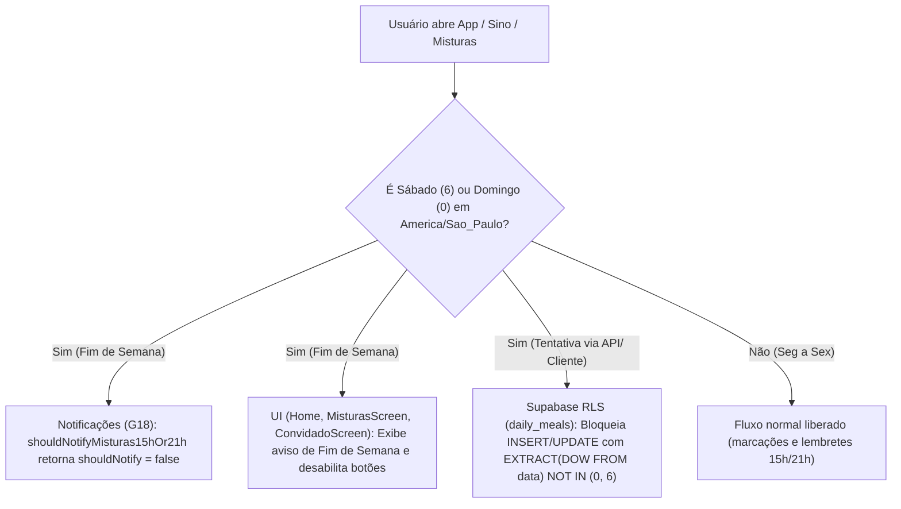

# Plano de Implementação — Bloqueio de Finais de Semana na Folha de Misturas & Notificações

> [!IMPORTANT]
> **Contexto da Worktree:**
> - **Caminho da Worktree:** `/home/ciosaki/hd/canta-grillo-app/.worktrees/fix-misturas-fim-de-semana`
> - **Branch:** `fix/misturas-fim-de-semana`
> - **Diretriz Mandatory (`GEMINI.md`):** Segurança Database-First via RLS no Supabase, fornecimento imediato do script SQL para o SQL Editor e sincronização de `AGY.md` e `REQUIREMENTS.md`.

---

## 1. Objetivo e Decisões Alinhadas

A **Folha de Misturas** opera exclusivamente em dias úteis (**Segunda a Sexta-feira**, no fuso `America/Sao_Paulo`). Aos finais de semana (**Sábado e Domingo**):
1. **Bloqueio Total de Marcação (Front-end + Back-end RLS):**
   - Nenhum usuário (**Moradores, Convidados Externos e Administradores**) pode inserir ou atualizar registros em `public.daily_meals` quando a data for Sábado (`DOW = 6`) ou Domingo (`DOW = 0`).
2. **Supressão Total de Notificações de Misturas no Fim de Semana:**
   - O **Gatilho 18** (`shouldNotifyMisturas15hOr21h` às 15:00h e 21:00h BRT) **nunca** deve disparar notificações no Sino nem Browser Push aos sábados e domingos.
3. **Experiência de Interface e Navegação (`‹ / ›`):**
   - Quando o dia atual for Sábado ou Domingo, exibir aviso claro: *"Sem Folha de Misturas no fim de semana (funciona de segunda a sexta)"* com os botões de marcação desabilitados em `MisturasScreen.tsx`, `ConvidadoScreen.tsx` e no card de resumo da `Home` (`App.tsx`).
   - O seletor de datas (`‹ / ›`) em `MisturasScreen.tsx` deve **pular automaticamente Sábados e Domingos** ao navegar pelo histórico (ex.: voltar de Segunda-feira vai direto para Sexta-feira; avançar de Sexta-feira vai direto para Segunda-feira, respeitando o teto de `hoje`).

---

## 2. Arquitetura e Fluxo de Validação



---

## 3. Passo a Passo de Implementação por Arquivo

### Etapa 1 — Segurança Database-First no Supabase ([`supabase/schema.sql`](file:///home/ciosaki/hd/canta-grillo-app/.worktrees/fix-misturas-fim-de-semana/supabase/schema.sql#L597-L631))
1. Adicionar constraint ou atualizar as políticas RLS de `INSERT` (`"Insercao de refeicao diaria"`) e `UPDATE` (`"Atualizacao de refeicao diaria"`) na tabela `public.daily_meals` para exigir que o dia da semana seja útil (`Segunda = 1` a `Sexta = 5`):
   ```sql
   EXTRACT(DOW FROM data) NOT IN (0, 6)
   ```
2. Fornecer o bloco SQL pronto para execução no **SQL Editor** do Supabase na resposta final ao usuário:
   ```sql
   -- Atualiza políticas RLS de daily_meals para bloquear Sábado (6) e Domingo (0) para todos os perfis
   DROP POLICY IF EXISTS "Insercao de refeicao diaria" ON public.daily_meals;
   CREATE POLICY "Insercao de refeicao diaria"
   ON public.daily_meals FOR INSERT
   TO authenticated
   WITH CHECK (
     data = (CURRENT_TIMESTAMP AT TIME ZONE 'America/Sao_Paulo')::DATE
     AND EXTRACT(DOW FROM data) NOT IN (0, 6)
     AND (
       public.is_admin() OR (
         (public.is_active_morador() OR public.is_active_externo()) AND usuario_id = auth.uid()
       )
     )
   );

   DROP POLICY IF EXISTS "Atualizacao de refeicao diaria" ON public.daily_meals;
   CREATE POLICY "Atualizacao de refeicao diaria"
   ON public.daily_meals FOR UPDATE
   TO authenticated
   USING (
     data = (CURRENT_TIMESTAMP AT TIME ZONE 'America/Sao_Paulo')::DATE
     AND EXTRACT(DOW FROM data) NOT IN (0, 6)
     AND (
       public.is_admin() OR (
         (public.is_active_morador() OR public.is_active_externo()) AND usuario_id = auth.uid()
       )
     )
   )
   WITH CHECK (
     data = (CURRENT_TIMESTAMP AT TIME ZONE 'America/Sao_Paulo')::DATE
     AND EXTRACT(DOW FROM data) NOT IN (0, 6)
     AND (
       public.is_admin() OR (
         (public.is_active_morador() OR public.is_active_externo()) AND usuario_id = auth.uid()
       )
     )
   );
   ```

---

### Etapa 2 — Utilitários de Data e Fim de Semana ([`src/types/refeicoes.ts`](file:///home/ciosaki/hd/canta-grillo-app/.worktrees/fix-misturas-fim-de-semana/src/types/refeicoes.ts))
1. Criar e exportar funções puras e testáveis em `src/types/refeicoes.ts`:
   - `isWeekendDateString(dateStr: string): boolean`:
     - Faz o parse seguro de `YYYY-MM-DD` (`const [y, m, d] = dateStr.split('-').map(Number); const dow = new Date(y, m - 1, d).getDay();`) e retorna `dow === 0 || dow === 6`.
   - `getAdjacentWeekday(dateStr: string, direction: -1 | 1, maxDateStr?: string): string`:
     - Avança ou retrocede a partir de `dateStr` em incrementos de `direction` (`-1` ou `+1` dia) pulando qualquer data onde `isWeekendDateString` seja `true`.
     - Se `maxDateStr` for informado e a próxima data útil ultrapassar `maxDateStr` (`novaData > maxDateStr`), retorna a própria `dateStr` original (impedindo avançar para o futuro).
   - `getInitialMisturasDate(hojeStr: string): string`:
     - Se `hojeStr` cair no fim de semana, ou pode manter `hojeStr` (para exibir claramente o banner de Fim de Semana de hoje) ou auxiliar na navegação. **Decisão:** Ao abrir no sábado/domingo, `selectedDate` inicia em `hoje` exibindo o banner informativo *"Sem Folha de Misturas no fim de semana (Seg a Sex)"* com botões desabilitados, e ao clicar na seta `‹` (dia anterior), pula direto para a última Sexta-feira!

---

### Etapa 3 — Supressão de Notificações no Fim de Semana ([`src/types/notificacoes.ts`](file:///home/ciosaki/hd/canta-grillo-app/.worktrees/fix-misturas-fim-de-semana/src/types/notificacoes.ts#L47-L185))
1. Em `getBrasiliaDateParts(date: Date = new Date()): BrasiliaDateParts`:
   - Incluir `dayOfWeek: number` (`0` = Domingo .. `6` = Sábado) calculado a partir de `new Date(Date.UTC(year, month - 1, day)).getUTCDay()`.
2. Em `shouldNotifyMisturas15hOr21h(agora: Date = new Date(), params)`:
   - Extrair `{ hour, dayOfWeek } = getBrasiliaDateParts(agora)`.
   - Se `dayOfWeek === 0 || dayOfWeek === 6`, retornar imediatamente:
     ```ts
     return {
       shouldNotify: false,
       window: null,
       message: '',
     };
     ```
3. Em [`src/hooks/useNotifications.ts`](file:///home/ciosaki/hd/canta-grillo-app/.worktrees/fix-misturas-fim-de-semana/src/hooks/useNotifications.ts#L372):
   - Opcionalmente evitar busca desnecessária de `daily_meals` quando o dia atual em Brasília for Sábado ou Domingo.

---

### Etapa 4 — Interface da Folha de Misturas, Convidados e Home
1. **[`src/features/refeicoes/MisturasScreen.tsx`](file:///home/ciosaki/hd/canta-grillo-app/.worktrees/fix-misturas-fim-de-semana/src/features/refeicoes/MisturasScreen.tsx):**
   - Calcular `const isFimDeSemana = isWeekendDateString(selectedDate);` e `const podeEditarHoje = isHoje && !isFimDeSemana;`.
   - Atualizar `mudarDia(direcao: -1 | 1)` para usar `getAdjacentWeekday(selectedDate, direcao, hoje)` (pulando sábados e domingos nas setas `‹ / ›` e desabilitando a seta `›` quando o próximo dia útil for `> hoje`).
   - Quando `isFimDeSemana` for `true`, exibir um banner de aviso em destaque:
     - *"Folha fechada no fim de semana — A marcação de almoço e janta funciona apenas de segunda a sexta-feira."*
   - Bloquear `handleMarcarMinhaMistura`, `handleAdminAlterarMarca` e `handleAdminToggleConvidado` quando `isFimDeSemana` for `true`, e desabilitar visualmente os botões de marcação (tanto do morador quanto dos controles de Admin e Convidados).
2. **[`src/features/convidados/ConvidadoScreen.tsx`](file:///home/ciosaki/hd/canta-grillo-app/.worktrees/fix-misturas-fim-de-semana/src/features/convidados/ConvidadoScreen.tsx):**
   - Calcular `const isFimDeSemanaHoje = isWeekendDateString(hoje);`.
   - Se `isFimDeSemanaHoje` for `true`, desabilitar o botão de registrar refeição de hoje e exibir aviso amigável de que a Folha de Misturas funciona de segunda a sexta-feira.
3. **[`src/App.tsx`](file:///home/ciosaki/hd/canta-grillo-app/.worktrees/fix-misturas-fim-de-semana/src/App.tsx#L497-L516) (Card da Home):**
   - No card `"Folha de Misturas"` da tela inicial, se hoje for fim de semana (`isWeekendDateString(getLocalDateString(new Date()))`), exibir subtítulo `"Fechada no fim de semana (Seg a Sex)"` e badge `"Fim de semana"` no lugar da cota diária.

---

### Etapa 5 — Testes Automatizados e Documentação
1. **[`tests/unit/notificacoes-logic.test.mjs`](file:///home/ciosaki/hd/canta-grillo-app/.worktrees/fix-misturas-fim-de-semana/tests/unit/notificacoes-logic.test.mjs):**
   - Adicionar testes unitários no bloco `G18: Folha de Misturas` garantindo que `shouldNotifyMisturas15hOr21h` e `deriveNotifications` retornam `shouldNotify = false` às 15:15 BRT e às 21:30 BRT tanto no **Sábado** (`2026-10-17`) quanto no **Domingo** (`2026-10-18`), mesmo com `misturasConsumidasHoje: 0`.
   - Adicionar testes unitários para `isWeekendDateString` e `getAdjacentWeekday` (garantindo que a seta `‹` na Segunda-feira pula Domingo/Sábado para Sexta-feira, e a seta `›` na Sexta-feira pula Sábado/Domingo para Segunda-feira).
2. **[`AGY.md`](file:///home/ciosaki/hd/canta-grillo-app/.worktrees/fix-misturas-fim-de-semana/AGY.md) e [`REQUIREMENTS.md`](file:///home/ciosaki/hd/canta-grillo-app/.worktrees/fix-misturas-fim-de-semana/REQUIREMENTS.md):**
   - Atualizar a documentação (`RN15`, `RN16` e `Gatilho 18`) registrando que a Folha de Misturas e seus lembretes operam estritamente de segunda a sexta-feira, com bloqueio de escrita no fim de semana via RLS para moradores, convidados e administradores.
3. **Verificação Final:**
   - Executar `npm test` e `npm run build` dentro da worktree `.worktrees/fix-misturas-fim-de-semana` garantindo 0 erros.
