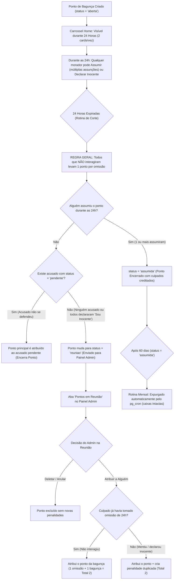

# Plano de Implementação — Pontos de Bagunça v2 (Carrossel 2 Cards por 24h, Múltiplas Assunções, Interação Obrigatória, Reunião Admin, 2 Penalidades e TTL 60 Dias)

> [!IMPORTANT]
> **Contexto da Worktree:**
> - **Caminho da Worktree:** `/home/ciosaki/hd/canta-grillo-app/.worktrees/feat-pontos-bagunca-acusacoes`
> - **Branch:** `feat/pontos-bagunca-acusacoes`
> - **Arquivo no Repositório:** [plan.md](file:///home/ciosaki/hd/canta-grillo-app/.worktrees/feat-pontos-bagunca-acusacoes/plan.md)
> - **Diretriz Mandatory (`GEMINI.md`):** Garantir segurança Database-First no Supabase (políticas RLS, RPCs e triggers em `pontos_bagunca`, `pontos_bagunca_visualizacoes`, `pontos_bagunca_acusacoes` e `pontos_bagunca_culpados`), fornecer o script SQL completo pronto para o SQL Editor do Supabase e atualizar `AGY.md` e `REQUIREMENTS.md`.

---

## 1. Goal Description & Regras Centrais

Atualizar o sistema de **Pontos de Bagunça** da República Canta Grillo com as seguintes regras de negócio:

1. **Permanência no Carrossel da Home durante Todas as 24 Horas (2 Cards por vez):**
   - O carrossel horizontal em [`PontosBaguncaCarousel.tsx`](file:///home/ciosaki/hd/canta-grillo-app/.worktrees/feat-pontos-bagunca-acusacoes/src/components/PontosBaguncaCarousel.tsx) exibirá **2 cards amplos por vez** (`w-[calc((100%-12px)/2)]`).
   - O ponto **permanece visível no carrossel durante todas as 24 horas a partir da sua criação**, mesmo que um ou mais moradores já o tenham assumido.
   - No card, exibe o cronômetro regressivo, os acusados e uma badge indicando quem já assumiu (`Assumido por: [Apelidos]`).

2. **Múltiplos Moradores Podem Assumir o Mesmo Ponto:**
   - Mais de uma pessoa pode assumir o mesmo ponto (ex.: dois moradores que dividiram a bagunça).
   - Mesmo que um morador já tenha assumido, qualquer outro morador pode abrir o ponto e clicar em **"Assumir Ponto Também (Fui Eu)"** dentro das 24 horas.
   - Cada morador que assumir recebe **1 ponto individual creditado** (tabela `public.pontos_bagunca_culpados` + registro correspondente em `pontos_bagunca` para contagem da cerveja).

3. **Dever Geral de Interação Obrigatória para TODOS em até 24h:**
   - Mesmo se alguém já tiver assumido o ponto, **todos os outros moradores da casa (exceto o relator) continuam com a obrigação de interagir em até 24 horas**: seja assumindo junto ou clicando em **"Sou Inocente"**.
   - Apenas abrir a foto (remover o blur) **não basta**.
   - **Todos que NÃO interagirem em 24 horas** (não assumiram e não declararam inocência) **levam 1 ponto de penalidade por omissão**.

4. **Sistema de Acusações Múltiplas:**
   - Na tela [`DenunciaPontoScreen.tsx`](file:///home/ciosaki/hd/canta-grillo-app/.worktrees/feat-pontos-bagunca-acusacoes/src/features/pontos/DenunciaPontoScreen.tsx), o relator pode selecionar opcionalmente **1 ou mais moradores** como acusados iniciais.
   - No modal de discussão do Ponto, qualquer morador ativo pode **acusar outro(s) morador(es)** posteriormente.
   - Quem é acusado é notificado com urgência e precisa se manifestar clicando em **"Sou Inocente"** (negando a acusação) ou assumir o ponto.

5. **Regra de Vencimento de 24 Horas (`verificar_penalidades_pontos_24h`):**
   - **Etapa A (Omissões):** Todos os moradores ativos que **não interagiram** em 24h recebem **1 ponto de penalidade**.
   - **Etapa B (Destino do Ponto Principal):**
     - **Cenário 1 — 1 ou mais pessoas assumiram durante as 24h:** O ponto principal é encerrado como `status = 'assumida'`. O caso está finalizado (não vai para reunião).
     - **Cenário 2 — Ninguém assumiu, mas há acusado em aberto (`status = 'pendente'`):** O ponto principal é atribuído ao primeiro acusado omisso (`status = 'assumida'`) e o caso é encerrado (não vai para reunião).
     - **Cenário 3 — Ninguém assumiu E NÃO há acusados em aberto (ninguém acusado ou todos declararam inocência):** O ponto principal não é arquivado; ele muda para **`status = 'reuniao'`**, sai do carrossel e entra na **página exclusiva do Admin** para deliberação da reunião da casa.

6. **Página Exclusiva do Admin (Julgamento em Reunião):**
   - Nova aba **"Pontos em Reunião"** no Painel Admin ([`AprovacoesScreen.tsx`](file:///home/ciosaki/hd/canta-grillo-app/.worktrees/feat-pontos-bagunca-acusacoes/src/features/admin/AprovacoesScreen.tsx)).
   - Exibe a lista de pontos com `status = 'reuniao'`, foto original sem blur, local, relator, mensagens do chat, lista de quem declarou inocência e histórico de acusações.
   - O Admin delibera na reunião da casa com duas opções:
     - **Deletar / Anular:** Exclui o ponto (`DELETE FROM pontos_bagunca`), sem gerar novas penalidades.
     - **Atribuir a Alguém (Regra das 2 Penalidades Totais):**
       - Quem era o verdadeiro culpado e não assumiu em 24h fica com um **total exato de 2 penalidades**:
         - **Se mentiu** (`declarou_inocente = true`): não tinha tomado o ponto de omissão em 24h; na reunião, o ponto é atribuído a ele e gera +1 penalidade duplicada. **Total = 2 penalidades.**
         - **Se não interagiu** (`declarou_inocente = false`): já havia tomado 1 ponto de omissão em 24h; na reunião, o ponto da bagunça é atribuído a ele sem criar ponto duplicado. **Total = 1 (omissão) + 1 (bagunça) = 2 penalidades.**

7. **Tempo de Vida (TTL de 60 Dias) e Expurgamento Automático:**
   - **Ciclo Mensal Independente:** O cálculo de caixas de cerveja por pontos de desorganização ocorre estritamente dentro do mês civil corrente (`check_pontos_gerar_cerveja()`).
   - **Independência Total das Caixas:** As caixas de cerveja geradas são gravadas de forma definitiva na tabela `public.caixas_cerveja` sem Foreign Key dependente de `pontos_bagunca`. Deletar pontos antigos **não afeta nenhuma caixa já criada**.
   - **Rotina de Limpeza Automática:** Pontos de bagunça resolvidos (`status = 'assumida'`) com mais de 60 dias são excluídos do banco via rotina agendada no `pg_cron` (`public.limpar_pontos_bagunca_antigos()`), liberando espaço no banco e permitindo o expurgo de fotos antigas no Storage.
   - **Otimização nas Queries do Frontend:** Em [`src/hooks/useNotifications.ts`](file:///home/ciosaki/hd/canta-grillo-app/src/hooks/useNotifications.ts), a query de `pontos_bagunca` passa a ter filtro de limite temporal (últimos 60 dias / início do mês anterior) para nunca baixar o banco todo na memória RAM.

---

## 2. Fluxo Completo de Decisão (Diagrama)



---

## 3. Segurança Database-First (Script SQL para o Supabase)

Conforme diretriz obrigatória do [`GEMINI.md`](file:///home/ciosaki/hd/canta-grillo-app/.worktrees/feat-pontos-bagunca-acusacoes/GEMINI.md), atualizar [`supabase/schema.sql`](file:///home/ciosaki/hd/canta-grillo-app/.worktrees/feat-pontos-bagunca-acusacoes/supabase/schema.sql) e executar o script abaixo no **SQL Editor do Supabase**:

```sql
-- =====================================================================
-- MIGRAÇÃO: PONTOS DE BAGUNÇA V2 (ASSUNÇÕES, REUNIÃO, 2 PENALIDADES E TTL)
-- =====================================================================

-- 1. Atualizar constraint de status em public.pontos_bagunca para incluir 'reuniao'
ALTER TABLE public.pontos_bagunca
  DROP CONSTRAINT IF EXISTS pontos_bagunca_status_check;

ALTER TABLE public.pontos_bagunca
  ADD CONSTRAINT pontos_bagunca_status_check
  CHECK (status IN ('aberta', 'assumida', 'reuniao'));

-- 2. Evoluir public.pontos_bagunca_visualizacoes para registrar declaração de inocência
ALTER TABLE public.pontos_bagunca_visualizacoes
  ADD COLUMN IF NOT EXISTS declarou_inocente BOOLEAN NOT NULL DEFAULT FALSE,
  ADD COLUMN IF NOT EXISTS inocente_em TIMESTAMPTZ;

-- Permitir UPDATE na própria linha de visualização/declaração
DROP POLICY IF EXISTS "Morador ativo atualiza sua visualizacao ou inocencia" ON public.pontos_bagunca_visualizacoes;
CREATE POLICY "Morador ativo atualiza sua visualizacao ou inocencia"
ON public.pontos_bagunca_visualizacoes FOR UPDATE
TO authenticated
USING (
  public.is_admin() OR (public.is_active_morador() AND morador_id = auth.uid())
)
WITH CHECK (
  public.is_admin() OR (public.is_active_morador() AND morador_id = auth.uid())
);

-- 3. Criar tabela public.pontos_bagunca_acusacoes (Múltiplos acusados por Ponto)
CREATE TABLE IF NOT EXISTS public.pontos_bagunca_acusacoes (
    id UUID PRIMARY KEY DEFAULT uuid_generate_v4(),
    ponto_id UUID NOT NULL REFERENCES public.pontos_bagunca(id) ON DELETE CASCADE,
    acusado_id UUID NOT NULL REFERENCES public.profiles(id) ON DELETE CASCADE,
    acusador_id UUID NOT NULL REFERENCES public.profiles(id) ON DELETE CASCADE,
    status TEXT NOT NULL DEFAULT 'pendente' CHECK (status IN ('pendente', 'inocente', 'assumido')),
    created_at TIMESTAMPTZ DEFAULT NOW(),
    respondido_em TIMESTAMPTZ,
    CONSTRAINT unique_ponto_acusado UNIQUE (ponto_id, acusado_id)
);

CREATE INDEX IF NOT EXISTS idx_pontos_bagunca_acusacoes_ponto
  ON public.pontos_bagunca_acusacoes(ponto_id, status);

ALTER TABLE public.pontos_bagunca_acusacoes ENABLE ROW LEVEL SECURITY;

DROP POLICY IF EXISTS "Todos podem ler acusacoes de pontos" ON public.pontos_bagunca_acusacoes;
CREATE POLICY "Todos podem ler acusacoes de pontos"
ON public.pontos_bagunca_acusacoes FOR SELECT
TO authenticated
USING (public.is_admin() OR public.is_active_morador());

DROP POLICY IF EXISTS "Morador ativo pode acusar em ponto aberto" ON public.pontos_bagunca_acusacoes;
CREATE POLICY "Morador ativo pode acusar em ponto aberto"
ON public.pontos_bagunca_acusacoes FOR INSERT
TO authenticated
WITH CHECK (
  (public.is_admin() OR public.is_active_morador())
  AND acusador_id = auth.uid()
  AND EXISTS (
    SELECT 1 FROM public.pontos_bagunca pb
    WHERE pb.id = ponto_id AND pb.status = 'aberta'
  )
);

DROP POLICY IF EXISTS "Acusado responde acusacao" ON public.pontos_bagunca_acusacoes;
CREATE POLICY "Acusado responde acusacao"
ON public.pontos_bagunca_acusacoes FOR UPDATE
TO authenticated
USING (
  public.is_admin() OR (public.is_active_morador() AND acusado_id = auth.uid())
)
WITH CHECK (
  public.is_admin() OR (public.is_active_morador() AND acusado_id = auth.uid())
);

-- 4. Criar tabela public.pontos_bagunca_culpados (Múltiplos moradores que assumiram o ponto)
CREATE TABLE IF NOT EXISTS public.pontos_bagunca_culpados (
    id UUID PRIMARY KEY DEFAULT uuid_generate_v4(),
    ponto_id UUID NOT NULL REFERENCES public.pontos_bagunca(id) ON DELETE CASCADE,
    morador_id UUID NOT NULL REFERENCES public.profiles(id) ON DELETE CASCADE,
    assumido_em TIMESTAMPTZ DEFAULT NOW(),
    CONSTRAINT unique_ponto_culpado UNIQUE (ponto_id, morador_id)
);

CREATE INDEX IF NOT EXISTS idx_pontos_bagunca_culpados_ponto
  ON public.pontos_bagunca_culpados(ponto_id);

ALTER TABLE public.pontos_bagunca_culpados ENABLE ROW LEVEL SECURITY;

DROP POLICY IF EXISTS "Todos podem ler culpados de pontos" ON public.pontos_bagunca_culpados;
CREATE POLICY "Todos podem ler culpados de pontos"
ON public.pontos_bagunca_culpados FOR SELECT
TO authenticated
USING (public.is_admin() OR public.is_active_morador());

DROP POLICY IF EXISTS "Morador ativo pode assumir ponto aberto" ON public.pontos_bagunca_culpados;
CREATE POLICY "Morador ativo pode assumir ponto aberto"
ON public.pontos_bagunca_culpados FOR INSERT
TO authenticated
WITH CHECK (
  (public.is_admin() OR public.is_active_morador())
  AND morador_id = auth.uid()
);

-- Habilitar Realtime
DO $$
BEGIN
  IF NOT EXISTS (SELECT 1 FROM pg_publication_tables WHERE pubname = 'supabase_realtime' AND tablename = 'pontos_bagunca_acusacoes') THEN
    ALTER PUBLICATION supabase_realtime ADD TABLE public.pontos_bagunca_acusacoes;
  END IF;
  IF NOT EXISTS (SELECT 1 FROM pg_publication_tables WHERE pubname = 'supabase_realtime' AND tablename = 'pontos_bagunca_culpados') THEN
    ALTER PUBLICATION supabase_realtime ADD TABLE public.pontos_bagunca_culpados;
  END IF;
END $$;

-- 5. Trigger: Notificar quando alguém é acusado e resetar sua inocência
CREATE OR REPLACE FUNCTION public.trg_fn_nova_acusacao_ponto()
RETURNS TRIGGER
LANGUAGE plpgsql
SECURITY DEFINER
AS $$
DECLARE
  v_nome_acusador TEXT;
  v_local TEXT;
BEGIN
  UPDATE public.pontos_bagunca_visualizacoes
  SET declarou_inocente = FALSE,
      inocente_em = NULL
  WHERE ponto_id = NEW.ponto_id
    AND morador_id = NEW.acusado_id;

  SELECT COALESCE(apelido, nome) INTO v_nome_acusador
  FROM public.profiles WHERE id = NEW.acusador_id;

  SELECT local_descricao INTO v_local
  FROM public.pontos_bagunca WHERE id = NEW.ponto_id;

  PERFORM public.criar_notificacao_sistema(
    NEW.acusado_id,
    'ponto-acusado-' || NEW.ponto_id::text || '-' || NEW.acusado_id::text,
    'ponto_bagunca',
    'alta',
    '⚠️ Você foi acusado em um Ponto de Bagunça',
    v_nome_acusador || ' acusou você pelo ponto em ' || v_local || '. Abra e responda em até 24h!',
    'home',
    jsonb_build_object('pontoId', NEW.ponto_id)
  );

  RETURN NEW;
END;
$$;

DROP TRIGGER IF EXISTS trg_nova_acusacao_ponto ON public.pontos_bagunca_acusacoes;
CREATE TRIGGER trg_nova_acusacao_ponto
AFTER INSERT ON public.pontos_bagunca_acusacoes
FOR EACH ROW
EXECUTE FUNCTION public.trg_fn_nova_acusacao_ponto();

-- 6. RPC: Assumir Ponto de Bagunça (Suporta Múltiplos Moradores Assumindo em 24h)
CREATE OR REPLACE FUNCTION public.assumir_ponto_bagunca(p_ponto_id UUID)
RETURNS JSONB
LANGUAGE plpgsql
SECURITY DEFINER
AS $$
DECLARE
    v_uid UUID := auth.uid();
    r_ponto RECORD;
    v_primeira_assuncao BOOLEAN := FALSE;
BEGIN
    IF v_uid IS NULL OR NOT (public.is_active_morador() OR public.is_admin()) THEN
        RAISE EXCEPTION 'Apenas moradores ativos podem assumir pontos de bagunça.';
    END IF;

    SELECT id, relator_id, local_descricao, foto_url, status, created_at, culpado_id
    INTO r_ponto
    FROM public.pontos_bagunca
    WHERE id = p_ponto_id;

    IF r_ponto.id IS NULL THEN
        RAISE EXCEPTION 'Ponto de bagunça não encontrado.';
    END IF;

    IF r_ponto.status NOT IN ('aberta') THEN
        RAISE EXCEPTION 'Este ponto não está mais aberto para assunção.';
    END IF;

    IF r_ponto.created_at < NOW() - INTERVAL '24 hours' THEN
        RAISE EXCEPTION 'O prazo de 24 horas para assumir este ponto já expirou.';
    END IF;

    -- 1. Insere na tabela de culpados múltiplos
    INSERT INTO public.pontos_bagunca_culpados (
        ponto_id,
        morador_id,
        assumido_em
    ) VALUES (
        p_ponto_id,
        v_uid,
        NOW()
    )
    ON CONFLICT (ponto_id, morador_id) DO NOTHING;

    -- 2. Atualiza o ponto original com o primeiro culpado, ou cria linha espelho para assunção conjunta
    IF r_ponto.culpado_id IS NULL THEN
        UPDATE public.pontos_bagunca
        SET culpado_id = v_uid,
            assumida_em = NOW()
        WHERE id = p_ponto_id;
        v_primeira_assuncao := TRUE;
    ELSE
        INSERT INTO public.pontos_bagunca (
            relator_id,
            culpado_id,
            foto_url,
            local_descricao,
            status,
            assumida_em
        ) VALUES (
            r_ponto.relator_id,
            v_uid,
            r_ponto.foto_url,
            'Assunção compartilhada: ' || r_ponto.local_descricao || ' (' || p_ponto_id::text || ')',
            'assumida',
            NOW()
        );
    END IF;

    -- 3. Atualiza acusação para 'assumido' caso estivesse pendente
    UPDATE public.pontos_bagunca_acusacoes
    SET status = 'assumido',
        respondido_em = NOW()
    WHERE ponto_id = p_ponto_id
      AND acusado_id = v_uid;

    -- 4. Registra visualização e marca que interagiu
    INSERT INTO public.pontos_bagunca_visualizacoes (
        ponto_id,
        morador_id,
        visualizado_em,
        declarou_inocente
    ) VALUES (
        p_ponto_id,
        v_uid,
        NOW(),
        FALSE
    )
    ON CONFLICT (ponto_id, morador_id) DO NOTHING;

    -- 5. Dispara mensagem no chat do ponto
    INSERT INTO public.mensagens_ponto_bagunca (
        ponto_bagunca_id,
        autor_id,
        conteudo
    ) VALUES (
        p_ponto_id,
        v_uid,
        'Assumiu o ponto de bagunça.'
    );

    RETURN jsonb_build_object(
        'success', true,
        'ponto_id', p_ponto_id,
        'morador_id', v_uid,
        'primeira_assuncao', v_primeira_assuncao
    );
END;
$$;

GRANT EXECUTE ON FUNCTION public.assumir_ponto_bagunca(UUID) TO authenticated;

-- 7. RPC: Declarar "Sou Inocente"
CREATE OR REPLACE FUNCTION public.declarar_inocencia_ponto_bagunca(p_ponto_id UUID)
RETURNS JSONB
LANGUAGE plpgsql
SECURITY DEFINER
AS $$
DECLARE
  v_uid UUID := auth.uid();
  v_status TEXT;
  v_created_at TIMESTAMPTZ;
BEGIN
  IF v_uid IS NULL OR NOT (public.is_active_morador() OR public.is_admin()) THEN
    RAISE EXCEPTION 'Apenas moradores ativos podem declarar inocência.';
  END IF;

  SELECT status, created_at INTO v_status, v_created_at FROM public.pontos_bagunca WHERE id = p_ponto_id;
  IF v_status IS NULL THEN
    RAISE EXCEPTION 'Ponto de bagunça não encontrado.';
  END IF;
  IF v_status <> 'aberta' THEN
    RAISE EXCEPTION 'Este ponto de bagunça já foi encerrado ou enviado para reunião.';
  END IF;
  IF v_created_at < NOW() - INTERVAL '24 hours' THEN
    RAISE EXCEPTION 'O prazo de 24 horas já expirou.';
  END IF;

  INSERT INTO public.pontos_bagunca_visualizacoes (
    ponto_id,
    morador_id,
    visualizado_em,
    declarou_inocente,
    inocente_em
  ) VALUES (
    p_ponto_id,
    v_uid,
    NOW(),
    TRUE,
    NOW()
  )
  ON CONFLICT (ponto_id, morador_id) DO UPDATE
  SET declarou_inocente = TRUE,
      inocente_em = NOW();

  UPDATE public.pontos_bagunca_acusacoes
  SET status = 'inocente',
      respondido_em = NOW()
  WHERE ponto_id = p_ponto_id
    AND acusado_id = v_uid
    AND status = 'pendente';

  UPDATE public.notifications
  SET read = true
  WHERE user_id = v_uid
    AND (
      event_key = 'ponto-novo-' || p_ponto_id::text
      OR event_key = 'ponto-acusado-' || p_ponto_id::text || '-' || v_uid::text
    );

  RETURN jsonb_build_object('ponto_id', p_ponto_id, 'morador_id', v_uid, 'declarou_inocente', true);
END;
$$;

GRANT EXECUTE ON FUNCTION public.declarar_inocencia_ponto_bagunca(UUID) TO authenticated;

-- 8. Função de Verificação Automática de 24 Horas:
CREATE OR REPLACE FUNCTION public.verificar_penalidades_pontos_24h()
RETURNS INT AS $$
DECLARE
    v_penalizados INT := 0;
    v_qtd_assuncoes INT;
    v_tem_acusados_pendentes BOOLEAN;
    r_ponto RECORD;
    r_omisso RECORD;
    r_acusado RECORD;
    r_admin RECORD;
BEGIN
    FOR r_ponto IN
        SELECT id, relator_id, local_descricao, foto_url, created_at, culpado_id
        FROM public.pontos_bagunca
        WHERE status = 'aberta'
          AND created_at <= NOW() - INTERVAL '24 hours'
    LOOP
        -- 1. REGRA GERAL DE OMISSÃO: Todos os moradores ativos (exceto relator e quem assumiu)
        -- que NÃO declararam inocência levam 1 ponto por omissão
        FOR r_omisso IN
            SELECT p.id
            FROM public.profiles p
            WHERE p.ativo = TRUE
              AND p.role IN ('morador', 'admin')
              AND p.id <> r_ponto.relator_id
              AND NOT EXISTS (
                  SELECT 1 FROM public.pontos_bagunca_culpados c
                  WHERE c.ponto_id = r_ponto.id AND c.morador_id = p.id
              )
              AND NOT EXISTS (
                  SELECT 1
                  FROM public.pontos_bagunca_visualizacoes pv
                  WHERE pv.ponto_id = r_ponto.id
                    AND pv.morador_id = p.id
                    AND pv.declarou_inocente = TRUE
              )
              AND NOT EXISTS (
                  SELECT 1 FROM public.pontos_bagunca pb_sub
                  WHERE pb_sub.culpado_id = p.id
                    AND pb_sub.local_descricao LIKE '%Omissão em 24h (' || r_ponto.id::text || ')'
              )
        LOOP
            INSERT INTO public.pontos_bagunca (
                relator_id,
                culpado_id,
                foto_url,
                local_descricao,
                status,
                assumida_em
            ) VALUES (
                r_ponto.relator_id,
                r_omisso.id,
                '',
                'Penalidade: Omissão em 24h (' || r_ponto.id::text || ')',
                'assumida',
                NOW()
            );
            v_penalizados := v_penalizados + 1;
        END LOOP;

        -- 2. VERIFICA SE ALGUÉM ASSUMIU O PONTO DURANTE AS 24H
        SELECT COUNT(*) INTO v_qtd_assuncoes
        FROM public.pontos_bagunca_culpados
        WHERE ponto_id = r_ponto.id;

        IF v_qtd_assuncoes > 0 OR r_ponto.culpado_id IS NOT NULL THEN
            UPDATE public.pontos_bagunca
            SET status = 'assumida',
                assumida_em = COALESCE(assumida_em, NOW())
            WHERE id = r_ponto.id;

        ELSE
            -- 3. NINGUÉM ASSUMIU: VERIFICA SE EXISTE ACUSADO PENDENTE
            SELECT EXISTS (
                SELECT 1
                FROM public.pontos_bagunca_acusacoes a
                JOIN public.profiles p ON p.id = a.acusado_id
                WHERE a.ponto_id = r_ponto.id
                  AND a.status = 'pendente'
                  AND p.ativo = TRUE
            ) INTO v_tem_acusados_pendentes;

            IF v_tem_acusados_pendentes THEN
                SELECT a.acusado_id INTO r_acusado
                FROM public.pontos_bagunca_acusacoes a
                JOIN public.profiles p ON p.id = a.acusado_id
                WHERE a.ponto_id = r_ponto.id
                  AND a.status = 'pendente'
                  AND p.ativo = TRUE
                ORDER BY a.created_at ASC
                LIMIT 1;

                UPDATE public.pontos_bagunca
                SET status = 'assumida',
                    culpado_id = r_acusado.acusado_id,
                    assumida_em = NOW()
                WHERE id = r_ponto.id;

                UPDATE public.pontos_bagunca_acusacoes
                SET status = 'assumido',
                    respondido_em = NOW()
                WHERE ponto_id = r_ponto.id
                  AND status = 'pendente';

            ELSE
                -- Caso 3: Ninguém assumiu E nenhum acusado pendente -> Encaminha para Reunião no Admin
                UPDATE public.pontos_bagunca
                SET status = 'reuniao'
                WHERE id = r_ponto.id;

                FOR r_admin IN
                    SELECT id FROM public.profiles
                    WHERE ativo = true AND role = 'admin'
                LOOP
                    PERFORM public.criar_notificacao_sistema(
                        r_admin.id,
                        'ponto-reuniao-' || r_ponto.id::text,
                        'ponto_bagunca',
                        'alta',
                        '⚖️ Ponto de Bagunça em Reunião',
                        'Ponto em ' || r_ponto.local_descricao || ' expirou 24h sem culpado. Julgue na Reunião.',
                        'aprovacoes',
                        jsonb_build_object('pontoId', r_ponto.id, 'aba', 'pontos_reuniao')
                    );
                END LOOP;
            END IF;
        END IF;

    END LOOP;

    RETURN v_penalizados;
END;
$$ LANGUAGE plpgsql SECURITY DEFINER;

-- 9. RPC para o Admin Atribuir Ponto em Reunião (Total de 2 Penalidades ao Culpado)
CREATE OR REPLACE FUNCTION public.admin_atribuir_ponto_reuniao(
    p_ponto_id UUID,
    p_morador_id UUID
)
RETURNS JSONB
LANGUAGE plpgsql
SECURITY DEFINER
AS $$
DECLARE
    v_admin_id UUID := auth.uid();
    r_ponto RECORD;
    v_ja_tomou_omissao BOOLEAN := FALSE;
    v_segundo_ponto_id UUID := NULL;
    v_penalidades_geradas INT := 1;
BEGIN
    IF NOT public.is_admin() THEN
        RAISE EXCEPTION 'Apenas administradores podem atribuir pontos em reunião.';
    END IF;

    SELECT id, relator_id, local_descricao, foto_url, status
    INTO r_ponto
    FROM public.pontos_bagunca
    WHERE id = p_ponto_id;

    IF r_ponto.id IS NULL THEN
        RAISE EXCEPTION 'Ponto de bagunça não encontrado.';
    END IF;

    IF r_ponto.status <> 'reuniao' THEN
        RAISE EXCEPTION 'Apenas pontos com status em reunião podem ser atribuídos pelo admin.';
    END IF;

    SELECT EXISTS (
        SELECT 1 FROM public.pontos_bagunca
        WHERE culpado_id = p_morador_id
          AND local_descricao LIKE '%Omissão em 24h (' || p_ponto_id::text || ')'
    ) INTO v_ja_tomou_omissao;

    UPDATE public.pontos_bagunca
    SET status = 'assumida',
        culpado_id = p_morador_id,
        assumida_em = NOW()
    WHERE id = p_ponto_id;

    IF NOT v_ja_tomou_omissao THEN
        INSERT INTO public.pontos_bagunca (
            relator_id,
            culpado_id,
            foto_url,
            local_descricao,
            status,
            assumida_em
        ) VALUES (
            COALESCE(r_ponto.relator_id, v_admin_id),
            p_morador_id,
            r_ponto.foto_url,
            'Penalidade duplicada (Reunião): ' || r_ponto.local_descricao || ' (' || r_ponto.id::text || ')',
            'assumida',
            NOW()
        )
        RETURNING id INTO v_segundo_ponto_id;

        v_penalidades_geradas := 2;
    END IF;

    PERFORM public.criar_notificacao_sistema(
        p_morador_id,
        'ponto-reuniao-atribuido-' || p_ponto_id::text,
        'ponto_bagunca',
        'alta',
        '⚖️ Penalidade Dupla em Reunião',
        'O ponto em ' || r_ponto.local_descricao || ' foi atribuído a você na reunião (total de 2 penalidades).',
        'home',
        jsonb_build_object('pontoId', p_ponto_id)
    );

    RETURN jsonb_build_object(
        'success', true,
        'ponto_id', p_ponto_id,
        'segundo_ponto_id', v_segundo_ponto_id,
        'culpado_id', p_morador_id,
        'penalidades_adicionadas_agora', v_penalidades_geradas,
        'ja_havia_tomado_omissao', v_ja_tomou_omissao,
        'total_penalidades_caso', 2
    );
END;
$$;

GRANT EXECUTE ON FUNCTION public.admin_atribuir_ponto_reuniao(UUID, UUID) TO authenticated;

-- 10. Rotina de Expurgamento / TTL de 60 Dias para Pontos de Bagunça Antigos
CREATE OR REPLACE FUNCTION public.limpar_pontos_bagunca_antigos()
RETURNS INT AS $$
DECLARE
    v_deletados INT := 0;
BEGIN
    -- Deleta pontos já assumidos/resolvidos criados há mais de 60 dias
    WITH deletados AS (
        DELETE FROM public.pontos_bagunca
        WHERE status = 'assumida'
          AND created_at < NOW() - INTERVAL '60 days'
        RETURNING id
    )
    SELECT COUNT(*) INTO v_deletados FROM deletados;

    RETURN v_deletados;
END;
$$ LANGUAGE plpgsql SECURITY DEFINER;

-- Agendamento do expurgo mensal via pg_cron (se disponível)
DO $$
BEGIN
  IF EXISTS (SELECT 1 FROM pg_extension WHERE extname = 'pg_cron') THEN
    BEGIN
      PERFORM cron.unschedule('limpeza_pontos_bagunca_60d');
    EXCEPTION WHEN OTHERS THEN
    END;

    PERFORM cron.schedule(
      'limpeza_pontos_bagunca_60d',
      '0 5 1 * *', -- Roda às 05:00 UTC do 1º dia de cada mês
      'SELECT public.limpar_pontos_bagunca_antigos();'
    );
  END IF;
EXCEPTION WHEN OTHERS THEN
  NULL;
END $$;
```

---

## 4. Proposed Changes por Arquivo

### 1. Tipos e Entidades
- [`src/types/pontosBagunca.ts`](file:///home/ciosaki/hd/canta-grillo-app/.worktrees/feat-pontos-bagunca-acusacoes/src/types/pontosBagunca.ts):
  - Expandir `PontoBagunca['status']`: `'aberta' | 'assumida' | 'reuniao'`.
  - Expandir `VisualizacaoPonto`: adicionar `declarou_inocente?: boolean` e `inocente_em?: string | null`.
  - Adicionar interfaces `AcusacaoPontoBagunca` e `CulpadoPontoBagunca`.

---

### 2. Otimização de Queries no Frontend
- [`src/hooks/useNotifications.ts`](file:///home/ciosaki/hd/canta-grillo-app/.worktrees/feat-pontos-bagunca-acusacoes/src/hooks/useNotifications.ts):
  - Filtrar busca de `pontos_bagunca` para limitar aos últimos 60 dias (ou início do mês anterior) em vez de baixar o histórico completo:
    ```typescript
    const limite60Dias = new Date(Date.now() - 60 * 24 * 60 * 60 * 1000).toISOString();
    supabase
      .from('pontos_bagunca')
      .select('id, relator_id, culpado_id, local_descricao, status, created_at')
      .gte('created_at', limite60Dias)
      .order('created_at', { ascending: false });
    ```

---

### 3. Carrossel da Home e Modal de Discussão
- [`src/components/PontosBaguncaCarousel.tsx`](file:///home/ciosaki/hd/canta-grillo-app/.worktrees/feat-pontos-bagunca-acusacoes/src/components/PontosBaguncaCarousel.tsx):
  - **Filtro de Exibição:** Filtra os pontos criados há menos de 24 horas que estejam em `status === 'aberta'` (mesmo que já tenham 1 ou mais culpados em `pontos_bagunca_culpados`).
  - **Cards Aumentados (2 por vez):** `w-[calc((100%-12px)/2)]`. Exibir chips dos moradores que já assumiram (`Assumido por: [X, Y]`) e badge do status do usuário logado (Assumiu, Inocente ou Falta Interagir).
  - **Modal de Detalhes:**
    - Botão **"Assumir Ponto Também (Fui Eu)"**: invoca a RPC `assumir_ponto_bagunca(ponto.id)`. Permite assumir mesmo se outro morador já tiver assumido.
    - Botão **"Sou Inocente"**: invoca `declarar_inocencia_ponto_bagunca(ponto.id)`.
    - Dropdown **"Acusar outro morador"**: insere em `pontos_bagunca_acusacoes`.
    - Lista de culpados que já assumiram em destaque no topo da discussão.

---

### 4. Painel Administrativo — Aba "Pontos em Reunião"
- [`src/features/admin/AprovacoesScreen.tsx`](file:///home/ciosaki/hd/canta-grillo-app/.worktrees/feat-pontos-bagunca-acusacoes/src/features/admin/AprovacoesScreen.tsx):
  - Nova aba `'pontos_reuniao'` para listar pontos com `status = 'reuniao'`.
  - Botão **"Atribuir Ponto a Morador (2 Penalidades Totais)"**: executa `admin_atribuir_ponto_reuniao`.
  - Botão **"Anular Ponto"**: executa `supabase.from('pontos_bagunca').delete().eq('id', ponto.id)`.

---

### 5. Documentação
- [`AGY.md`](file:///home/ciosaki/hd/canta-grillo-app/.worktrees/feat-pontos-bagunca-acusacoes/AGY.md) e [`REQUIREMENTS.md`](file:///home/ciosaki/hd/canta-grillo-app/.worktrees/feat-pontos-bagunca-acusacoes/REQUIREMENTS.md):
  - Registrar a regra geral de interação em 24h (omissão = 1 ponto), permanência de 24h no carrossel mesmo com múltiplos culpados assumindo, encaminhamento para `'reuniao'` caso ninguém assuma e não haja acusados pendentes, aplicação de 2 penalidades totais caso atribuído em reunião, e política de TTL / expurgo de 60 dias para pontos resolvidos.

---

## 5. Verification Plan

### Testes Automatizados
1. `npm test`
2. Criar teste unitário `tests/unit/pontos-bagunca-multiplas-assuncoes.test.mjs` validando:
   - Tabela `pontos_bagunca_culpados` e constraint `UNIQUE (ponto_id, morador_id)`.
   - RPC `assumir_ponto_bagunca` aceita múltiplos culpados no mesmo ponto.
   - Ponto permanece no carrossel por 24h mesmo com moradores já tendo assumido.
   - Rotina `verificar_penalidades_pontos_24h` penaliza quem não interagiu e só move para `'reuniao'` se ninguém assumiu e não há acusados pendentes.
   - RPC `admin_atribuir_ponto_reuniao` assegura exatamente 2 penalidades totais.
   - Função `limpar_pontos_bagunca_antigos()` expurga pontos resolvidos com > 60 dias sem tocar em `caixas_cerveja`.
3. Validar build: `npm run build`.
